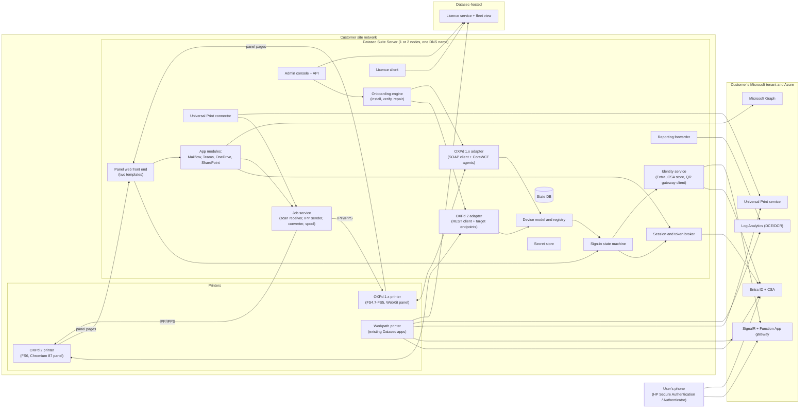

# Datasec OXPd: architecture of the HP Authentication Suite on a localised server (OXPd 2 and OXPd 1.x, beside Workpath)

Datasec / OXPd, 2026-11-18. Author: lead architect agent (Opus), for Kam. Status: REVIEWED, not final. The Fable review pass (C-5) ran on 2026-11-20 and its corrections are applied here (B1757: change log at the end, one row per finding in `review/B1757_APPLIED.md`). Fifteen open questions for Kam remain (OQ-1 to OQ-15, listed in `05_readiness-to-build.md` and in document 2 §8.3); where one touches the design the text takes the narrowest reading of his answer and says "not ruled: open question OQ-n". Kam's answers to all 25 questions were applied 2026-11-19 (C-6 to C-30). **B1765, 2026-11-20:** reports A9 and A10 and the product owner's answers C-38 to C-44 are applied (change log, last entry; one row per change in `review/B1765_APPLIED.md`). OQ-7 is now answered in both halves, so fourteen of the fifteen numbered questions remain open; the open points this pass added (OP-1 to OP-18, each on a default) are listed in document 2 §8.4. Questions and points to clarify are kept on one master list, Jira `OXPD2-1`, and the kit checklist is Jira `OXPD2-2` (C-41). The product owner gave the word to start the no-hardware work on 2026-11-20 (C-42); the project folder is `OXPd_2` and the repository `datasecau/OXPd_2` (C-37, C-42).

Sources: Kam's brief and rulings (`00_kam-brief_verbatim_2026-11-18.txt`, `CLARIFICATIONS.md` C-1 to C-30), the question cards themselves (`CLARIFICATIONS.md` records only the label Kam tapped; the option detail and default text of each card are in the board's data file `0_Brain/dashboard/data/decisions.json`, cited here as "card qNN option detail"), the common analysis brief (`01_analysis-brief.md`) and the twelve analysis reports in `analysis/`, cited `[A1 §4.7]`. Library files are cited `library:relative/path:line`, relative to `/Volumes/Laptop-DEV/!CODING/Datasec/OXPd/` (the review of 2026-11-20 opened the same paths in the NAS copy of the library). The brief's words "integration into intra-environments" (speech-to-text) are read as "Entra environments"; that is a reading, not confirmed (OQ-15). "(inferred)" marks a conclusion no source states; "(assumption, Qn)" marked a design choice that waited on question Qn in document 2 (`03_plan-of-attack-and-build.md` §8); since 2026-11-19 every question is answered, so "(ruled, C-n)" marks a choice Kam's answer confirmed (C-n in `CLARIFICATIONS.md`) and "(ruled, C-n; changed from the draft)" marks one his answer changed. "(ruled, C-n)" is written only for what the card option he tapped says; anything wider is marked "not ruled: open question OQ-n". No secret value appears in this document; section 6.6 gives locations only.

Coverage note, read before trusting section 5.6.3: report A3's OneDrive/SharePoint half was never written (its sections 4.1, 5.1, 6, 7 and 8 for OneDrive are placeholders, `[A3 §4.1]`). OneDrive and SharePoint journeys here rest on the product documentation `[A6 §9 rows 61-64]`, the shared-library report `[A4]` and a short inventory of `library:HPAM - Docs and Notes/Source Code/CypherOneDrive-main/` made for this document (one code base with flavours `onedriveforpersonal` and `onedriveforbusiness`, SharePoint site and library browsing inside it: `library:HPAM - Docs and Notes/Source Code/CypherOneDrive-main/app/build.gradle.kts:121-128`, `.../app/src/com/hp/print/cypher/ui/search/sites/task/RootSiteTask.java`, `.../task/GetLibraryMetadataTask.java`). A full read of that tree is work package WP0.6 in document 2. Two facts found by the review: (1) the release pipeline of that tree builds and packages the business flavour only (`.../CypherOneDrive-main/.github/workflows/release.yml:130`) and the consumer sign-in endpoints are commented out (`.../app/src/com/hp/print/cypher/constants/OneDriveConstants.java:13-18`), so "OneDrive personal" is a build flavour, not a shipped product as far as the library shows (open question OQ-4). (2) The suite ships SharePoint as its own package, `com.hp.print.cypher.sharepoint` (`.../HPAuthenticationManager-main/app/src/main/AndroidManifest.xml:12`; `.../HP-AuthSuite-Manager-main/src/Core/Utilities/AuthSuiteApps.cs:12`), and no build in the library produces that package (report A4 lines 237, 301); whether it is built from `CypherOneDrive-main` at another revision or from a repository that is not in the library is unknown (open question OQ-7). Until that source is supplied, F39 rests on the product documentation alone. **Update 2026-11-20 (B1760): the SharePoint source was supplied by the product owner on 2026-11-20 (C-33) and has been read: report `analysis/A8_sharepoint-app-and-common-library.md`, cited `[A8 row n]` for its feature rows and `[A8 §n]` for its sections.** It is a separate repository, `CypherSharePoint-main`, that builds `com.hp.print.cypher.sharepoint` version 4.4.6 as its own HPK; it is not a revision of `CypherOneDrive-main` `[A8 §1 items 1, 3]`. The files are outside the library, under `2_Project_Files/fleet/state/kam_attachments_1120/` (not in git: the archive holds a keystore). The two sentences before this update are kept as the record of what was known before; F39 and section 5.6.3 now rest on the source, and section 3.8 carries the SharePoint behaviour that had no requirement row. What A8 did not read is in its section 10: the OneDrive tree is still unread (WP0.6), the common library binary the SharePoint app links was not decompiled, and nothing was built or run. The gateway source asked for with the same card is **not** supplied: C-33 records that the product owner asked what "gateway" meant, and the question is asked again. **Update 2026-11-20, later (B1765): the gateway source was supplied on 2026-11-20 (C-40) and has been read: report `analysis/A9_hpam-backend-gateway-and-infra.md`.** The sentence before this update is kept as the record of what was known before. Citation forms used by this pass: `[A9:n]`, `[A10:n]` and `[A5:n]` are line n of that analysis report (`analysis/A9_hpam-backend-gateway-and-infra.md`, `analysis/A10_oxpd1-solution-earlier-work.md`, `analysis/A5_backend-licensing-admin-deployment-source.md`); `[CL:n]` is line n of `CLARIFICATIONS.md`; `HPKU/` is the root of the HPK Deployment Utility as the product owner sent it, `/Volumes/Datasec_DEV/!CODING/Datasec/OXPd_2/1_Project_Definition/Source_Documents/2026-11-20_from-product-owner/HPK-Deployment-Utility-main/`. What arrived with C-40 `[CL:252-258]`: `hpam-api` (the gateway: three Azure Functions in front of Azure SignalR `[A9:11]`), `hpam-marketplace` (two Azure Marketplace offers: the customer-tenant deployment and a deployable licence server `[A9:13]`), `infra_hpam` (Terraform for Datasec's own older Keycloak back end, out of scope under C-18 `[A9:13, 171]`) and `OXPd1_solution-master` (the earlier OXPd 1 attempt: byte-identical to the tree report A7 read, so it is not new material; report `analysis/A10_oxpd1-solution-earlier-work.md` `[A10:17, 29-31]`). Not sent: `cc-api` (by A9's inference from its infrastructure, the hosted API of the older Keycloak back end; its source was not read, so that is an inference `[A9:205]`), the phone app, and the licence server's source `[A9:339]`. The repository `OXPD1` is empty `[CL:258]`. The files are kept outside git under `2_Project_Files/fleet/state/kam_attachments_1120b/`. Nothing was run from any of them: every statement taken from A9 about run-time behaviour is a reading of code and configuration `[A9:344]`.

---

## 1. BLUF (for Kam)

1. **What we build:** one server product, the "Datasec Suite Server", that recreates HP Authentication Manager, Mailflow, Teams, OneDrive, SharePoint and Universal Print for printers that cannot run Workpath apps. The printer shows web pages from the server and passes card swipes, scans and sign-in events to it; the server does everything else.
2. **Where it runs:** on the customer's own network, one server (or a two-node pair) per site, because both OXPd generations need the printer to call the server and the server to call the printer [B1 §4.10] [C2 §5.1 item 1]. It talks outbound to Microsoft 365, to the customer's existing Azure pieces and to Datasec's licence service.
3. **Two printer "adapters" behind one core:** OXPd 2 (FutureSmart 6, REST) and OXPd 1.8.4.1 (FutureSmart 4.7 to 5, SOAP). A printer speaks one or the other, never both [B1 §4.17].
4. **What stays the same:** the Entra app registration, the card-to-user records in Entra Custom Security Attributes, the Log Analytics tables, the licence service. A card enrolled at a Workpath printer works at an OXPd printer and the reverse; one licence and one admin view cover the mixed fleet. The HP Secure Authentication phone app and its SignalR/Function App gateway are reused, but Kam has ruled they **may change** (C-27): the server may add a phone-redirect relay to the customer's gateway, and later gateway changes are allowed as long as fielded Workpath printers and shipped phone-app versions keep working. **B1765:** the gateway is now read (`hpam-api`: three functions, no user, card, PIN, token, licence or tenant logic `[A9:11]`). The server can join it as planned `[A9:235]`; the relay is a change to the Azure offer's template, not one added function (section 5.5, R19); and the gateway does not check who sends an unlock message `[A9:240]` (section 6.5, R24, OQ-10). A deployable licence server also exists as a second Marketplace offer `[A9:246]`; the design still assumes the Datasec-hosted service, and who is meant to deploy that offer is open (OP-7).
5. **What changes for users:** Microsoft's sign-in page is not shown on the printer panel (old browsers, proven failures on OXPd 1.x [C2 §4.4]); the interactive Microsoft step moves to the user's phone (device-code or a phone redirect), card and phone-app sign-in work as today.
6. **What changes for security:** the tenant secret, user tokens and printer certificates leave the printers and live once, encrypted, on the customer's server; of the 27 weaknesses listed in section 6.7, 25 are not carried into the server and two are carried by ruling: plain-text No-MFA tokens in the directory (W2, C-7) and the single shared card and QR key (W3, C-28, D5). Four of the 25 (W5, W21, W23, W27) are fixed in systems the server does not own and are tracked for their owners.
7. **Language:** C# on .NET 10, like the existing back end; HP's OXPd 2 library is C#-first [B3 §4.7] but is used in the lab only: the shipped OXPd 2 adapter uses Datasec's own REST clients generated from HP's specifications (C-11). The OXPd 1.x agent side is planned on CoreWCF (inferred: no HP source shows agents hosted on it), to be proven on both the agent and the client side by spike S2 (Java fallback kept for that one adapter).
8. **Biggest risk 1:** OXPd 2 is a beta SDK and, as of 17 Nov 2026, no partner has an HP-signed bundle that installs on a customer printer [B3 §1 item 1]. HP has confirmed the approach (C-30), so OXPd 2 is no longer held back on HP's position; what remains is four HP items, none dated (D33): a production FutureSmart 6 firmware that customers may run, a platform version HP's validation accepts, a signing service whose output installs, and HP's turnaround; plus the beta SDK changing under us. Whether "HP confirmed" covers more than HP's position on the approach is open question OQ-1.
9. **Biggest risk 2:** card sign-in on OXPd 1.x is the most failure-prone area in ten years of HP forum history (lost reader reports, wake-from-sleep races, missing sign-out events) [C2 §5.3 R2].
10. **HP's position (was biggest risk 3):** HP told a partner in 2023 that OXPd does not support direct integration with public cloud services such as SharePoint Online [B3 §1 item 5]. Kam's answer (C-30): **HP has confirmed** that a server-side Microsoft 365 integration is acceptable and signable for Datasec. The written confirmation is to be filed with the project.
11. **Release order and scope (C-30, C-16, C-17):** release 1 is a **full match of everything** the Workpath suite does (all five apps, the sign-in hub and Universal Print, every journey), on **both OXPd 2 and OXPd 1.x**, packaged both as a **Linux container/appliance and as a Windows service, equally supported**. OXPd 1.x is no longer planned to reach customers first; OXPd 2 is built for the same release; its customer install waits on the HP items of D33, none of which has a date. Not ruled and left open: the OneDrive personal flavour (OQ-4) and HPAM's role as the sign-in for HP Advance and LRS VPSX (OQ-5).
12. **One stack per printer (C-19):** a printer runs our suite and no other vendor's sign-in or print solution. The server does not design for coexistence with other vendors; onboarding checks for another vendor's agent and refuses or warns where the platform lets it see one.

---

## 2. Prior-work check (Datasec standing rule)

Everything that already exists, and what this architecture does with it.

| # | Existing asset | What it is | Verdict | Reason and evidence |
|---|---|---|---|---|
| P1 | HP Authentication Manager Workpath app v4.4.1 (`HPAuthenticationManager-main`) | Kotlin sign-in hub on the printer | **KEPT as is** for Workpath printers; **REPLACED** by the server's Session and Identity core for OXPd printers, which reimplements its behaviour as the specification | Its state already lives off the device (CSA), so a server can make the same calls [A1 §1 item 1]; the AIDL token service has no network form [A1 §1 item 2] |
| P2 | Mailflow 4.4, Teams 4.4.3 Workpath apps | Graph clients with native panel UI | KEPT for Workpath; **REPLACED** on OXPd by server modules; their Graph call lists (23 and 16 calls) are the functional contract | Both are thin Graph clients; scan and print go through CVL with local files [A2 §1] |
| P3 | OneDrive / SharePoint Workpath app 4.4.1 (`CypherOneDrive-main`) | Graph file client; two build flavours, of which the release pipeline ships the business one. SharePoint is a second, separate Workpath app (`CypherSharePoint-main`, version 4.4.6, its own HPK), whose source was supplied on 2026-11-20 and is outside the library (coverage note; B1760) | KEPT for Workpath; REPLACED on OXPd by one server module covering OneDrive for Business and SharePoint | Coverage note above; [A6 §9 rows 61-64]; [A8 §3.1, §3.2, §7] |
| P4 | Universal Print Workpath app 4.4.1 | Registers up to three cloud printers per device, IPP INFRA to Microsoft | KEPT for Workpath; on OXPd **REPLACED** by a server connector that reuses its protocol logic almost line for line (`RegisterPrinter.kt`, `DeviceTokenManager.kt`, `IPP.kt` and others) | Registration, device token and IPP INFRA need nothing from the device [A3 §5.2] |
| P5 | Shared libraries CVL 1.09.x, `usermanagement` AAR, QuickAccessLibrary | Android scan/print wrapper, token-binding client | NOT USED on OXPd; CVL's option model and mapping tables are **KEPT as specification** for the server's neutral job ticket | Android-only; option keys and conflict rules define what admins can preset today [A4 §5.2 R3] |
| P6 | HP's 21 Workpath repositories (git bundles in `WorkPathApplicationsAndLibrariesSources-master`) | HP originals, including SecureAccess | NOT USED; reference only, logic reimplemented (ruled, C-11) | Rights over HP sources not stated anywhere [A4 §6 item 2] |
| P7 | Licence service (`License-Services-main`: portal, `License.Common`, generator) | Per-tenant licence with device cap; `POST /api/validate` | **KEPT and extended**: server calls it per device; additive batch endpoint, authenticated server caller, platform column, optional platform claim | Licence is per tenant and per serial, not per platform; devices never read the licence file, so claims can be added safely [A5 §1 items 1-3, §5.3] |
| P8 | Datasec Administration Portal | Keycloak onboarding, Marketplace SaaS | KEPT as is (commercial plumbing); **NOT USED** as the fleet view | It does not administer devices, licences or app configuration [A5 §1 item 4] |
| P9 | HPK Deployment Utility 3.0 | WinForms + worker wrapping `HPKTool-cli.exe` | Its job / task / retry / per-device result model is **KEPT and extended** into the server's onboarding engine; the HPKTool layer and its password handling are REPLACED | Platform-neutral engine; command layer is Workpath-only; hardcoded AES key and password on command line [A5 §5.1, §8.2 items 8-9]. **Changed by C-43 (B1765):** the product owner ruled that deployment uses this utility, amended where OXPd needs it, in place of a new installer `[CL:276-282]`. So the utility itself is KEPT as the operator's deployment tool and gains an OXPd command layer; the server's onboarding engine remains the part that executes and repairs device registrations, because it must hold what they produce (section 8.7, D26). The copy the product owner sent has 0 files different from the copy this report analysed `[CL:282]` |
| P10 | HP-AuthSuite-Manager (Windows .NET 10 tool) | Pushes HPKs and configs to printers; reads OXPd 1.x DeviceInfo by SOAP | Ideas **KEPT** (IPP discovery, DeviceInfo call, device groups, DPAPI-protected passwords); code NOT USED directly; TLS-off and Basic-auth-over-TLS-1.0 patterns not carried | [A1 §5.3, §8.2 item 4] |
| P11 | Customer-hosted Azure pieces (SignalR, Function App, Storage, Log Analytics from the "Onboarding Azure Services" Marketplace offer) | QR / phone gateway and reporting | **KEPT and may be changed** (ruled, C-27; changed from the draft, which froze it): the server joins the existing SignalR as one subscriber per tenant; the Function App may gain the phone-redirect relay endpoint (section 5.5) and later changes (for example per-printer routing instead of broadcast, W5), each backward-compatible with fielded Workpath printers | Phone app is shipped software [A6 §5 item 4]; no source of the gateway in the library [A1 §7 Q4] [A5 §1 item 5]: its location is still to be found before any change. **B1765 (supersedes the clause before this one):** gateway source received 2026-11-20 (`hpam-api`; the offer that deploys it is in `hpam-marketplace`; report A9): three functions, a health check, `negotiate` and `send`, all behind App Service authentication `[A9:45-47, 51]`. A relay endpoint needs a template change (an authentication exclusion, an entry in the function allow-list, a new package version), not only a new function `[A9:236]`. Per-printer routing instead of broadcast is still unknown in cost: the routing key is the `realm` field chosen by the sender, so it needs either a phone-app change or a gateway change keyed on another body field, and which body fields exist is not in this source `[A9:237]`. Customer-hosted pieces confirmed as listed, plus a deploy identity and two deployment scripts `[A9:249]` |
| P12 | HP Secure Authentication phone apps (iOS/Android, Intune edition) | QR and BLE badge | **KEPT; may be changed** (ruled, C-27; changed from the draft): the OXPd design needs no phone-app change, and any later change must keep older installed app versions working | [A6 §3.1], [A6 §5 item 8] |
| P13 | Legacy Keycloak back end | V3 / hosted back end | **NOT USED** (ruled, C-18) | Doubles every code path [A1 §5.2 item 8] [A5 §7 Q5]. B1765: `infra_hpam`, received 2026-11-20, is this back end's infrastructure (Terraform for Keycloak, its databases and the `CypherConnectAPI` web app in seven environments, four of them production regions; no SignalR in it) `[A9:171, 176]`; nothing in it is needed by this design `[A9:247]`. `cc-api` was not sent (C-40) and, by A9's inference from that infrastructure, is this back end's API `[A9:205]`. One naming trap: the Terraform calls that web app "hpam api"; it is not the `hpam-api` repository `[A9:207]` |
| P14 | Earlier OXPd 1.x attempt (`OLD BUILD/OXPd1_solution-master`, Java 21) | Spike. **B1765 (corrected; the draft's words were "Spike against the simulator"):** by the author's note it was checked against an emulator on his own Windows machine; the tree holds no run log and no compiled server; the README names a lab address as "the printer", and which it was is not recorded; the copy the product owner sent on 2026-11-20 (C-40) is byte-identical to the library copy `[A10:29-31, 67, 172, 294]` | **NOT USED as code**; KEPT as knowledge (registration recipe, call order, reconcile step, admin feature list) | Card never looked up, device-code only, session by source IP, no TLS, sign-out notification off [A7 §1, §5.1-5.2] |
| P15 | OXPd 2 SDK Beta 10 demos (pullPrintAuth, simpleScan, storedJob, statsDemo, kioskAndBrowser) | HP samples | KEPT as call-sequence patterns; nothing copied into the product | Demos accept any card, disable TLS, open CORS [B3 §5.3] |
| P16 | OXPd 1.x SDK 1.8.4.1 (`OXPdLib`), Demos 1.9, OXPm 1.7, Omni UI kit 1.4 | HP libraries and samples | OXPdLib **KEPT** (redistributable unchanged [C1 §5.3]; B1765: HP's Java jar is signed by HP and carries no licence text, and the jars of SDK 1.8.4 and SDK 1.8.4.1 have the same file name `OXPdLib-1.8.4.jar` and different SHA-256 values, so any build that takes the jar takes the 1.8.4.1 one identified by hash and carries the terms from the SDK guide `[A10:186-190, 199-201]`. This matters for the product only if the Java sidecar fallback is taken; the chosen stack uses HP's .NET library `[A10:202]`); demos as patterns; OXPm records as an optional Web Jetadmin export; Omni kit as panel look and feel | [C1 §5.3] |
| P17 | Product documentation and help portal (V4.4) | Customer-facing behaviour | **KEPT**: A6's 90-row checklist plus the function tables of the source reports A1 to A4 are the requirements baseline (section 3.1; where the manuals and the code disagree the code wins); error vocabulary AI01-AI09, MF01-MF03 kept on the panel | [A6 §9], [A6 §5 item 8] |

---

## 3. Requirements

### 3.1 How to read this section

Each requirement carries its source and a binding: **D** = needs the device (panel, reader, scanner, print engine, timeout), **S** = server only. For every D requirement the three columns say how it is met on OXPd 2, on OXPd 1.x, and on Workpath (unchanged product). "Same" in the Workpath column means the existing Workpath suite already does it and is not touched. A6 checklist rows are cited by number (`A6#n`). Rows the first draft did not carry are in section 3.7, which also says where the rows carried in prose live; row 24 is an open question (OQ-5). **The baseline is A6's checklist plus the function tables of the source reports** (A1 §4.3-4.4, A2 §4.3 and §5.2, A3 §4.2.4-4.2.8, A4 §4.2-4.3): A6 is the documentation only and says the manuals may lag the apps and the code decides (report A6 lines 3, 494). Caution when reading app code as the specification: `isSIOEnabled()` always returns false, so every branch behind it is dead and must not become a requirement (report A4 line 290).

### 3.2 Functional requirements: sign-in hub (HP Authentication Manager)

| Id | Requirement | Source | Bind | OXPd 2 | OXPd 1.x | Workpath |
|---|---|---|---|---|---|---|
| F1 | A sign-in method of the device ("Proxy" / custom agent) that the device calls for pre-prompt, prompt, post-prompt and sign-out | A6#1-3, [A1 §5.1 row 1] | D | Authentication Agent record in the signed bundle, kind `akCustom`; four endpoints on the server [B1 §4.7] | `RegisterAuthenticationAgent` (admin SOAP) with pre-prompt, `UserPromptTarget`, sign-out notification ON [C1 §4.4] | Same |
| F2 | Card tap at any time (panel idle, no app open, device asleep) starts sign-in | A6#3-4, [A1 §4.3] | D | Owned HID reader → `hidRead` to server → callback response `initiateLogin` or `login(succeeded)`; `login` wakes a sleeping device [B1 §4.7, §4.9] | Owned accessory `HidReportEvent` → server → `ReserveAuthenticationContext` → device calls `GetPrePromptResult` → Succeeded [C1 §4.4]; defensive retry for wake races [C2 §5.1 item 3] | Same |
| F3 | Second tap of the same card signs out; another user's card signs the first out, then signs the second in | A6#21, [A1 §4.3] | D | USB callback response `forceLogout`, then `login` when idle; 409 handling [B2 §5] | `ReleaseAuthenticationContext`, wait for idle, then `Reserve…` [C2 §5.1 item 3] | Same |
| F4 | Card string decoded per reader model exactly as Workpath decodes it (lower-cased, UUID dashes removed, max 32 bytes) | A6#6-7, [A1 §4.11], [A7 §5.3 item 1] | D+S | Raw HID reports to server; shared decoder library | Same decoder; reports are 8-byte keyboard reports with ordinals [C1 §4.6] | Same |
| F5 | Reader recognised by USB vendor/product id; missing reader reported (AI07/AI08) | A6#7-8 | D | Ids fixed in the signed manifest. Release 1 (ruled, C-23, card q08 option detail: "Plus the two extra ones only if they work on Workpath today"): the four ids the Workpath app has a specific decoder for (RF IDeas and HP HIP2 0C27:3BFA, HP 03F0:0045, Elatec TWN4 09D8:0410 and TWN3 09D8:0310); the two other ids in `hpk.xml` (HID OMNIKEY 076B:5428, Inepro Spider 1DA6:0110) only if a Workpath printer decodes them today (spike S3, first step) [A1 §4.11] (report A7 line 392); a new model needs a new HP-signed bundle [B1 §5.1] | Ids registered per device at onboarding; can change without HP [C1 §4.6] | Same |
| F6 | Known card: look up user in CSA set `HPAuthenticationSuite`, attribute `cardId`, same blob format and key | A6#9, [A1 §4.7] | S | Server | Server | Same |
| F7 | Known card, MFA mode (default): interactive Microsoft step for that user with number match; any method Microsoft's page offers (password, OTP, SMS, e-mail code) works because the page is Microsoft's, now on the phone (changed by ruling, C-29) | A6#12-13, A6#17, [A1 §4.3] | D (display) + S | Prompt page shows a QR and code; the Microsoft step runs on the user's phone (section 5.5); on-panel Microsoft page only if the Chromium 87 spike passes (D10) | Prompt page shows QR and code; Microsoft step on the phone only [C2 §5.1 item 5] | Same (WebView) |
| F8 | Known card, No-MFA mode: redeem stored refresh token from CSA, no interaction; fall back to interactive on failure; AADSTS53009 clears the token | A6#14-16, [A1 §4.3] | S | Server, then `login(succeeded)` | Server, then pre-prompt Succeeded | Same |
| F9 | Unknown card: self-enrolment with a Microsoft sign-in, then append the card to the signed-in user's `cardId` (max 15) | A6#10-11, [A1 §4.3] | D + S | Prompt page with QR and code; enrolment identity taken from the verified token | Same | Same |
| F10 | QR / phone-app sign-in through the customer's SignalR gateway; same QR format; "secret" treated as a card id | A6#26-29, [A1 §4.4, §4.10] | D (display) + S | Prompt page renders a per-device QR; the server holds one SignalR connection per tenant and routes by printer name. B1765, confirmed against the gateway source: the server gets an app-only token, calls POST `/api/negotiate`, joins hub `printerhub`, registers a handler under the name the Workpath app uses and filters by printer name itself, because the gateway filters nothing `[A9:235, 275-277]` | Same | Same |
| F11 | BLE badge: reader performs BLE and emits keyboard input | A6#5, [A1 §4.4] | D | Same as card (reader is USB HID) | Same as card; no other BLE path exists [C2 §5.1 item 4] | Same |
| F12 | Passkey / device-code sign-in (no card) | [A1 §4.4] | D (display) + S | Prompt page | Prompt page | Same |
| F13 | One session shared by all suite apps; "exit is not sign out" | A6#19, A6#22 | S + D | Server token broker keyed by device + authentication session id; apps learn the user from header macros / Security Context [B1 §5.1] | Server token broker keyed by device + `AuthenticationContextId`; apps receive an opaque handle via `$AUTHUSER_OPAQUEAUTHNTOKEN$` [C1 §5.1 item 5] | Same (AIDL) |
| F14 | Sign-out from panel, from any app, by timeout ends access for all apps; tokens erased | A6#20, A6#23, [A1 §4.13] | D + S | `signoutNotification` + `ntWalkupSignOut` + server-side expiry; `forceLogout` from server [B1 §4.7] | `SignoutNotification` (best effort, not sent on power loss) + server-side expiry; `EndUserSession` [C1 §4.4] [C2 §6] | Same |
| F15 | Display name on the console in one of four configured forms | A6#18, [A1 §4.15] | D | `details.displayName` in `login` / post-prompt | `AuthenticationInfo.DisplayName` | Same |
| F16 | "Launch the chosen app after sign-in" | A6#1, [A1 §4.8] | D | `login` action `initiateAppLaunch`, or `initiateLaunch` [B1 §5.1] | Authentication preference "launch application access point" [C1 §4.4] | Same |
| F17 | Pull-print check at sign-in with release / stay / cancel dialog and per-user auto-release (`UPAR`) | A6#77-79, [A1 §4.9] | D + S | In-server call; dialog is the prompt page before close, or a page of the Universal Print app after auto-launch (D14) | Same; release must happen in the app page, not the sign-in page [C1 §5.2] | Same |
| F18 | Card emulation for administrators (4-6 characters) | A6#31 | S | Admin console of the server only, audited, off by default (Workpath has it in the panel diagnostics menu; a design choice that is not ruled: deviation register, OQ-6) | Same | Same |
| F19 | National clouds: Commercial, GCC, GCC High, DoD, Custom | A6#34, [A1 §4.15] | S | Per-tenant endpoint set on the server | Same | Same |
| F20 | Confidential-client mode where public client flows are disabled | A6#35 | S | Server is a confidential client by design (section 7.1) | Same | Same (hidden option) |
| F21 | Error vocabulary AI01-AI09 kept on the panel; finer internal codes | A6#67, [A1 §5.4] | S | Server pages | Server pages | Same |

### 3.3 Functional requirements: Microsoft 365 apps

| Id | Requirement | Source | Bind | OXPd 2 | OXPd 1.x | Workpath |
|---|---|---|---|---|---|---|
| F30 | One home-screen tile per app; which apps a site offers is a tenant and device-group setting on the server (on Workpath: which HPKs are installed). The licence carries no app set: "There is no claim for an app, a feature, a device model, a platform or a version" (report A5 line 90) | A6#1, [A4 §5.1 item 10] | D | Application Agent records in the manifest; bindable `enabled` + `refresh` [B1 §4.8] | `RegisterTopLevelButton` per app (max about 20) [C1 §4.19] | Same |
| F31 | Scan with sides, colour, size, orientation, resolution 75-600, image adjustments, blank-page suppression, misfeed detection; formats PDF, PDF/A, TIFF, MTIFF, JPEG, XPS, OCR, PDF encryption (when encryption is on and no password is set, a password dialog comes first: report A2 line 187) | A6#44-45, [A2 §6.1] | D | `POST scanJobs` with UI-context token, `http(s)` destination on the server, multipart POST [B2 §1 item 3] | Scan service with the app's UI context (not the sign-in one); device POSTs to server receiver [C1 §5.1 item 8] | Same |
| F32 | Scan preview with remove, rescan, add page, cancel | A6#47, [A2 §6.1] | D + S | Server renders page thumbnails from the received file; rescan = new job (ruled, C-15) | Same, under the 3 MB page budget [C2 §5.1 item 6] | Same |
| F33 | Print stored documents with sides, colour, paper size/tray, collate, copies, page range; options limited to device capability | A6#50-51 | D | Server fetches and converts, then IPP Print-Job (push) or Print-URI (pull) to the device [B1 §5.1] [B2 §5] | IPP Print-Job / Print-URI inside priority print with the app's UI context [C1 §5.1 item 7] | Same |
| F34 | Office documents converted to PDF through Graph before printing | A6#53, [A2 §1 item 3] | S | Server; Graph `?format=pdf` for files already in OneDrive/SharePoint; mail attachments through a server-side temporary location, not the user's OneDrive (D18) | Same | Same |
| F35 | Mailflow: list mail and folders, search, refresh; compose with To/CC/BCC auto-complete, scanned attachments; reply (reply-all on a server-created draft, `createReplyAll`, as Workpath; no forward: report A2 lines 128, 130, 161); drafts; print message and attachments; admin max attachment size (default 35 MB) | A6#55-59, [A2 §6.4] | S + D (scan/print) | Server pages + Graph | Same | Same |
| F36 | Mailflow not offered on panels 4.3 inches or smaller | A6#60 | D | Tile hidden by panel class from `User Interface Attributes` [B1 §4.8] | Hidden by `GetUIAttributes` [C1 §4.20] | Same |
| F37 | OneDrive: browse, scan to folder, print, rename, delete, create folder, search, sort, tile/list | A6#61 | S + D | Server pages + Graph | Same | Same |
| F38 | OneDrive/SharePoint optional "Send to e-mail" through the device's SMTP, default off | A6#62 | D | No e-mail destination on either OXPd; replaced by Graph `sendMail` from the server (ruled, C-15) [C2 §5.1 item 8]; this needs delegated `Mail.Send` consent for OneDrive/SharePoint customers (section 7.2), and the mail then comes from the user's mailbox, not the device's default From address (report A4 line 177); off by default as today. In the SharePoint app (B1760) the mail carries the scanned files as attachments, goes to at most five recipients prefilled with the user's own address, and a failure mail is sent when the upload fails `[A8 rows 54-56]`; the server's Graph mail keeps those three behaviours | Same | Same |
| F39 | SharePoint: sites → libraries → folders; metadata entry at scan; sort (newest, oldest, A to Z, Z to A); multi-select print and delete. **Corrected by B1760:** the manual's "4 custom fields" is not in the 4.4.6 source, which offers one input for every editable library column of five types (text, number, currency, yes/no, date or date and time) with no cap, and not at all on 4.3-inch panels `[A8 row 53]`; the requirement follows the source (section 3.1: the code decides). Whether "4" describes an older version is A8 §9 question 4. The rest of the SharePoint behaviour is in section 3.8 | A6#63-64; [A8 rows 14-20, 25, 36, 45, 53] | S + D | Server pages + Graph | Same | Same |
| F40 | Teams: scan to a channel folder with optional channel message (reference attachment recipe); print; manage files and folders; channels only, no chats | A6#65, [A2 §6.2, §8 Q7] | S + D | Server pages + Graph | Same | Same |
| F41 | Per-user settings roam (quick messages, quick-access pins, remember-me) between Workpath and OXPd | [A2 §8 Q3], [A1 §4.7] | S | Same store: JSON file in the user's OneDrive app folder (`special/approot`), same file name and keys. SharePoint's keys (B1760) are prefixed `sharepoint.`; three are written by live features: `recent_sites`, `recent_searches`, `recent_site_searches` `[A8 §5.1]` | Same | Same |
| F42 | Six UI languages at parity (strings exist for six; admin config in seven); documentation says English only. **SharePoint differs (B1760):** its source holds eight string sets (English, German, Spanish, French, Indonesian, Italian, Portuguese, Traditional Chinese) and its admin configuration form nine locales `[A8 row 62, §3.1]`; the SharePoint pages carry eight | [A2 §6.4], A6#42; [A8 row 62] | S | Server-side i18n | Same | Same |
| F43 | Administrator access-code sign-in opens an app's settings pages | A6#43 | D | Move app settings to the server admin console; on the panel, an `AUTH_TYPE` admin check shows read-only status (D19; a design choice that is not ruled: deviation register, OQ-6) | Same | Same |

### 3.4 Functional requirements: Universal Print

| Id | Requirement | Source | Bind | OXPd 2 | OXPd 1.x | Workpath |
|---|---|---|---|---|---|---|
| F50 | Register a device as up to three printers (`_Direct`, `_Secure`, `_Pull`); enable, disable, rename without re-registration | A6#68, A6#72, [A3 §1] | S | Server connector holds key, certificate and cloud id per (printer, flavour) | Same | Same |
| F51 | Registration by a Printer Administrator: interactive sign-in in the server's admin console, used for a batch; no stored admin password, no scripted login | A6#69-70, [A3 §7 Q1] | S | Server admin console | Same | Workpath keeps today's method |
| F52 | `_Direct`: print with nobody at the panel within minutes; PIN jobs land in device job storage | A6#73-74, [A3 §5.2] | D | Server polls Universal Print, pushes by IPPS `Print-Job` to TCP 631 of the device with `job-password` forwarded | Same (plain IPPS, no OXPd API) [A3 §5.2 item 9] | Same |
| F53 | `_Pull`: sign-in releases the user's jobs, prompt with count, auto-release flag | A6#77-79 | D + S | In-server call at sign-in; release by IPP from the server | Same; release in an app page with priority print where needed [C1 §5.1 item 7] | Same |
| F54 | `_Secure`: list the user's jobs, preview, select, override options, release | A6#75-76 | D + S | Server pages + IPP | Same | Same |
| F55 | Print Anywhere: any member printer serves a virtual queue's jobs; status reported back | A6#80 | S | Same connector logic | Same | Same |
| F56 | Job status and page counts reported to Universal Print for all flavours. This is more than Workpath does (it reports counts for Secure only); it rests on a report question whose answer was an assumption, so it is **not part of the parity gate** and is listed in the deviation register (OQ-6) | [A3 §7 Q8] | D + S | IPP job attributes or job statistics | Same | Secure only today |
| F57 | "Device registration required" message when unregistered | A6#83 | S | Server page | Same | Same |
| F58 | Capability report at registration and attribute sync: Workpath sends the printer's capabilities with IPP `Update-Output-Device-Attributes` and re-reads the device every 120 s, sending only changed watch-list attributes (out of paper, tray changes, state) | [A3 §4.2.8] (report A3 lines 246-257; `.../UniversalPrint-main/.../directprint/PrintService.kt:115`) | D + S | Server reads IPP `Get-Printer-Attributes` from the device and sends the diff. The half Workpath took from its own capability model "must come from OXPd device / print services instead, or be dropped in favour of the IPP answer" (report A3 line 343): decided in WP4.6 | Same | Same |
| F59 | Pull release details: the admin-set pull sign-out timeout (default 10 s) and IPP `Cancel-Job` at the device when the user cancels | [A3 §4.2.6] (report A3 lines 227, 230) | D + S | Server setting; `Cancel-Job` from the server | Same | Same |

### 3.5 Functional requirements: administration, licence, reporting

| Id | Requirement | Source | Bind | Met by |
|---|---|---|---|---|
| F60 | Tenant configuration: tenant id, client id, secret, attribute switch, SignalR URL, name format, MFA switch, reporting string, licence endpoint, cloud | A6#36, [A1 §4.15] | S | Server configuration store; secret in the server's secret store; importer for existing `.cfg` files (ruled, C-12). B1765 (C-43): the deployment utility already lets an operator pick a `.cfg`, `.json` or `.txt` file per app for a job (`HPKU/src/HpkDeployment.Entities/DomainModels/FileFilter.cs:13`; `[A5:231]`); with the OXPd amendment it can hand those files to the server's importer instead of pushing them to a printer (section 8.7 row 3) |
| F61 | Fleet-wide configuration push and per-app presets | A6#37, A6#49 | S | Server holds configuration once; device groups for presets. B1765 (C-43): on OXPd nothing is pushed per printer, so the utility's per-app configuration and attestation steps (`HPKU/src/HpkDeployment.Worker/Worker.cs:812, 840`) have no OXPd counterpart `[A5:314]`; they stay as they are for the Workpath half of a mixed fleet |
| F62 | Licence check per device serial against Datasec's licence service; 20-day temporary grace | A6#38, [A1 §4.16] | S | Server validates per device (section 7.5) |
| F63 | Job statistics and supplies to the customer's Log Analytics streams `<base>_StatisticsJobData_CL` and `<base>_Supply_CL`, same record shape (to be proven field by field: spike S11, section 7.4) | A6#39-40, [A1 §4.18] | D + S | OXPd 2 `jobStatistics` (non-critical) + `supplies` agents; OXPd 1.x Statistics agent (non-critical); server forwards [B1 §5.1] [C1 §5.1 item 9]. B1765: the accepted columns are now in hand from the Azure offer's template: 17 for job statistics and 3 for supplies, and records with other top-level names are not stored `[A9:117-118, 244, 280]`; spike S11 tests against that list. Reporting is optional and off by default in the offer `[A9:96]` |
| F64 | Clock accuracy checked and reported (AI03) | A6#88 | S | Server NTP check; device clock read at onboarding [B1 §4.10] |
| F65 | Diagnostic log export for support | A6#89 | S | Server support bundle with redaction |
| F66 | One admin view for a mixed fleet (Workpath + OXPd 1 + OXPd 2) under one tenant and one licence | Kam's brief (C-1), [A5 §5.3] | S | Server console per site + extended licence portal as the cross-site view (section 7.6) |
| F67 | Secret rotation without touching printers | A6#86 | S | Secret held only on the server |
| F68 | Coexistence: same registration, same enrolments, same queue naming, same reporting tables | A6#90 | S | Sections 7.1 to 7.4 |

### 3.6 Non-functional requirements

| Id | Requirement | Source | How met |
|---|---|---|---|
| N1 Security: no secret in source | C-3, [A1 §8.2], [A5 §8.2] | Secrets only in the server's secret store (section 6.2); CI secret scanning with no allow-listed folders |
| N2 Security: Microsoft tokens never leave the server | [B2 §1 item 4], [C1 §4.21] | The device session carries only identity (OXPd 2) or identity and an opaque handle (OXPd 1.x): section 6.4 |
| N3 Security: TLS everywhere, validated both ways | [C1 §5.1 item 10], [A3 §8 item 3] | Section 6.3 |
| N4 Security: card numbers, tokens, mail content and file names never logged | [A4 §8 item 2], [A2 §9 item 4] | Structured logging with a deny-list of fields; tests assert it |
| N5 Scale per site | inferred from [A6 §9] and [A1 §5.2 item 5] | Design target 500 printers and 5,000 users per server node, 50 concurrent panel sessions, 20 sign-ins per minute peak (ruled, C-21) |
| N6 Latency at the panel | inferred; [C2 §4.1] reports 10-22 s sign-ins from sleep on 1.x | Known-card sign-in, panel awake: server work under 1.5 s at p95 (CSA lookup cached); panel page first paint under 2 s on OXPd 1.x WebKit |
| N7 Availability | [C2 §5.3 R6], [B3 §5.2] | No device-side failover exists; active/passive pair behind one name on a virtual IP, switch-over target 2 minutes (a target until spike S10 has measured it); restore under 15 minutes for single node; printers keep native functions when the server is down (agents non-critical wherever the platform offers the choice; the OXPd 2 USB target is critical by HP's definition, section 5.8; failure behaviour dismissible) |
| N8 Offline behaviour | [A5 §5.2 item 4] | Without internet: no Microsoft sign-in possible (stated on the panel); licence grace 20 days survives restarts; Universal Print polling resumes |
| N9 Data residency | inferred from [A6 §5 item 5], [A5 §4.4] | All user data stays on the customer's server and their Microsoft tenant; the only Datasec-bound data is the licence call (tenant id, server id, nonce and per device: serial, platform, model, app version; the fleet view adds site/server and last seen: sections 7.5, 7.6) and optional health telemetry; no user data |
| N10 Coexistence with other vendors | [B1 §5.3], [C1 §5.2] | Not required (ruled, C-19; changed from the draft): a printer runs our stack only, no other vendor's sign-in, pull-print or accounting solution beside it. Kept anyway for device safety: no authorization or quota proxy, non-critical statistics (C-10), merged trusted sites. Added: onboarding checks for another vendor's authentication agent or owned reader and refuses (or warns, by admin choice) where the platform exposes it (design point, section 8.2 and 8.3; not a promise until the spikes show what each platform lists) |
| N11 Panel classes | [B1 §4.4] seven test groups down to 320x240; [C1 §4.13] 160x64 to 1280x800 | Two page templates (OXPd 2 Chromium 87; OXPd 1.x WebKit, ES5: AppleWebKit 534 on FS4 and CE-based FS5, AppleWebKit 605 on Linux-based FS5). Panel classes: 8-inch and larger, the whole suite; 4.3-inch touch, sign-in and the apps Workpath offers at that size (the print apps, not Mailflow: A6#30, A6#60); below 4.3 inch, sign-in only (the 4.3-inch floor is in card q09's default text, C-22) |
| N12 Upgradeability without HP re-signing | [B1 §5.2 item 7] | Manifest kept generic; all logic and most settings on the server and in the solution context |
| N13 Auditability | [A1 §8.2 item 6] | Every card lookup, sign-in, token redemption, print release and admin action written to an append-only audit log; rate limits on card lookups |

### 3.7 Requirements added by the review of 2026-11-20

The first draft cited 72 of A6's 90 checklist rows and had no row for behaviour that only the source reports show. The rows below close that gap. "Met by" is the same on OXPd 2 and OXPd 1.x unless a row says otherwise; Workpath is unchanged. Each row has a work package in document 2.

| Id | Requirement | Source | Bind | Met by |
|---|---|---|---|---|
| F70 | Document separation at scan: split the scanned document by page count | A6#46; report A2 line 193 | D + S | Server splits the received file before upload (scan option model, WP3.11) |
| F71 | File naming: default `Scan_<date>_<time>` in the device locale's date order, `_001`, `_002` suffixes on multi-file scans, a typed name, the default extension shown | A6#48; report A2 line 190 | S | Server pages |
| F72 | Print preview of a document on the panel before printing, and direct print without preview | A6#52; report A2 lines 286, 339-340 | D + S | Server-rendered preview pages; direct print skips them |
| F73 | Password-protected PDF, TIFF and MTIFF printing | A6#54 | D | To be designed in WP3.11 from the Workpath behaviour (who asks for the password, and whether the device or the server opens the file); no design text yet |
| F74 | App Guide tutorial at first launch; Information page with version and licences | A6#66; report A2 line 290 | S | Server pages; "first launch" kept per user in the roaming settings (F41). In the SharePoint app (B1760) the guide opens from the menu only: the automatic first-launch showing sits behind the dead `isSIOEnabled` switch `[A8 rows 61, 67]`, so for SharePoint "at first launch" is a requirement only if a Workpath printer shows it |
| F75 | Universal Print jobs up to 1 GB; print-engine memory limits respected | A6#81 | D + S | Streaming fetch and push with resume (section 5.6.5); the spool is sized for it (section 8.1); tested in E4.11 |
| F76 | Finishing on Universal Print release: five staple positions, booklet, hole punch; no fold | A6#84 | D | IPP finishing attributes limited to what the device reports; part of the Secure option overrides (F54) |
| F77 | Extended debug logging switch | A6#32 | S | Tenant setting in the server console; output under the section 5.9 deny-list |
| F78 | Additional sign-in scopes switch (for Entra sign-in logs): Workpath requests `openid profile offline_access` by default and lets an administrator add ten more per device | A6#33; [A1 §4.6] | S | Tenant setting in the server console; bounded by what the tenant consented to (section 7.2) |
| F79 | Error screens point to the help portal for the error code, without open browsing | A6#41 | D | The error page shows the help-portal address for the code as text and QR. Whether the panel may also open it in place (one trusted-sites entry for the help portal, no onward links) is decided in WP3.13; if it may not, that is a deviation for the register |
| F80 | QR sign-in by panel class: usable on 8-inch panels; on 4.3-inch panels with the print apps only | A6#30 | D | Prompt-page template per panel class (N11) |
| F81 | Teams: Recent files | report A2 line 285 | S | Server page + Graph |
| F82 | Teams quick access: pinned print items and pinned scan destinations (at most 10 each), nicknames, quick print, quick scan to a pinned destination | report A2 lines 289, 334 | S + D | Server pages; pins kept in the roaming store (F41) |
| F83 | Teams: print a pinned folder, at most 10 files per folder | report A2 line 287 | S + D | Server |
| F84 | Teams channel files: list or grid with thumbnails, sort by name or modified time, column chooser, sort and group-by; search inside a channel's files with recent search terms remembered | report A2 lines 282, 284 | S | Server pages |
| F85 | Teams: scan to several destination folders in one scan | report A2 line 288 | S + D | Server uploads the received file to each chosen folder |
| F86 | Mailflow list: filters All / Unread / Flagged / Has attachments, unread counts; reading a mail shows inline images and marks it read | report A2 lines 122, 124 | S | Server pages + Graph |
| F87 | Mailflow quick messages: up to five canned texts (three defaults), auto-expand on reply and on new mail, edited in their own screen | report A2 line 132 | S | Server pages. **Condition:** the Workpath code offers this only behind the dead `isSIOEnabled` switch (reports A2 line 132, A4 line 290); it is a requirement only if a Workpath 4.4 printer shows it (checked in WP0.6). F41 roams the data either way |
| F88 | Mailflow printing of attachments: `doc, docx, xls, xlsx, ppt, pptx, rtf, odt, odp, ods, txt` up to 100 MB, and the mail body with inline images, converted to PDF | report A2 lines 206-207 | S | Converter component on the server (D18); same page count as Workpath (document 2 E3.5) |
| F89 | Sensitivity label on a print task: an interface through which an app lists labels and assigns one to a print task | report A4 line 144; [A8 row 68, §6.3] | S | Only if a shipped app uses the interface (to be established in WP0.6); no design until then. **Established at source (B1760):** one app implements the interface, SharePoint 4.4.6, and there it is compiled off by a constant (`SharePointSensitivityLabelProvider.java:38`); 0 source files in OneDrive, Teams, Mailflow and Universal Print name a sensitivity label. By the rule of section 3.1 this row is **not a requirement**. The code reads as a feature in progress (label lookup, a label chooser before a scan upload, a block on printing a "Do Not Print" label); whether release 1 carries it is **not ruled** and is the product owner's to say `[A8 §9 question 2]`. **RULED on 2026-11-20 (C-38, B1765; this replaces the "not ruled" mark before it): "Leave it out, as today".** Sensitivity labels are not in the rebuild; the option's own text lists the feature as a possible later addition `[CL:236-242]` |

A6 rows that were already carried in prose without their number, and one that is open:

| A6 row | Behaviour | Where this document carries it |
|---|---|---|
| A6#14 | Store and rotate the user's refresh token in Custom Security Attributes | F8; section 6.4 (rotation and write-back rule); section 7.4 |
| A6#17 | Username/password, OTP, SMS, e-mail code sign-in work because the page is Microsoft's | F7 (the page is now on the phone: changed by ruling, C-29) |
| A6#24 | Device-level signed-in state usable by other solutions (HP Advance, LRS VPSX) | **Not ruled: open question OQ-5.** Default: out, because C-19 ("No, ours only") says no other party's pull-print solution runs on our printers. Excluded from the parity gate pending the ruling |
| A6#25 | No other authentication solution on the device | Section 7.4 "Device" row, D31 (C-19) |
| A6#71 | Universal Print: hold the Microsoft-issued certificates (10-year life) | C12, C15, section 6.2 |
| A6#82 | IPP 631 / IPPS enabled on the device | Section 8.1 prerequisites; the onboarding test print proves it per device |
| A6#85 | Phone app: unchanged QR and BLE behaviour, settings, Intune keys | P12; F10; F11 |

### 3.8 Requirements added by the read of the SharePoint source (B1760, 2026-11-20)

The SharePoint app's source was supplied on 2026-11-20 (C-33) and read (report A8). F39 carried what the manual says; the rows below carry what only the source shows. Each is live in the 4.4.6 source (A8 section 4 marks every row LIVE, DEAD or UNREFERENCED). "Met by" is the same on OXPd 2 and OXPd 1.x unless a row says otherwise; Workpath is unchanged. All belong to work package WP3.4 in document 2. None has been checked on a Workpath printer: A8 is a reading of the code (A8 section 10).

| Id | Requirement | Source | Bind | Met by |
|---|---|---|---|---|
| F90 | SharePoint sites: the first screen lists the sites the user can find (site search, all result pages); the last 3 sites opened are listed first; sites can be searched by name, and the last 3 site search terms are kept | [A8 rows 14-17, 32] | S | Server pages + Graph; recent sites and terms in the roaming store (F41) |
| F91 | SharePoint library file handling beyond F39: create folder, rename (a file keeps its extension), delete a single item, search inside the open library with the last 3 terms kept, list or grid view with thumbnails, file details, refresh | [A8 rows 26, 28, 30, 31, 33-36] | S | Server pages + Graph |
| F92 | Library columns in the SharePoint file list: the column values of each file, a column chooser, sort and group by a column, and editing the column values of an existing file. Columns offered: not read-only, not hidden, of type text, number, currency, yes/no or date/time. Column values are not shown on 4.3-inch panels | [A8 rows 21-24, 37] | S + D | Server pages + Graph (list columns, list-item fields); panel class from the device (N11) |
| F93 | Create folder, rename and delete are offered only where the user has write permission on the folder or item | [A8 row 29] | S | Server reads the item's permissions before rendering the actions. Whether the scan button is withheld too is not established in A8; settled in WP3.4 |
| F94 | SharePoint printing: printable types `pdf, jpg, jpeg, tiff, tif, txt`, and `doc, docx, xls, xlsx, ppt, pptx` through conversion; conversion refused above 80 MB (Excel 40 MB); a conversion time-out and a protected document each have their own message; a swipe on a file prints it at once with the default settings | [A8 rows 39-43] | S + D | Server (F34 conversion); direct print is offered as a control on the row. Whether the swipe gesture itself can be kept in both panel browsers is not known: tested in WP3.4, and if it cannot, that is a platform deviation for the register |
| F95 | A scan to SharePoint never overwrites a file: an existing name gives a duplicate-name message and the user chooses another | [A8 row 52] | S | Server uploads with the conflict behaviour "fail" |
| F96 | A device administrator who opens SharePoint gets the app's settings only and never a user's files | [A8 row 4] | D | Follows from D19 (settings on the console, read-only status on the panel after the `AUTH_TYPE` admin check): an administrator session is given no token and no file pages |

Present in the SharePoint source and **not** requirements, because the code is unreachable: quick access (pins, quick print, quick scan), "remember me", sensitivity labels (F89) (labels are also left out by ruling, C-38), the app's own Microsoft sign-in screen `[A8 rows 65-73]`. Nobody should add a SharePoint twin of the Teams quick-access rows F82 and F83 unless a Workpath printer shows one `[A8 §9 question 1]`.

---

## 4. Platform facts that constrain the design

One table, concept by concept. The OXPd 2 column is HP's Beta 10 documentation and contracts; the OXPd 1.x column is SDK 1.8.4.1 plus ten years of field reports; the Workpath column is the existing product, which is not changed.

| Concept | OXPd 2 (FutureSmart 6+, Beta 10) | OXPd 1.x (1.8.4.1; full set from FutureSmart 4.7, up to FutureSmart 5) | Workpath (unchanged) | Design consequence |
|---|---|---|---|---|
| Which devices | FutureSmart 6 and later only; these devices do not run OXPd 1 (`library:OXPd2/Docs/how-it-works.md:28`); model list "to be defined prior to production release" [B1 §4.17] | Every FutureSmart up to 5; full 1.8 from FS 4.7; legacy "Oz" subset; Pro devices are a separate frozen 1.7 REST dialect [C1 §4.20] | HPAM V4.4 on Workpath-enabled FutureSmart firmware (documented ranges 5.8.x to 5.10.x, with doubts) [A6 §6 row 1]; Workpath packages also appear as a target type in OXPd 2 contracts, so FS6 devices can carry Workpath apps (inferred from [B2 §1 item 5]) | Platform chosen **per device** by capability probe at onboarding, never by model name [C2 §5.1 item 13]; Pro and Oz out of scope (ruled, C-22) |
| Where code runs | Nothing on the device; signed bundle of declarations; server hosts every target [B1 §1 item 1] | Nothing on the device; registration records written by admin SOAP [C1 §1 item 1] | APKs on the device | One server; two device adapters |
| Network direction | Two-way: device → server (pages, callbacks, scan upload, Print-URI fetch); server → device (tokens, `login`, HID open, IPP) [B1 §4.10] | Two-way, fixed port 7627 on the device, no NAT remap, no 3xx on agent endpoints [C1 §5.2] [C2 §5.1 item 1] | Device → cloud only | Server on the customer LAN; a cloud-only server is not viable without a site relay |
| Wire protocol | REST/JSON, 16 services, 201 operations [B2 §1] | SOAP 1.2 + WS-Addressing 2004, both directions [C1 §4.1] | Android SDK | Adapter per platform; core never sees SOAP or REST |
| Trust: device → server | TLS validated only against CAs in the solution's own store on the device; static Basic or bearer credential in the target; no device client certificate [B1 §4.3] | TLS validated against the device's OXPd CA store; Subject CN must match the URI host exactly, no IP addresses; empty store = no outbound HTTPS [C1 §4.2] | n/a | Server certificate on an FQDN; customer CA pushed to every device; per-device callback credential |
| Trust: server → device | Device OAuth2: admin password grant (1 h, install only), then per-device solution access + refresh token from an install code exchanged within 5 minutes [B1 §4.3] | HTTP Basic `admin` on every admin-class call, including run-time calls (`ReserveUIContext`, home-screen messages) [C1 §4.2] | n/a | OXPd 2: admin password held in memory for the install job and discarded (ruled, C-24, card q07 option detail: "newer ones discard it"); a stored copy for unattended re-issue is not ruled: open question OQ-2. OXPd 1.x: admin password stored encrypted for the server's life (ruled, C-24) |
| Device identity to server | Header macros `$DEVICE(ID)$`, `$DEVICE(IPV4_ADDRESS)$`; no signature [B1 §4.3] | `serverContextId` per registration, `$DEVICE_ID$` macros, DeviceInfo GUID and serial [C1 §4.1, §4.21] | Serial from `DeviceService` | Device record keyed by serial; per-device callback credential binds callbacks to the record |
| Sign-in agent | Authentication Agent: pre-prompt, prompt page, post-prompt, sign-out; server-initiated `login(succeeded|continue|failed)`; 409 if UI not idle; one session at a time; `forceLogout` [B2 §4.2] | `RegisterAuthenticationAgent`; pre-prompt, prompt page, post-prompt; `ReserveAuthenticationContext` (server-initiated) and `ReleaseAuthenticationContext`; sign-out notification not sent on power loss [C1 §4.4] | `AbstractAuthenticationService` callbacks [A1 §4.12] | One sign-in state machine in the core |
| Identity carried by the device session | Security Context attributes; custom attributes up to 256 pairs of 512 characters; no tokens [B2 §1 item 4] | `AuthenticationInfo` → `$AUTHUSER_...$` macros posted to each button's first request, including an opaque token chosen by the agent [C1 §5.1 item 5] | Principal with display data and a placeholder password [A4 §1 item 2] | OXPd 2: the device carries identity only and the server finds the session by (device id, platform session id); OXPd 1.x: identity + an opaque session handle; Entra tokens only on the server (section 6.4) |
| Card readers / HID | Owned HID readers declared by vendor/product id in the signed bundle; raw reports with sequence numbers; a model already owned by another solution blocks install; a new model needs a new HP-signed bundle [B1 §4.9] | Owned or shared HID readers registered per device; raw 8-byte keyboard reports with ordinals; HID only, single report id; owned-accessory events not guaranteed, `ResendOwnedAccessoryEvent` [C1 §4.6] | Owned accessories, per-reader decoders [A1 §4.11] | One decoder library shared by both adapters, tested byte-for-byte against Workpath output |
| Panel UI and browser | Chromium 87 (QtWebEngine 5.15); no pop-ups, file input, downloads; cookies, cache and hooks "under development"; trusted-sites list in context; seven test groups down to 320x240 [B1 §4.8] | AppleWebKit 534+ on FS4 and CE-based FS5, AppleWebKit 605.1.15 on Linux-based FS5 with different cookie and memory behaviour (report C2 lines 131-133) (523 on FS3); 10-second JavaScript limit; about 2-3 MB of device memory for the whole solution; no SVG, pop-ups, downloads; cookies unreliable on FS5; screens 160x64 to 1280x800 [C1 §1 item 4] [C2 §5.1 item 6] | Native Android screens + WebView | Server-rendered pages, two templates, ES5 for 1.x; no Microsoft sign-in page on the 1.x panel; on OXPd 2 only after a spike |
| Timeouts | Inactivity 10-300 s (default 60); `resetInactivityTimer` must not extend indefinitely [B1 §4.7] | Same range; reset from server unreliable in the field [C2 §6] | Device timeout | Long Graph operations run asynchronously with progress pages; reset sparingly |
| Scan | `POST scanJobs` only with the UI-context token; `http(s)` destination; multipart POST, `tmJob` or `tmImage`; ~60 options; no stated size limit [B2 §4.7] | Scan service only with the app's UI context, not the sign-in one; POST to server receiver; TLS 1.3 upload faults before FS 5.8 [C1 §4.4] [C1 §6] | CVL to local files [A4 §1 item 3] | Scan receiver endpoint on the server, streaming to disk, per-job secret in the destination |
| Print | No REST print; IPP Print-Job (push) or Print-URI (device fetches with Basic or cookie); priority-print submission "currently not supported"; IPP certificate check on from 6.25.0.730 [B2 §4.6] [B1 §5.1] | IPP Print-Job / Print-URI; priority print keyed by the app's UI context; queue at most 5 jobs (often 1) [C1 §4.8] [C2 §5.1 item 9] | Workpath print from file; Universal Print Direct/Pull already IPPS to the device's own port [A3 §1 item 3] | One "send job to device" interface over IPP; jobs held on the server or in Universal Print |
| Held jobs | Only `copy/storedJobs` (scan-created; driver jobs unknown) [B2 §4.8] | No device job-storage API [C1 §1 item 5] | Universal Print `_Secure` uses device print path | Secure release = server-held / cloud-held jobs on both OXPd platforms |
| Statistics | `jobStatistics` with user identity; critical mode blocks jobs when unacknowledged; `deviceUsage`, `supplies` [B2 §4.11] | Statistics agent with ordinals; critical agent locks the device (48.A1.01); no supplies service [C1 §4.10] [C2 §5.3 R9] | Polled on device [A1 §4.12] | Non-critical registration; supplies on OXPd 1.x from another source or dropped (D22) |
| Deployment and life cycle | Bundle `solution.bdl` installed via the Solution Manager Installer API only (EWS/USB routes not supported); context and CA import after install; developer mode (LDB) wipes all solutions when toggled; same-id upgrade behaviour undocumented [B1 §6 rows 4, 5] [B1 §5.3] | Records written per device; wiped by disk initialisation; re-check and repair after firmware change; Web Jetadmin + OXPm can push buttons, accessories, agents [C1 §4.19] | HPK via HP Command Center or the HPK utility [A5 §5.2 item 6] | Onboarding engine with drift detection and repair for both. B1765 (C-43): the operator's tool for it is Datasec's HPK Deployment Utility, amended (section 8.7) |
| Signing / certification | Production bundle must be HP-signed after "VAV/VNV"; self-certified tests on one device from each of seven groups for an authentication solution; no partner has a working signed bundle as of 17 Nov 2026 [B1 §1 item 3] [B3 §1 item 1] | None; no HP approval for 1.8 [C1 §4.19] | HP validation of HPKs [A4 §7 Q2] (assumed; not ruled: card q19 is about Command Center, the HPK utility and config files) | HP has confirmed the approach (C-30): OXPd 2 is built alongside OXPd 1.x, not held back; four HP items, none dated, stay on the OXPd 2 critical path (D33): every platform version in HP's table is "pre-release" and "Not Supported" for validation (`library:OXPd2/Docs/platform-versions.md:11-19`) |
| Firmware spread | Each beta needs matching firmware; Beta 9 bundles hang Beta 10 firmware [B3 §5.4] | "Firmware lottery": TLS 1.3 in 5.5, cookie changes in FS5, sign-out loss in 5.7, duplicated buttons in 5.9.0.2 [C2 §5.3 R5] | Documented ranges | Minimum firmware per platform + defect table in the server |
| Maturity | Beta 10 (1 Jun 2026); `userPolicy` Alpha; browser "under development"; no production date [B1 §5.3] | Mature, frozen; OXPd 1.9 "soon" since 2017, treat as absent [C2 §6] | Shipping product | Design against 1.8.4.1 and Beta 10; contract tests against both |
| Simulator | OVA 6.38.0.793, not yet downloaded (`library:START-HERE.md:6`) | Windows OXPd Simulator 1.3 with a Chromium panel, not the device WebKit [C1 §5.4] | Workpath emulator | Real devices are mandatory test targets for both |

---

## 5. The architecture

### 5.1 Shape in one paragraph

A single server product, deployed on the customer's network, contains a platform-independent **core** (sign-in state machine, token broker, Entra and Graph clients, the five app modules, the Universal Print connector, licence and reporting clients) and two **device adapters** (OXPd 2 REST, OXPd 1.x SOAP) that translate each platform's callbacks and calls into one internal device model. A **panel web front end** serves pages to both device browsers from one code base with two templates. An **onboarding engine** installs, verifies and repairs the solution on each device. The customer's existing Azure pieces (SignalR, Function App, Log Analytics) are reused; the gateway may gain the phone-redirect relay and later backward-compatible changes (C-27); Datasec's licence service gains small additive changes and becomes the cross-site fleet view. **B1765:** the operator starts and follows onboarding from Datasec's existing HPK Deployment Utility, amended for OXPd, and no new installer is built for it (C-43, section 8.7); the onboarding engine is what executes and repairs.

### 5.2 Component view



The Workpath printer (PW) talks to the same Entra tenant, the same gateway, the same Universal Print service, the same Log Analytics workspace and the same licence service. Those shared stores are the whole integration between the two products; no bridge component is needed [A1 §1 item 2] [A4 §5.2 R4].

### 5.3 Components

| # | Component | Responsibility | Technology and reason | Interfaces | Data held | Runs where |
|---|---|---|---|---|---|---|
| C1 | **Device model and registry** | One record per printer: serial (key), platform (`oxpd2`, `oxpd1`), firmware, model, capability set, address and DNS name, panel class, registration state, per-device credentials (references into C15), health | .NET 10 class library + EF Core | internal API used by every component | device rows, capability snapshots, defect-table matches | Server |
| C2 | **OXPd 2 adapter** | Calls device REST services with the per-device solution token (refresh on 401; re-issue of a dead token needs the device administrator, section 8.2); hosts every target the manifest declares: authentication (`prePromptResult`, `prompt`, `postPromptResult`, `signoutNotification`), the USB accessories target (`/registration` and `/operationCallback` in the Beta 10 service-target specification; the older guide calls it the registration target), solution notifications (`ntAuthCode`, `ntDeviceBoot`, `ntWalkupSignIn/Out`), job statistics, scan notifications; validates the per-device callback credential on every call | ASP.NET Core minimal APIs + Datasec's own REST clients generated from HP's OpenAPI specifications (document 2 WP0.4). HP's `OXPd2Lib` (netstandard2.0, C#-first [B3 §4.7]) is used in the lab only and is in no shipped artefact until HP's production SDK and its terms are in hand (ruled, C-11, card q20 option detail: "newer library after beta"; R16). Cost of that ruling: HP "tests and commits to supporting the signed libraries" and has no position on generated clients (report B3 line 295), so the generated clients are Datasec's to maintain against each beta | REST to device; HTTPS targets from device; emits internal events | solution refresh token per device (encrypted), last sequence numbers | Server |
| C3 | **OXPd 1.x adapter** | SOAP client to device services on 7627 (OXPdLib .NET 8 build, client side); SOAP 1.2 agent endpoints for Authentication Agent, Accessories callbacks, Statistics agent, Scan notifications | .NET 10 + `OXPdLibCore` + **CoreWCF** for the agent side (inferred from [C1 §4.17]; no HP source shows agents hosted on CoreWCF. HP's one forum remark on Core WCF concerns the client side and advises it in place of OXPdLib, and the same thread is an unresolved field report of OXPdLib 1.8.4 client proxies failing device TLS on .NET 8: `library:OXPd1-NET-Java/Support-Forum/2025-01-24-37773710045075-Proxies-calls-not-working-with-OXPd-1-8-4-in-NET-8.md:10,97,114`); both the agent side and the client side are to be proven by spike S2 in document 2; fallback: the same adapter as a small Java 21 sidecar (JAX-WS RI 4.0.3 + the OXPdLib jar; corrected by B1765, the draft said "OXPdLib 1.8.4.1 jar, known to work": the earlier build compiled against the SDK 1.8.4 jar, not the 1.8.4.1 one, and that it ran is the author's note only, with no run log and no compiled server in the tree [A7 §5.1] `[A10:186-187, 287]`) speaking the same internal gRPC/HTTP contract | SOAP to device; SOAP agents from device; emits internal events | device admin password reference, authentication and accessory context ids, `serverContextId` per device | Server |
| C4 | **Onboarding engine** | Probe device (discovery tree / capabilities), choose platform, push CA, install bundle (OXPd 2) or write records (OXPd 1.x), exchange install code, set context, verify, record what was registered; detect drift (disk init, firmware change, reboot) and repair; idempotent uninstall | .NET 10 background service; job/task/retry/result model taken from the HPK Deployment Utility [A5 §5.1]. **B1765 (C-43):** the engine has no batch front end of its own. Batch onboarding, removal and their result lists are started and shown from the HPK Deployment Utility, amended, through the admin API; the engine executes each device step and owns drift detection and repair, because the tokens, records and credentials those steps produce live on the server (section 8.7) | admin API and console; C2/C3 | job history, per-device registration manifest (what we wrote) | Server |
| C5 | **Sign-in state machine** | Per-device instance of HPAM's state machine (`AuthPhase`) with the "stale session" guard [A1 §4.3]; triggers: card, QR/phone, panel button, device-code; outcomes: login with identity, enrol, fail, cancel; handles "same card = sign out", "other card = switch user", 409 / Concurrency retries, wake-from-sleep races [C2 §5.1 item 3] | .NET 10, actor-per-device (a `Channel<T>` per device, serialising events) | internal events from C2/C3/C7/C8; calls C6, C7, C9 | per-device transient state only (persisted for restart within 10 min, like HPAM [A1 §4.7]) | Server |
| C6 | **Session and token broker** | Replaces the Android `TokenManagementService` [A1 §4.8]: holds the user's access + refresh tokens per device session; `GetToken(sessionHandle)`, `GetNewToken`, refresh before expiry and on 401; sign-in / new-token / sign-out events to app modules; "launch app after sign-in"; per-user properties (CSA keys and the OneDrive approot JSON); token-subject = session-user check on every read | .NET 10 in-process service; tokens in memory, persisted only encrypted and only while the session lives (D6) | internal API; no network surface | sessions keyed by (device serial, platform session id); on OXPd 1.x also opaque session handle → session (no handle exists on OXPd 2, section 6.4) | Server |
| C7 | **Identity service** | Entra: auth-code + PKCE (confidential client), device-code, refresh redemption; CSA store (find by card blob, read/write attributes, enrolment, 15-card / 50-value limits, schema creation cached); QR gateway client (one SignalR connection per tenant, routes by printer name); national clouds. B1765, the gateway contract as read: app-only token for `api://<client id>/.default`; POST `<SignalR endpoint>/api/negotiate`; hub `printerhub`; a handler under the name the Workpath app uses (the tenant id, report A1 line 266 as cited at `[A9:277]`), filtered by printer name on receipt; the server never calls `/api/send`; reconnect and re-negotiate on drop (serverless connection timeout 60 s) `[A9:275-279]`. An empty SignalR endpoint is a valid configuration `[A9:282]`. The server works against both deployment routes of the gateway, the Marketplace offer and the hand-run script, which differ in plan type, runtime version, SignalR tier, issuer string and caller restriction `[A9:283]` | .NET 10 + MSAL.NET (confidential client) + `Microsoft.AspNetCore.SignalR.Client`; Graph via `HttpClient` with `Retry-After` handling | Entra, Graph, customer SignalR | app-only token cache; CSA schema check cache; no card numbers at rest | Server |
| C8 | **Card decoder library** | Decode raw HID keyboard reports per reader model into the same string Workpath produces (the Workpath decoders for the four reader ids that have one: RF IDeas / HP HIP2, HP, Elatec TWN4 and TWN3; plus the generic keyboard decoder, which is what the Workpath app's newer path uses for the two other ids) [A1 §4.11]; reassemble reports by sequence/ordinal with a ~1 s window [C2 §5.1 item 4] | .NET 10 library, golden-file tests from the Workpath decoders | used by C2/C3 | none | Server |
| C9 | **Panel web front end** | All panel pages: sign-in prompt (QR, code, enrolment, errors), each app's screens, pull-print dialog, Universal Print secure list; one code base, two templates: `p2` (Chromium 87, modern ES2017 subset) and `p1` (WebKit 534, ES5, Omni UI kit; the solution's panel memory stays within 2 MB, HP's recommendation, against a limit of 3 MB for the whole solution: `library:OXPd1-NET-Java/Support-Forum/2020-01-15-360038344494-Browser-Memory-problem.md:23`, measured on the device) | ASP.NET Core Razor Pages, server-rendered HTML, minimal JS, no third-party CDN; state carried in URL/POST + server session, not cookies [C2 §5.1 item 6] | HTTPS from device browsers; calls C6, C10, C11 | none beyond session | Server |
| C10 | **App modules** (Mailflow, Teams, OneDrive+SharePoint) | Port of each app's Graph call list as server services: mail list/search/compose/reply/drafts/send; Teams teams→channels→files, channel message recipe; OneDrive/SharePoint browse, metadata, rename/delete/create, search; quick access; scan-to and print-from orchestration | .NET 10; one shared Graph HTTP layer (refresh on 401, `Retry-After`, paging, chunked upload sessions) [A2 §6.3] | C6 tokens; C11 jobs; Graph | per-session temp files only (C11 spool) | Server |
| C11 | **Job service** | Scan receiver (multipart, streaming to an encrypted spool, size caps); page thumbnail renderer; document converter (Graph `?format=pdf` for files already in a drive; a converter component shipped in both packagings for mail attachments and mail bodies, D18); IPP sender (Print-Job default, Print-URI optional with one-time Basic credential or cookie; priority print where supported); job status tracking; spool wiped per job and per session end | .NET 10; IPP via a maintained .NET IPP library or a port of HP's JIPP logic (reimplemented, not copied: ruled, C-11); PDF rendering with a permissively licensed library (inferred need) | HTTPS from devices (scan upload, Print-URI fetch); IPPS to devices | encrypted spool, deleted on completion | Server |
| C12 | **Universal Print connector** | Port of the Workpath Universal Print logic: registration (CSR, device certificate), device token, IPP INFRA polling, Direct / Pull / Secure flows, capability report and attribute sync (F58), job state report; unit of state = (printer, flavour) [A3 §5.2] | .NET 10; IPP INFRA encoder (port of `IPP.kt`, `ResumableIppDocumentInputStream.kt`); keys via C15 key provider (which provider fits the HA pair: section 6.2) | Universal Print service; C11 for delivery; C5 at sign-in for Pull | per (printer, flavour): key reference, certificate, cloud device id, endpoints, persisted job map | Server |
| C13 | **Licence client** | Per-device validation (and batch when available), 20-day grace persisted, seat release on device removal | .NET 10 referencing `License.Common` directly [A5 §5.1] | Datasec licence service | licence state per serial, last success timestamp (tamper-evident) | Server |
| C14 | **Reporting forwarder** | Job statistics and supplies (OXPd 2) → Log Analytics streams `<base>_StatisticsJobData_CL`, `<base>_Supply_CL`, same record shape (spike S11), de-duplicated by device + job sequence [A1 §4.18]. No device events: Workpath sends none (its `_DeviceEvent_CL` sender call is commented out, report A1 line 403). `customAttributes` are dropped from OXPd 2 job records before forwarding. B1765: only the 17 and 3 column names the customer's data collection rule accepts are sent; the reporting string is parsed exactly as issued, `<endpoint>@Custom-HpamPrinterLogs@<rule id>`; an empty reporting string is a valid configuration; and the rule replaces the record time with the arrival time, so the Log Analytics record time is not the job time `[A9:244, 280-282, 295]`. The Azure offer has no device-event table `[A9:244]` | .NET 10 + Azure Monitor Logs Ingestion API, app-only token for the monitor scope | customer DCE/DCR | high-water marks per device | Server |
| C15 | **Secret store** | Holds: Entra client secret or certificate, CSA card-blob key, OXPd 1.x admin passwords, OXPd 2 solution refresh tokens, per-device callback credentials, Universal Print private keys (or references to non-exportable keys), server TLS key | Pluggable: (a) default local store encrypted with ASP.NET Core Data Protection keys protected by DPAPI-NG / TPM on Windows or a sealed key file on Linux; (b) customer Azure Key Vault (keys non-exportable, sign remotely) when the customer allows (Key Vault part of Q14 kept as drafted: C-17 ruled the packaging only); provider (a) has a Windows and a Linux implementation of equal standing (ruled, C-17); a site with the HA pair or the 15-minute restore needs a key both nodes can open (section 5.8) | internal only | secrets | Server or customer Key Vault |
| C16 | **Admin console and API** | Site operations: tenant config, devices and onboarding jobs, health, Universal Print registration (interactive admin sign-in), reader assignments, presets per device group, card emulation (audited, off by default), support bundle; reports device inventory and health to the licence portal. B1765 (C-43): the console keeps device status, health and single-device repair; batch onboarding is not a console page but a job in the HPK Deployment Utility (section 8.7). Whether the console also keeps its own onboarding pages is open (OP-4) | ASP.NET Core + Entra sign-in for admins (roles: Site Admin, Operator, Auditor), no anonymous first-run (bootstrap code printed at install) | HTTPS for admins; licence portal API | admin audit log | Server |
| C17 | **State database** | Device registry, sessions (encrypted), jobs, Universal Print state, audit log | EF Core; PostgreSQL 16 on the Linux container/appliance and SQL Server (Express or existing) on the Windows service, both first-class and both in every release test run (ruled, C-17; changed from the draft, which made PostgreSQL primary) | internal | as above | Server or customer DB |
| C18 | **Licence service extensions** (Datasec-hosted) | Additive: authenticated server caller, batch validate, `platform` / `serverId` / `model` / `appVersion` columns, optional per-platform claim, fleet view pages (Workpath + OXPd devices from both sources) | existing ASP.NET Core portal [A5 §3] | REST | as today plus columns | Datasec Azure |
| C19 | **Solution bundle (OXPd 2)** | Signed manifest: one authentication agent, one USB accessories record (reader list; which of the two record types the Beta 10 SPU writes and the firmware accepts is recorded in spike S1, because HP's guide and the Beta 10 release note disagree), five application agents (Mailflow, Teams, OneDrive, SharePoint, Universal Print; a OneDrive personal tile only if OQ-4 is answered yes), security agent, print job agent, scan job agent, job statistics + supplies + device usage agents (non-critical), solution notification agent, message center agent (its messages are i18n asset strings declared in the bundle, fixed before the first signing round), runtime registration agent (for a later tile or message without a new signed bundle); every host, path, credential and trusted site bound to the solution context [B1 §5.2 item 5] | HP SPU CLI; built in CI on Windows/Linux [B1 §6 row 8] | installed by C4 | none (declarations only) | Device |

### 5.4 The platform-adapter layer and the internal device model

The core sees every printer through one interface; adapters implement it. Events flow up, commands flow down.

| Internal event (adapter → core) | OXPd 2 source | OXPd 1.x source |
|---|---|---|
| `DeviceOnline(serial)` | `ntDeviceBoot` or successful token refresh | DiscoveryTree reachable; `OwnedAccessoryEvent` after boot |
| `ReaderAttached(serial, vid, pid)` | `usbAttached` on the USB accessories target (`/registration`) | `OwnedAccessoryEvent` with a new accessory context id |
| `ReaderReport(serial, readerId, bytes, seq)` | `hidRead` (`data`, `hidReadSequence`) | `HidReportEvent` (report, ordinal) |
| `SignInRequested(serial, platformSession)` | `prePromptResult` call | `GetPrePromptResult` call |
| `PromptClosed(serial, platformSession)` | `postPromptResult` call | `GetPostPromptResult` call |
| `SignedOut(serial, platformSession)` | `signoutNotification`, `ntWalkupSignOut` | `SignoutNotification` (best effort) |
| `WalkupSignedIn(serial, identity)` (another method) | `ntWalkupSignIn` | not available; inferred from `$AUTHUSER_...$` on first app POST |
| `AppOpened(serial, appId, uiContext, sessionHandle)` | page request with `UI_CONTEXT_TOKEN` and session header macros | first POST with `UIContextId` header and IPQFS data |
| `ScanDelivered(serial, jobId, files)` | multipart POST to the scan receiver | POST to the scan receiver |
| `JobRecord(serial, seq, record)` | job statistics callback | Statistics agent callback |

| Internal command (core → adapter) | OXPd 2 | OXPd 1.x |
|---|---|---|
| `StartSignIn(serial, verdict)` | `login(succeeded {details} | continue)` or USB response `initiateLogin` | `ReserveAuthenticationContext`, then answer pre-prompt |
| `CompleteSignIn(identity, launchApp?)` | pre/post-prompt result `succeeded` with `initiateAppLaunch` | `Succeeded` with `AuthenticationInfo` and launch preference |
| `ForceSignOut(serial)` | USB response `forceLogout` or `session/forceLogout` with session token | `ReleaseAuthenticationContext` |
| `OpenReader(serial, readerId)` | `hid/open` with `reportReadingActive: true` | `HidOpen` + `HidStartReading` |
| `StartScan(uiContext, ticket, destUrl, destSecret)` | `POST scanJobs` | Scan service with UI context |
| `SendPrint(serial, uiContext?, document, options)` | IPP Print-Job / Print-URI (priority if usable) | IPP inside priority print mode |
| `ResetInactivity(uiContext)` | `resetInactivityTimer` | `ResetUIInactivityTimer` (unreliable, best effort) |
| `PostMessage(serial, messageId)` | Message Center agent; `messageId` names an i18n asset string declared in the bundle (or a runtime-registered i18n asset), never free text: inline message text is "Not currently supported" (`library:OXPd2/Docs/SDK-Documentation/guides/applicationServiceOverview.md:765,773`). No home-screen hint exists on OXPd 2 | `SetHomescreenMessage` (admin), text from the same message catalogue |
| `ReadCapabilities(serial)` | `capabilities` of each service, `userInterfaceAttributes` | DiscoveryTree + `GetUIAttributes` + scan/print profiles |

Normalisation rules at the adapter boundary, both required for a mixed fleet [A7 §5.4]: the same card on the same reader model leaves both adapters as the same string; a device leaves both adapters keyed by its serial number as Workpath reads it (`DA_SYSTEM_SERIALNUMBER`) [A1 §4.14], so licence seats do not double-count [A5 §5.3].

### 5.5 Sign-in flows: what is possible where

**The panel browser does not host Microsoft's sign-in page in the default design.** On OXPd 1.x a partner's attempt failed on memory and CA trust (45.00.33, 45.00.CB) and the page budget is 2-3 MB for the whole solution [C2 §4.4]. On OXPd 2 the engine is Chromium 87 with undefined cookie behaviour (risk of user B inheriting user A's Microsoft session) and no pop-ups [B1 §5.3]. Today's WebView path depends on cookie wipe, script injection and a spoofed user agent that the server cannot reproduce in a device browser [A1 §5.4]. So the interactive Microsoft step is moved off the panel:

| Mechanism | How it works | Where it works | Limits |
|---|---|---|---|
| **M1 Device code (baseline)** | Server requests a device code; panel shows the verification QR and the user code; user signs in on the phone (number match, MFA, CA apply there); server polls; server verifies the token's `oid` equals the expected user for a known card | OXPd 2 and 1.x; already in HPAM ("Sign-in with Passkey") [A1 §4.4] and the old build [A7 §1] | Needs "allow public client flows" on the registration; tenants that disabled public flows (the DPF guide exists for them, A6#35) or block device-code by Conditional Access cannot use it (general knowledge; verify per tenant) |
| **M2 Phone redirect (auth code + PKCE, confidential)** | Panel shows a QR with a short-lived authorize URL built by the server (state + PKCE verifier kept on the server); the user's phone browser completes sign-in and is redirected to an https endpoint; the code reaches the server, which redeems it with its secret and verifier | OXPd 2 and 1.x | The redirect endpoint must be reachable from the phone: (a) the server's own FQDN when phones are on the corporate network, or (b) a relay endpoint added to the customer's existing Function App that hands the code to the server over the existing SignalR connection (a change to the customer's Azure back end, permitted: ruled, C-27; changed from the draft, which allowed it only if Kam agreed). **B1765, now that the gateway is read:** variant (b) is not one added function. Every route sits behind App Service authentication that answers an unauthenticated request with 401, and a phone browser returning from Microsoft carries no bearer token, so the template needs an excluded path, which it does not have today; `host.json` allow-lists exactly three function names; the app has no store, so the relay must pass the code on, and its only channel broadcasts to every listener; and the package is compiled into the offer's template, so the change is a new offer version that each customer redeploys, with a separate update route for customers who deployed by script `[A9:236, 243, 290-291]`. The PKCE verifier staying on the server is what makes a broadcast code useless to a listener: that property is kept and is tested in spike S7 `[A9:290]` |
| **M3 HP Secure Authentication app (QR via SignalR)** | Unchanged: the phone app signs in itself and publishes `{printer name, email, secret}`; the server treats `secret` as a card id [A1 §4.10]. B1765: seen from the gateway, the phone calls POST `/api/send` with a JSON body; the gateway reads one field, `realm`, uses it as the SignalR method name and forwards the whole body unread `[A9:47, 52-53]`. The three fields named here are known from the receiving side only `[A9:238]`; the message body is captured in the phase-0 tenant (document 2 WP0.7) | OXPd 2 and 1.x | In MFA mode Workpath still runs an interactive step after the QR (`login_hint`) [A1 §4.3]; on OXPd that step becomes M1 or M2 (ruled, C-29: "phone code or phone link"; the phone-app sign-in alone is not treated as the MFA step) |
| **M4 On-panel Microsoft page** | Panel browser redirects to Microsoft and back to the server (https redirect, `prompt=login`, `state` verified) | OXPd 2 only, and only if spike S4 passes on real firmware (cookie isolation, CA trust for Microsoft hosts, number-match page renders) | Optional, per tenant; never on OXPd 1.x |
| **M5 No-MFA silent** | Stored refresh token in CSA redeemed by the server; no interaction | Both | Only with the same client id as Workpath (section 7.1) |

Matrix: which method serves which trigger (ruled, C-29):

| Trigger | Known card, MFA mode | Known card, No-MFA | Unknown card (enrolment) | QR / phone app | Passkey button |
|---|---|---|---|---|---|
| OXPd 2 | M1 or M2 (M4 if enabled) | M5 | M1 or M2, then write CSA | M3 (+ M1/M2 if MFA step required) | M1 |
| OXPd 1.x | M1 or M2 | M5 | M1 or M2 | M3 (+ M1/M2) | M1 |
| Workpath | unchanged WebView | unchanged | unchanged | unchanged | unchanged |

Binding rule that replaces Workpath's `login_hint` + cookie wipe: for a known card, the token obtained by M1/M2/M4 must carry the `oid` of the user the card maps to, otherwise the sign-in is refused and audited. For enrolment, the card is bound to whoever signs in, as today [A1 §4.3]; the phone-side sign-in shows the panel's printer name and a short code on the QR page so the user can check they are completing the sign-in for the printer in front of them (inferred mitigation for code-phishing).

#### 5.5.1 Sequence: card sign-in on OXPd 2

```mermaid
sequenceDiagram
  autonumber
  participant U as User
  participant R as Card reader (owned HID)
  participant D as OXPd 2 device
  participant S as Suite Server (adapter + core)
  participant E as Entra / Graph
  participant P as User's phone
  Note over D,S: At boot: device sends usbAttached; server calls hid/open (reportReadingActive=true)
  U->>R: Tap card
  R->>D: HID keyboard reports
  D->>S: POST USB accessories target: hidRead {data, hidReadSequence} (bearer = per-device secret)
  S->>S: Validate callback secret, drop a stale read (section 5.8), reassemble reports, decode card string (Workpath-identical)
  S->>E: GET users?$filter=CSA cardId startswith(blob) (app-only, cached schema)
  E-->>S: user (oid, upn, mail, UPAR, refreshToken chunks)
  alt Same user already signed in on this device
    S-->>D: callback response action forceLogout
  else Known card, No-MFA mode
    S->>E: redeem stored refresh token (same client id)
    E-->>S: access + refresh token
    S->>S: Token broker opens session; pull-print check (Universal Print connector)
    S-->>D: callback response initiateLogin, or POST authenticationAgents/{id}/login succeeded {details, action initiateAppLaunch}
    D-->>S: sessionId + sessionAccessToken
  else Known card, MFA mode, or unknown card
    S->>D: POST authenticationAgents/{id}/login {result: continue}
    D->>S: GET /prompt (headers: AUTHENTICATION_CONTEXT_ID, TOKEN)
    S-->>D: Prompt page: QR + user code (device code) or QR (phone redirect)
    U->>P: Scan QR, sign in, number match
    P->>E: Microsoft sign-in
    S->>E: poll token endpoint / receive code
    E-->>S: tokens; server checks oid == card's user (or enrols card)
    D->>S: page polls server, then window.close()
    D->>S: POST /postPromptResult
    S-->>D: succeeded {userName, fullyQualifiedUserName, emailAddress, displayName} + initiateAppLaunch (no session handle in custom attributes)
  end
  U->>D: Opens OneDrive tile
  D->>S: GET app page (per-device target credential, headers: UI_CONTEXT_TOKEN, DEVICE ID, session macros)
  S->>S: Resolve (device id, sessionId) → session → tokens, then render page
```

Notes on this sequence: `userName` and `fullyQualifiedUserName` are both required by the contract (report B2 line 119) and both are declared in C2's modified user attributes. No session handle is written to the device on OXPd 2 (section 6.4).

#### 5.5.2 Sequence: card sign-in on OXPd 1.x

```mermaid
sequenceDiagram
  autonumber
  participant U as User
  participant R as Card reader (owned HID)
  participant D as OXPd 1.x device
  participant S as Suite Server (adapter + core)
  participant E as Entra / Graph
  participant P as User's phone
  Note over D,S: At registration/boot: OwnedAccessoryEvent(accessoryContextId); server HidOpen + HidStartReading (admin Basic auth)
  U->>R: Tap card
  R->>D: HID keyboard reports
  D->>S: HidReportEvent(report, ordinal, serverContextId) [SOAP 1.2]
  S->>S: Detect lost ordinals, assemble within ~1 s, decode card string
  S->>E: CSA lookup (as on OXPd 2)
  E-->>S: user record
  alt Same user signed in
    S->>D: ReleaseAuthenticationContext(contextId)
  else Panel idle
    S->>D: ReserveAuthenticationContext(agentId) (retry on Concurrency / wake timeout)
    D-->>S: AuthenticationContextId
    D->>S: GetPrePromptResult(contextId, serverContextId, lang)
    alt No-MFA mode
      S->>E: redeem stored refresh token
      S-->>D: Succeeded(AuthenticationInfo: user, UPN, email, display name, opaque handle) + launch preference
    else MFA mode / enrolment
      S-->>D: Continued
      D->>S: GET UserPromptTarget (headers: OXPd.AuthenticationContextId, OXPd.UIContextId)
      S-->>D: Lightweight ES5 page: QR + code, polls server by XHR
      U->>P: Scan QR, sign in on phone
      S->>E: device-code poll / code redemption; oid check
      D->>S: page calls window.close()
      D->>S: GetPostPromptResult(contextId)
      S-->>D: Succeeded(AuthenticationInfo...)
    end
  end
  U->>D: Presses OneDrive button
  D->>S: POST app URL with IPQFS: $AUTHUSER_OPAQUEAUTHNTOKEN$, $AUTHUSER_USERPRINCIPALNAME$, $DEVICE_ID$ (+ UIContextId header)
  S->>S: Opaque handle → session → tokens
  Note over D,S: Sign-out: SignoutNotification (best effort) + server-side expiry at device timeout + 30 s (timeout as reported by pages from window.OXPd.uiInactivityTimeoutPeriod, 300 s until a page has reported)
```

### 5.6 Per-app journeys

#### 5.6.1 Common pattern (scan to cloud, print from cloud)

Scan: the app page (holding the UI context) asks the server to start a scan; the server calls `StartScan` with a ticket built from admin presets and the user's choices and a destination URL `https://<server>/scan/<jobId>` carrying a one-time bearer (OXPd 2) or per-job path secret (OXPd 1.x, inferred: no bearer field on 1.x destinations in the reports read); the device POSTs files; the server streams them to the encrypted spool, renders page thumbnails for the preview page, then uploads through Graph (upload session for large files, chunked) and deletes the spool [B2 §4.7] [C1 §5.1 item 8] [A2 §6.1]. While upload runs, the page shows progress and calls `ResetInactivity` at most every 45 s (inferred cadence under the 60 s default).

Print: the server downloads from Graph, converts when needed (Graph `?format=pdf` for Office files already in OneDrive/SharePoint/Teams; for mail attachments and mail bodies, a converter component on the server instead of the user's OneDrive, D18), checks the device's `document-format-supported`, and sends by IPP Print-Job from the server; Print-URI with a one-time Basic credential is the second path, used where Print-Job fails on a model [B2 §4.6] [B3 §5.1 item 8]. Which path carries very large jobs is decided by spike S6: neither cited section speaks of size, and on OXPd 1.x a Print-URI job of more than about 500 pages failed in the field (report C2 line 141). Options are limited to the device's reported capabilities [A6#51].

#### 5.6.2 Mailflow
Scan to mail: compose page (To/CC/BCC with People search, subject, message), scan, preview, then draft → attachments (upload session, real chunking) → send; on failure after draft creation, delete the draft (fixes [A2 §6.3 item 8]). Reply is reply-all on a server-created draft (`createReplyAll`), as in Workpath; no forward (report A2 lines 128, 130, 161). The list has the Workpath filters, unread counts, inline images and mark-as-read on open (F86). Print: message body rendered to PDF on the server (sanitised HTML, no script) and attachments converted. Graph delegated: `Mail.ReadWrite`, `Mail.Send`, `People.Read` [A2 §6.4]. Not offered on panels ≤ 4.3 inches [A6#60].

#### 5.6.3 OneDrive and SharePoint
One module, two entry tiles. OneDrive: `/me/drive` browse, search, sort, tile/list, rename, delete, create folder, scan to folder, print. SharePoint: sites → libraries → folders, library metadata entry at scan (four custom fields) via library column definitions and list item update (`GetLibraryMetadataTask`, `UpdateLibraryFieldsTask` in the Workpath source show the pattern; full read pending WP0.6; the shipped SharePoint package's own source is not in the library: OQ-7). **Corrected by B1760:** the SharePoint app's own source is now read `[A8]`. The two classes named in the bracket are the OneDrive app's; the shipped SharePoint app does the same work with `GetColumnsTask` (library column definitions) and `UpdateColumnValueTask` (list-item field write) `[A8 §5.2 calls G4, G8; §7]`, and "four custom fields" is the manual's figure, not the code's (F39). The SharePoint journey as the source has it: sites (all, recent, search) → document libraries → folders, 20 items a page, with library column values per file; print by tap (preview) or direct; scan to the open folder with one input per editable column, upload that never overwrites, column values written after the upload; optional mail of the scan (F38) `[A8 §4, rows 14-57]`. The two Workpath apps are sister code bases, not one `[A8 §7]`; "one module, two entry tiles" remains this design's choice. Delegated: `Files.ReadWrite.All`, `Sites.ReadWrite.All` (`library:START-HERE.md`, key facts). OneDrive personal (consumer) flavour: **not ruled: open question OQ-4; the design takes it as out until answered.** A build flavour `onedriveforpersonal` exists, but the release pipeline ships the business flavour only (`release.yml:130`), the consumer sign-in endpoints are commented out (`OneDriveConstants.java:13-18`), and the sign-in hub signs in on the tenant authority only (report A1 line 171). C-16 (card q15 option detail: "Every feature of today's Workpath apps at release") covers what Workpath ships; whether personal is a shipped product is Kam's to say. Parity means what Workpath does, not more: Teams stays channels only, as in Workpath.

#### 5.6.4 Teams
Teams → channels → channel files folder (`filesFolder`), browse/manage, scan to folder with optional channel message using the reference-attachment recipe (GUID from eTag, cleaned `webUrl`) ported exactly [A2 §6.2]; quick-access pins ≤ 20 to stay inside one Graph batch [A2 §6.3 item 11]; channels only. Delegated: `Team.ReadBasic.All`, `Channel.ReadBasic.All`, `Files.ReadWrite.All`, `ChannelMessage.Send` [A2 §6.4].

#### 5.6.5 Universal Print
The connector stands in for many printers; the unit of state is (physical printer, flavour) [A3 §5.2].

- **Registration**: from the admin console (through the admin API until the console page exists: document 2 WP1.11, WP5.3), one interactive sign-in of a Printer Administrator (device code or auth code) yields a token for the print registration resource, used for a batch of registrations; nothing stored [A3 §7 Q1]. Per (printer, flavour): RSA-2048 key generated in C15's key provider (provider choice: section 6.2), CSR, Microsoft-issued certificate, cloud device id, endpoints; same `_Direct` / `_Secure` / `_Pull` naming (ruled, C-14).
- **Direct**: poll `Get-Jobs` per Direct printer (Workpath polls every 10 s per device, `.../UniversalPrint-main/.../directprint/DirectPrintProcessor.kt:76`; the server's interval and stagger are stated in WP4.2; `Retry-After` honoured, investigate the registration's `notification_url` for events [A3 §5.2 item 4]); fetch with HTTP Range resume; push to the device by IPPS `Print-Job` on the port that accepts IPP over TLS on that model (631 on the Workpath-era firmware read in A3; HP's specifications list TLS IPP on 443; spike S6 records it per platform and firmware), forwarding `job-password` for PIN jobs; report state and counts.
- **Pull**: at sign-in (C5 → C12, in process) count the user's jobs (exact, whole-value match against the value Universal Print reports in `job-originating-user-uri`, fixing the substring match [A3 §8 item 6]. Which value that is, UPN or mail, no source states: Workpath Pull sends the HPAM e-mail and Secure sends the UPN (`PullPrintProcessor.kt:125,618`; `GetJobsIPPTask.kt:88`), so tenants where the two differ behave differently per flavour today. Candidate set {UPN, mail}, each compared whole; the rule is fixed after spike S9); show the release dialog or auto-release by `UPAR`; release by IPP; the admin-set pull sign-out timeout and `Cancel-Job` at the device on cancel are kept (F59). The release decision is bound to a verified panel sign-in event inside the server, because the device token can fetch any user's jobs [A3 §5.2 item 6].
- **Secure**: app page lists the user's jobs, server-rendered preview, option overrides including finishing where the device has it (F76), release by IPP.
- **Delivery path**: the IPPS leg needs the IPP-over-TLS port from server to printer (631, or 443 per HP's specifications: S6) and the printer's certificate pinned at onboarding (not trust-on-every-use [A3 §8 item 3]). Priority print is not used on OXPd 2 until HP supports it [B2 §4.6]; on OXPd 1.x it is used for Secure/Pull release from an app page [C1 §5.1 item 7].
- **Mixed fleet**: a device is registered by one product only; moving a device from Workpath to OXPd means new registrations and re-sharing [A3 §5.2 item 2]. Pull jobs released at any registered `_Pull` printer if the cloud-side sharing pools them (ruled, C-13: Print Anywhere pool, IPPS 631 open).
- **Identity the server must hold**: per tenant the print client id (`CLIENT_ID_UP`, a separate registration from HPAM's [A3 §6 row 8]) and cloud endpoints; per (printer, flavour) the table in [A3 §5.2]. Up to 3N private keys: the single most valuable store in the product. Whether the server may use Datasec's print registration is not ruled (OQ-9, section 7.1); non-commercial clouds need the customer's own print registration and tenant id (report A3 line 118; [A6 §4.8]).
- **Capability report and attribute sync** (F58): at registration and then on a timer the server reads the device's IPP attributes and sends changed watch-list attributes to Universal Print, so the cloud printer shows out-of-paper and tray changes as a Workpath printer does.
- **Removal**: see section 7.3; automatic deletion of the cloud printer object is not promised.

### 5.7 Single-tenant or multi-tenant server

**Decision: one customer tenant per installation; the data model is tenant-keyed so a Datasec- or partner-hosted multi-tenant edition stays possible later.** Reasons: Kam's "localised server" (C-1); both platforms need LAN reachability [B1 §5.2 item 2] [C2 §5.1 item 1]; HPAM is one tenant per printer today [A1 §4.14]; a multi-tenant server would hold many customers' admin passwords and Universal Print keys in one place. A customer with several Entra tenants installs one server per tenant (ruled, C-26).

### 5.8 High availability and scale

- **No device-side failover** on either platform (OXPd 2 `hostSets` not supported; OXPd 1.x one agent per device) [B1 §4.10] [C2 §5.1 item 2]. HA therefore means one name in front of an active/passive pair with a shared state database and a secret-store key both nodes can open; switch-over by a virtual IP that moves between the nodes (keepalived on Linux; a Windows failover-cluster IP resource or equivalent on Windows, chosen in document 2 WP5.7), so devices never re-resolve the name. HP supports no load-balancer or fail-over arrangement on either OS (`library:OXPd1-NET-Java/Support-Forum/2024-01-05-24843001539475-How-to-set-up-the-NLB-environment.md:8-19`: a general "not something we support", not a statement about Windows NLB), and no source says how long either platform's device keeps a DNS answer, so the pair is ours to prove (spike S10) and a DNS switch is not relied on.
- **Keys and database for the pair**: a site that runs the pair, or needs the 15-minute restore, uses a key both nodes can open: the customer Key Vault provider, or a wrapped key escrowed at install (DPAPI-NG to a domain group on Windows; a key file sealed to both nodes on Linux). A machine-bound TPM key is for single-node sites only, where losing the machine means re-registering every Universal Print printer (an interactive Printer Administrator sign-in, section 5.6.5). The pair also needs a database both nodes reach, which the bundled single-node PostgreSQL container and a local SQL Server Express are not (section 8.1).
- Per-device actors (C5) are owned by the active node only; the passive node takes over by lease in the DB (inferred design).
- Sizing: one node, 4 vCPU / 8 GB, for the load ruled in C-21 (500 printers, 5,000 users, 20 sign-ins a minute per server); the hardware figure is inferred and is measured in E6.3. Graph calls per sign-in are 2 to 7 [A1 §5.2 item 5]; caching the CSA schema checks and the app-only token cuts that to 1-2.
- **Failure behaviour**: agents are registered non-critical wherever the platform offers the choice (job statistics, the 1.x Statistics agent). The OXPd 2 USB accessories target is critical by HP's definition (`library:OXPd2/Docs/SDK-Documentation/guides/usbAccessoriesRegistration.md:113`), and for a critical callback "a new retry sequence will be initiated at a later time" where a non-critical one is "abandoned and any data discarded" (`.../openapi/usbAccessories.openapi.json:8213`): a card tapped during a server outage may be delivered after recovery. The adapter therefore discards any `hidRead` that arrives after a gap in server availability or more than N seconds after it was read (N fixed from spike S1), and re-opens each reader on recovery. OXPd 1.x "Enable HP home screen if OXPd app fails to load" left ON; application failure dialog dismissible; no kiosk/default application by default [C1 §5.4] [C2 §5.1 item 12]. When the server is down, users cannot use the suite but the printer's native functions keep working.

### 5.9 Observability

Structured logs (Serilog to file + optional OpenTelemetry exporter) with a field deny-list (tokens, session handles, card strings, mail content, file names, passwords); correlation id per device session; metrics: sign-ins by method and outcome, sign-in latency, Graph throttling, scan and print job outcomes, device health, licence state; health endpoint for the admin console and the licence-portal heartbeat (device count, version, no personal data). Support bundle export with redaction (A6#89). OXPd 2 `solutionDiagnostics` used to pull device-side logs for support [B1 §5.1].

### 5.10 Configuration and administration

- Tenant settings exactly as HPAM's `.moc` frames (tenant id, client id, secret, CSA switch, SignalR endpoint, cloud, console name format, MFA mode, reporting string, licence endpoint) [A1 §4.15], plus the app settings from the other apps' `.moc` files [A2 §6.2]; importer for existing `.cfg` files (ruled, C-12).
- Device groups carry presets (scan and print defaults, enabled tiles, reader model list).
- OXPd 2 per-device solution context carries only: server host, callback credential, trusted sites, tile `enabled` flags; no tenant secret goes to devices [B1 §5.1].
- Admin console roles; device-panel administrators cannot change tenant configuration (fixes [A4 §8 item 7]).

---

## 6. Security architecture

### 6.1 Trust boundaries

```
 [Phone] --(internet)--> [Microsoft Entra] <--(TLS, outbound)-- +----------------------------------+
 [Phone] --(internet)--> [Customer SignalR/Function] <--------- |  B3: Suite Server (customer LAN)  |
                                                                |  - adapters, core, secret store  |
 [Printer OXPd 2] ==(TLS, per-device bearer)==> targets ------> |  - admin console (Entra sign-in) |
 [Printer OXPd 1] ==(TLS, CN match, per-reg Basic)==> agents -> |                                  |
 [Printer panel browser] ==(TLS)==> panel pages -------------->  +----------------------------------+
 [Server] ==(TLS, device token / admin Basic)==> printers           |  outbound TLS only
 [Server] ==(IPPS 631, pinned device cert)==> printers              v
                                                     [Graph, Universal Print, Log Analytics, Datasec licence]
 B1: printer and panel (untrusted input: HID bytes, callbacks, page requests)
 B2: customer LAN (other hosts may imitate a printer; OXPd 2 has no device client certificate [B1 §4.3];
     OXPd 1.x devices can present their identity certificate when a server asks (HP support 2021, [C2 §4.3]),
     but it cannot be installed by API, so release 1 does not rely on it: a later hardening option)
 B3: the server (holds every high-value secret of the site)
 B4: Microsoft cloud and the customer's Azure (trusted, verified TLS)
 B5: Datasec licence service (trusted for licence answers only; receives no user data)
```

Rules at each boundary:
- **B1 → B3**: every device callback must present the per-device secret set in that device's context (OXPd 2 target `authorization`, OXPd 1.x registration network credentials) [B2 §4.3] [C1 §4.2]; the secret is unique per device and rotatable; source address is never an identity (fixes [A7 §8.2 item 3]).
- **Panel pages**: the application targets (OXPd 2) and top-level button endpoints (OXPd 1.x) carry the same per-device credential as the agent callbacks (both platforms allow it: `library:OXPd2/Docs/SDK-Documentation/guides/applicationServiceRegistration.md:129-134`; OXPd 1.x security model overview, "HTTP Authentication"). A page request is accepted only with that credential and a platform context the server has checked with the device (UI-context token on OXPd 2, `UIContextId` on OXPd 1.x). This is design intent, not yet proven: whether each panel browser sends the credential on the first page request and on sub-requests, and how a presented context is verified, are measured in spikes S1 and S2 (R23). No CORS; no third-party scripts; no external links (kiosk escape, [A6 §8 item 8]) other than the help-portal reference of F79; mail HTML is sanitised and rendered without script [A2 §9 item 9].
- **B3 → B1**: TLS to devices with the device certificate pinned at onboarding (trust on first use, recorded, admin-confirmed) or a customer-issued device certificate where available (inferred design response to [C1 §5.4]); never accept-all.
- **Admin console**: Entra sign-in with roles; no anonymous first-run (fixes [A7 §8.2 item 9]); lockout and rate limits.

### 6.2 Secrets and where they live

| Secret | Why the server needs it | Where | Protection |
|---|---|---|---|
| Entra app credential (prefer a certificate; secret supported) | Confidential client; app-only Graph for CSA; SignalR scope; Monitor scope [A1 §4.6] (B1765, confirmed at the Azure offer: the gateway's allowed audience is `api://<client id>` with the calling application restricted to the same client id, and the app's service principal holds Monitoring Metrics Publisher on the data collection rule `[A9:239]`) | C15 | Never on a printer; rotation in the admin console without touching printers (A6#86) |
| CSA card-blob and QR-payload key: one key does both today (the literals at `CardValidator.kt:10` and `Encryptor.kt:12` are the same value, compared without printing it). It is the key the fielded Workpath product uses; whether the library literal is that live key is an open question (OQ-8): C-3 is a general sentence about keys in the library and does not name this one | Byte-compatible card lookup across the mixed fleet [A1 §5.2 item 1]; drawing the QR for the HP Secure Authentication app (F10) [A1 §4.10, §8.1] | C15, delivered by Datasec at install, never in source | Loaded into two routines only: the card-blob compute (lookup and enrolment) and the QR-payload encryptor; versioned (`keyId`) for a later per-tenant key migration (D5), which must also move the phone app |
| OXPd 1.x device admin password, per device | Run-time admin-class calls [C1 §4.2] | C15 | Encrypted at rest; never logged (OXPdLib's `ToString()` prints it: wrap proxies [C1 §8]); never shown again after entry; lockout-aware retry (FS4 lockout [C1 §4.20]); rotation workflow per device |
| OXPd 2 admin password | Install only (password grant, 1 h token) [B1 §4.3] | Entered at onboarding, held in memory for the install job and discarded (ruled, C-24, card q07 option detail: "newer ones discard it"). A stored copy for unattended re-issue is not ruled: open question OQ-2. What hangs on it: `reissueInstallCode` is open to the local device administrator only (`library:OXPd2/Docs/SDK-Documentation/openapi/solutionManager.openapi.json`, path `/solutions/{solutionId}/reissueInstallCode`), and HP's example guide says the token "may need to be reissued" after a reboot (`.../guides/exampleOverviewGuide.md:155`). If spike S1 shows the token does not survive a reboot, every reboot of an OXPd 2 printer needs a person to enter that printer's admin password, and unattended operation would require the stored copy | Not stored in the design as ruled |
| OXPd 2 solution refresh token, per device | All run-time device calls [B2 §4.1] | C15 | Encrypted; refreshed; re-issue (admin-only on the device) audited |
| Per-device callback credential | Authenticate device callbacks | C15 + device context (sensitive key) | Unique per device; rotated by context PATCH (OXPd 2) or re-registration (OXPd 1.x) |
| Universal Print private keys (up to 3 per printer) and device tokens | Device-token requests and IPP INFRA [A3 §5.2] | C15 key provider: (a) customer Key Vault or HSM: non-exportable, and both HA nodes and a restored server sign remotely; (b) local provider: keys wrapped under the escrowed secret-store key, which makes them exportable to the pair and the backup (accepted, R14). A node-bound TPM key is used only on a single-node site that accepts re-registration after loss of the machine, because fail-over or restore would orphan up to 3N registrations [A3 §5.2 item 2] | The most valuable store; separate encryption key; backup policy |
| Users' Microsoft access and refresh tokens | Act for the signed-in user | C6 memory; persisted encrypted only for crash recovery during the session | Erased at sign-out and at server-side expiry; never sent to a device or browser |
| Server TLS private key | HTTPS for devices, panel and admin | OS store / C15 | Customer CA issued; renewal alert at 30 days |
| Licence installation credential | Authenticated licence calls (new) | C15 | Issued per installation by Datasec |

Never in source, configuration files in clear, logs, URLs or e-mail. CI runs secret scanning with no allow-listed folders (the existing repositories allow-list whole test folders [A1 §8.1]).

### 6.3 TLS and certificates

- **Server certificate**: issued for the server's FQDN (CN and SAN), never an IP address, because OXPd 1.x devices require an exact CN match with no IPs [C1 §4.2]; SAN may also carry the IP for tools, per field advice [C2 §5.1 item 11]. RSA 2048+ (the 1024-bit text in HP's spec is stale [C1 §6]). Full chain served.
- **Customer CA pushed to every device** by the onboarding engine: OXPd 1.x `CertificateManagement.ImportCertificate` into the OXPd CA store (an empty store means no outbound HTTPS at all) [C1 §4.19]; OXPd 2 `solutions/{id}/certificateAuthorities/import` into the solution's own store with the admin token, straight after install and before the install code is exchanged (section 8.2), because the CAs inside an HP-signed bundle are fixed [B1 §4.10 item 4] and the device uses the solution's CA store "exclusively" for outbound TLS to the server (`library:OXPd2/Docs/SDK-Documentation/guides/solutionPackagingUtility.md:162`). Separately, for IPP Print-URI fetches the device validates against its OXPd CA store [B2 §4.1], and for IPP certificate checks (on by default from 6.25.0.730) the device's own EWS certificate store may be the one consulted (inferred separation, [B1 §5.3]): onboarding verifies both by a test fetch.
- **Protocol**: TLS 1.2 minimum; TLS 1.3 offered only to devices whose firmware the defect table clears (not FS 5.5 to 5.7: scan uploads over TLS 1.3 fault there, fixed in FS 5.8, and HP advised in 2023 to cap at 1.2 on FS 5.5+: report C2 lines 124-125), so the listener caps at 1.2 per device where the table says so; cipher suites the oldest in-scope devices accept; `Expect: 100-continue` disabled on all .NET clients (FS 5.5+ defect) [C1 §5.1 item 10].
- **Device certificates**: devices present self-signed identity certificates by default; older models cannot carry a SAN [C1 §4.2]. The server pins each device's certificate at onboarding and alerts on change (devices regenerate certificates after some firmware events [C2 §5.1 item 11]).
- **SDK development CA**: never trusted outside the lab; its private key and passphrase ship in every SDK copy [B3 §8]; CI fails a production bundle that contains it [B1 §8].
- **Microsoft and licence endpoints**: normal public-CA validation; no trust-all anywhere (fixes [A1 §8.2 item 4], [A5 §8.2 item 1]).

### 6.4 Token custody

- Microsoft tokens are obtained, held, refreshed and used only by the server. On OXPd 2 the device session carries identity attributes only: custom attributes travel to other solutions' agents and into job statistics, and the contract says to put no token in them [B2 §8] (`authentication.openapi.json`, `customAttributes`), so no handle is written there; the server finds the session by (device id from the authenticated callback, platform session id). On OXPd 1.x an opaque random session handle (≥ 128 bits) is the only channel [C1 §5.1 item 5] [C1 §4.21]; it is single-device, never logged (deny-list, section 5.9) and never placed in a URL (a derived per-page token is used after the first POST).
- A session is bound to (device serial, platform session id). On a panel page request the device id is an unsigned header or POST macro (section 4), so this binding protects only together with the per-device page credential of section 6.1, which spikes S1 and S2 must prove (R23).
- Every token read checks "token subject = session user" (Workpath's anti-mix-up rule) [A1 §4.8].
- Sessions end on: sign-out notification, `ntWalkupSignOut`, a new sign-in on that device, server-side inactivity expiry (device timeout + 30 s, because notifications are not guaranteed [C2 §6] [A7 §5.3 item 3]; on OXPd 1.x no API reads the device timeout, so each page reports `window.OXPd.uiInactivityTimeoutPeriod` and the server uses 300 s, the platform maximum, until a page has reported: report C2 lines 69, 74), server restart beyond 10 minutes.
- The refresh token rotated by Entra is kept (fixes [A1 §6 item 3]); in No-MFA mode the server keeps the rotated token in the session and writes a token back to CSA only if spike S5 (parts c and d) shows it is one a Workpath printer can still redeem; otherwise the stored token is left untouched. Workpath discards the rotated token today [A1 §5.2 item 3], so write-back is a change from "as is" and is listed in the deviation register (OQ-6). No-MFA itself is carried over as is, off by default (ruled, C-7).
- The Universal Print device token is not user-bound; the server releases a user's jobs only after a verified sign-in event on that device [A3 §5.2 item 6].

### 6.5 Abuse controls

Rate limits and audit on card lookups per device and per card (a card alone is a full credential in No-MFA mode [A1 §8.2 item 6]); lockout of a card after repeated "association invalid" results; card emulation off by default and audited [A6 §8 item 4]; QR/phone messages accepted only for printer names the server issued, over a validated TLS connection, and in MFA mode never sufficient alone (C-29). That rule does not bound who may publish a message: the gateway source has not been read [A1 §7 Q4], printer names are in the QR, and the QR payload is not confidential against anyone who holds the app binary (the key is compiled into it, section 6.2). Whether the Function App binds the published e-mail to the caller's token is a WP0.7 finding (R24); what to do about No-MFA with QR if it does not is open question OQ-10. **B1765 (answers the two sentences before this one; they are kept as the record):** the gateway has been read and it does not bind. `send` never looks at the caller or the token; the platform check in front of it admits any token from the customer's tenant with the right audience, issued to the HPAM application, with no restriction on which user; `negotiate` has the same gate, so whoever may send may also listen, and every message goes to every connection on the hub `[A9:240-241]`. Two links between that and a real attack are inferred and NOT tested: that an ordinary user of the customer's tenant can obtain such a token, and that the per-user `secret` is the same from one sign-in to the next. If both hold, a tenant user could collect other users' e-mail and secret pairs by listening and replay them at a printer, which in No-MFA mode is a sign-in as that user; in MFA mode the second step required by C-29 bounds it `[A9:261]`. Both links are tested in the phase-0 tenant before anyone states this as fact (document 2 WP0.7). What to do about QR sign-in without MFA remains open question OQ-10: the decision is the product owner's and the default is unchanged. The gateway keeps no audit trail (its logging is switched off `[A9:57]`), so any audit of QR sign-ins is the server's own (N13) `[A9:294]`.

### 6.6 Principal secret locations seen in the library (locations only; the full lists are section 8 of each report; C-3: keys are old and rotated, the rule still applies; OQ-8 asks whether that holds for the card and QR key)

| Location (library-relative) | What | Report |
|---|---|---|
| `HPAM - Docs and Notes/Source Code/*/datasec_printer_keystore` (5 copies) and the `build.gradle.kts` lines naming its passwords | Release signing keystore and passwords | [A1 §8.1], [A2 §9], [A3 §8], [A4 §8] |
| `.../HPAuthenticationManager-main/config.properties`, `app/notes`, `app/moc_file/*.cfg`, `app/src/test/resources/*.cfg` | Client ids, an app secret, API keys, test accounts with passwords | [A1 §8.1] |
| `.../HPAuthenticationManager-main/app/src/main/java/.../util/CardValidator.kt:10`, `.../util/Encryptor.kt:12` | Hardcoded card-blob / QR key | [A1 §8.1] |
| `.../MailFlow-main/.../GotenbergCloudRenderingRequestJob.kt:36-39`, `AuthenticateGotenberg.kt:11` | Conversion API client secret and tenant id | [A2 §9] |
| `.../UniversalPrint-main/app/moc/config_for_printer.cfg`, `config_from_moc_tool.cfg` | What look like an admin UPN and password | [A3 §8] |
| `.../License-Services-main/certificates/hpam_root_key.pem`, `hpam_api_key.pem`, `image_cache.bin` (and copies under `src/`) | Licence root and API private keys | [A5 §8.1] |
| `.../HPK-Deployment-Utility-main/src/HpkDeployment.Common/Utilities/EncryptionUtils.cs:54-55` | Hardcoded AES key and IV | [A5 §8.1] |
| `OLD BUILD/OXPd1_solution-master/server/src/.../MicrosoftAuthService.java:33-34` | Hardcoded HMAC and AES keys of the earlier build's own card scheme. B1765: they are not the Workpath card key (compared by hash, never displayed) and the algorithm differs from Workpath 4.4.1's; the same two lines are also in the copy under `2_Project_Files/fleet/state/kam_attachments_1120b/extracted/` and in `!CODING/Datasec/Security Review/Source_Code/` `[A10:31, 237-238, 255-256]` | [A7 §8.1]; `[A10:237-238]` |
| `OXPd2/SDK/OXPd2-SDK-Beta-10/tools/certificates/ExtSDKRootCA.key` + passphrase in `generateHPExtSDKExample.sh:5-6` | SDK development CA | [B3 §8] |
| `HPAM/.../NFR Free Azure Tenant Deployment Instructions.txt:116-127` and two deployment instruction files | Demo back-end keys; PDF-form password | [A6 §8] |
| HP forum exports under `OXPd1-NET-Java/Support-Forum/` | FTP passwords, Basic headers, personal data | [C2 §8] |
| `.../HPAuthenticationManager-main/.../ui/main/MainActivity.kt:85`; `.../repository/AzureUserModel.kt:28-71` | Diagnostics password; token payload | [A1 §8.1] |
| `OnGuardLib/src/main/cpp/hdr/locker/secret/secrets.h` in the app repositories and the Workpath archive | Compiled-in secrets header | [A2 §9], [A3 §8], [A4 §8] |
| HP `AppAttestation` tool (spreadsheet and `Program.cs`); SecureAccess `.pfx` files and `WebServiceTask.kt:24` | Client secrets at device level; certificates | [A4 §8] |
| `.../Datasec-Administration-Portal-main/.../Pages/Saas/Rentals.cshtml:30,34` | Share links | [A5 §8.1] |
| `OLD BUILD/OXPd1_solution-master` | Default device admin password literals | [A7 §8.1] |
| OXPd 1.x demos: `.../AuthnAuthz/AuthenticationAgent/users.xml`, `hpservercertificate.pfx` | Demo users with passwords; demo server certificate | [C1 §8] |
| OXPd 2 SDK demos and simulator | Demo passwords; simulator default PIN | [B3 §8] |
| B1765, not library-relative: under `2_Project_Files/fleet/state/kam_attachments_1120b/extracted/`, `infra_hpam-main/infra_hpam-main/hpam/terraform.tfstate.backup:24-52` | A committed Terraform state backup holding the four access keys of the Azure App Configuration store that keeps every credential of the older Keycloak back end. Read as structure only. Whether the keys are still valid is not knowable from the file. The product owner is flagging it to the team that owns that back end (C-44); nothing is done to it from this project | `[A9:213]`; `[CL:284-290]` |
| Same root, `infra_hpam-main/infra_hpam-main/docker/keycloak/docker-compose.yml:11, 22, 24`; `.../docker/app-registration-secret-alert/Dockerfile:16-29` | Local-development database and bootstrap passwords; a service-principal password and a mail connection string passed as build arguments into image layers (no value in the repository) | `[A9:215-216]` |
| Run time only, not in any repository: the gateway Function App's settings `SIGNALR_CONNECTION_STRING`, `MICROSOFT_PROVIDER_AUTHENTICATION_SECRET`, `AzureWebJobsStorage`, `DEPLOYMENT_STORAGE_CONNECTION_STRING` | The SignalR key, the app registration's client secret and the storage key, each held as a plain app setting (W27). No value is in the repositories | `[A9:77-79, 131]` |
| Same root, `OXPd1_solution-master/OXPd1_solution-master/README.md:81`; `claude-install.log:4-7` and `claude-install-console.log:4` | A printer administrator password given as the "default" beside a lab address (treated as live until the product owner says otherwise, OP-14); a real person's Windows user name and a machine name | `[A10:239, 241]` |

The eight rows from `MainActivity.kt` down were added by the review from the reports' own lists; the files were not opened. The NAS copy of the library leaves out `*.pem`, `*.key` and `*.pfx` files by name but is not free of secret material (keystores, `config.properties`, `.cfg` files and the two source files of the second row above are in it).

### 6.7 Weaknesses in the existing code that the new build must NOT carry over, and the two it carries by ruling

Each is a test case in the hardening phase (document 2, phase 6). Two are carried by ruling and are tested as "exactly as documented": W2 (C-7) and W3 (C-28, D5). Four are fixed in systems the server does not own (W5 the Workpath gateway, W21 the licence service, W23 the portal, W27 the customer Function App) and are tracked for their owners, not tested on the server.

| # | Weakness | Where found | New build rule |
|---|---|---|---|
| W1 | Tenant-wide client secret on every printer, with roles over every user's security attributes | [A1 §8.2 item 1], [A6 §8 item 1] | Secret only on the server (C15); certificate credential preferred |
| W2 | User refresh tokens in plain text in CSA, readable by attribute readers; docs claim encryption | [A1 §8.2 item 2], [A6 §8 item 2] | No-MFA stored tokens encrypted with a tenant key that both products can obtain (its custody is to be designed in the joint release; it cannot be C15 alone, because Workpath printers must decrypt too), with dual-read migration so Workpath still works, in a later joint release with Workpath; release 1 carries No-MFA as is, off by default, documented as an accepted risk (ruled, C-7) |
| W3 | One global hardcoded key for card blob and QR payload; deterministic | [A1 §8.2 item 3], [A7 §8.2 item 11] (B1765: the earlier OXPd 1 build's two keys are different values under a different algorithm and are not this key; they occur nowhere in the Workpath sources searched `[A10:255-256, 288]`) | Key from C15, versioned; plan per-tenant key v2 with dual-read |
| W4 | TLS verification disabled (SignalR, licence, device calls, IPP printer fetch, demos, OXPd samples) | [A1 §8.2 item 4], [A3 §8 item 3], [A5 §8.2 item 1], [A7 §8.2 item 2], [B3 §5.3], [C1 §8] | Verified TLS everywhere; device certs pinned |
| W5 | Unlock messages broadcast to every connection on the customer's hub (every printer and any other admitted listener), carrying e-mail and virtual card id. B1765, confirmed from the sending side and wider than the draft's "every printer of a tenant" `[A9:52, 241]` | [A1 §8.2 item 5] | One subscriber per tenant on the server; messages never forwarded to devices; the Workpath side may now be fixed too by a backward-compatible gateway change (permitted by C-27, not in release 1 scope unless Kam adds it). B1765: "never forwarded to devices" fixes the OXPd side only; the hub still delivers every message to every other listener `[A9:293]` |
| W6 | OAuth `state` generated but never verified | [A1 §8.2 item 7] | `state`, `nonce`, PKCE verified on every redirect |
| W7 | Debug entry points in release builds (unprotected broadcasts, fixed diagnostics password, crash receiver, card emulation) | [A1 §8.2 item 8], [A2 §9 item 3], [A3 §8 item 11], [A4 §8 item 3], [A7 §8.2 item 10] | Test hooks compiled out of release; emulation is an audited admin feature |
| W8 | Signature check skipped on one method; trust by shared APK signing key committed with passwords | [A1 §8.2 items 9, 12], [A4 §8 item 1], [A3 §8 item 5] | Module trust is in-process; no shared static secret; signing keys in a vault-backed signing service |
| W9 | Tokens, card numbers, config, job packets, user e-mails in logs and analytics events | [A1 §8.2 item 10], [A2 §9 item 4], [A3 §8 item 8], [A4 §8 item 2], [A7 §8.2 item 12] | Deny-listed fields; tests assert absence |
| W10 | Silent failures that look like success or "new user" (failed search = unknown card; swallowed write errors) | [A1 §8.2 item 11] | Lookup failure is an error state, never "unknown card"; write failures fail the sign-in |
| W11 | Secrets compiled into client apps (Gotenberg secret) | [A2 §9 item 1] | No secret in any shipped artefact |
| W12 | Claims trusted from unvalidated JWT decoding | [A2 §9 item 5], [A3 §8 item 7], [A7 §8.2 item 7] | Identity from the server's own token responses (validated id token) only |
| W13 | Mail HTML rendered with JavaScript enabled | [A2 §9 item 9] | Sanitise; no script; served from the server's origin with CSP |
| W14 | User files left in the user's OneDrive as a side effect of printing | [A2 §9 item 8] | No OneDrive round trip for mail conversion (D18) |
| W15 | Privileged Entra account password pushed through device management and stored on printers; scripted sign-in into Microsoft's page | [A3 §8 items 1-2], [A6 §8 item 5] | Interactive admin sign-in in the console; nothing stored |
| W16 | Exportable device private keys | [A3 §8 item 4] | Non-exportable keys with the Key Vault provider; wrapped keys under an escrowed key with the local provider (section 6.2) |
| W17 | Substring user matching for Pull release | [A3 §8 item 6] | Exact, whole-value match; which value is fixed after spike S9 |
| W18 | No cloud clean-up of orphaned printer objects | [A3 §8 item 12] | Orphan report on removal; automatic deletion only if spike S13 finds an API and a credential for it (section 7.3) |
| W19 | Placeholder password written into the device session; `$AUTHUSER_PASSWORD$` / `password` fields | [A4 §8 item 4], [B2 §8], [C1 §5.4] | Never set or read user passwords on devices |
| W20 | Configuration write-back by any device admin | [A4 §8 item 7] | Tenant config only via the server console |
| W21 | Anonymous licence device registration and licence upload replay; open DB migration page; operator status by name pattern; root key in a desktop executable; tokens without expiry | [A5 §8.2 items 2-7] | Authenticated server caller; issue-date ordering; role checks; key in a vault-backed issuing service (licence model ruled, C-20) |
| W22 | Device admin password on a process command line, under a static key with fixed IV | [A5 §8.2 items 8-9] | C15; never on command lines; AEAD with random nonces. B1765 (C-43): the utility that has this weakness is now the deployment tool. The weakness is in the utility's own code (`HPKU/src/HpkDeployment.Worker/Worker.cs:176, 753`; `[A5:400-401]`); no OXPd job puts a device password on a command line or under the built-in key (section 8.7); whether the amendment may also change how existing Workpath jobs store the password is open (OP-6) |
| W23 | Webhook auth by query-string code; client secrets sent by e-mail | [A5 §8.2 items 10-11], [A6 §8 item 6] | Not part of the server; flagged to the portal owner |
| W24 | Session keyed by source IP; Graph proxy without auth; SSRF; plain HTTP listeners; plain-text secrets in SQLite; open first-run admin; CORS `*`; CDN scripts on admin page | [A7 §8.2 items 1-13], [B3 §5.3], [C1 §8] | Device-keyed sessions with per-device secret; no generic proxy; no URL fetch from user input; TLS only; C15; bootstrap code; no CORS; no CDNs |
| W25 | Demo patterns: any card accepted; access token shown on a page; `TRUSTED_SITES=*`; device password in a web form | [B1 §8], [B3 §5.3] | Trusted sites listed exactly; tokens never rendered |
| W26 | Critical statistics agents, non-dismissible failure behaviour, kiosk default application | [C1 §5.4], [C2 §5.1 items 10, 12] | Non-critical, dismissible, no default application unless a customer asks |
| W27 | Function App secret in a plain environment variable. B1765: confirmed in the offer's template and both scripts, and two more secrets are held the same way: the SignalR key and the storage key; the offer has no Key Vault `[A9:77-79, 242]` | [A6 §8 item 9] | Key Vault reference; the gateway may now be changed to use one (C-27). B1765: a Key Vault reference needs a template change: the Function App has an identity but no role, and the offer deploys no vault `[A9:296]` |

---

## 7. Integration

### 7.1 Entra app registration: same as Workpath or a new confidential client

| | Option A: reuse the customer's existing "HP Authentication Manager" registration | Option B: a new registration for the server |
|---|---|---|
| What changes in the tenant | Add a **Web** platform redirect URI on the server's FQDN (and the relay URL if M2b is chosen); add a client certificate or secret for the server (the registration already holds one for printers [A1 §4.6]); keep "allow public client flows" if M1 is used | New registration with web redirect, delegated Graph scopes, app-only permissions and the two attribute-administrator roles; admin consent; customers manage two |
| No-MFA stored refresh tokens | Redeemable by the server: a refresh token is bound to the client it was issued to [A1 §5.2 item 2] (whether a token issued to the public-client flow redeems with the confidential credential must be proven: spike S5) | Not redeemable: users enrolled on Workpath fall back to interactive sign-in on OXPd, and the two products overwrite each other's single stored token [A1 §5.2 items 2-3] |
| Per-user settings in OneDrive app folder | Same `special/approot` folder, so settings roam (the app folder is per application, inferred from Graph's approot semantics) (`library:HPAM - Docs and Notes/Source Code/HPAuthenticationManager-main/app/src/main/java/com/hp/print/hpauthenticationmanager/storage/OneDriveUserPropertiesStore.kt:136`) | Different app folder: settings do not roam (inferred) |
| Conditional Access | Same enterprise app; existing CA exclusions and policies apply; sign-ins now come from the server's IP (printer-subnet location rules no longer match) [A6 §5 item 5] | Customers must replicate CA policy work |
| Blast radius | One credential now used by printers (Workpath) and the server | Separate credentials; a compromise of one does not expose the other |
| Card enrolments in CSA | Shared regardless (app-only access to the same attribute set works from either registration) | Shared, but the second registration needs the same two directory roles |
| **Recommendation** | **Option A** (ruled, C-25): it is the only option that keeps No-MFA users and per-user settings working across a mixed fleet, which Kam's mixed-fleet requirement implies | Offered for customers who refuse to share a credential with printers; documented consequences |

Universal Print registration uses a separate client id (`CLIENT_ID_UP`) and the print service resource [A3 §6 row 8]; the server would reuse it for registration. That is an assumption, **not ruled: open question OQ-9**: C-14 (card q17: three printers, same names, console sign-in, Secure held off-device) and C-25 (card q06: the HPAM registration) do not cover it, and the two report questions that ask it ([A3 §7 Q2], [A6 §7 Q6]) were never put to Kam. It is Datasec's own multi-tenant application [A6 §4.8], so Datasec can answer without a customer. Three facts bound the answer: the device-token JWT carries the `client_id` [A3 §4.2.3], so the id cannot change after registration; sovereign clouds need the customer's own registration [A6 §4.8]; and if device code is blocked in the tenant (R7), registration by device code is blocked too, and the auth-code alternative needs a redirect URI on that Datasec app.

### 7.2 Graph and resource permissions per module

| Module | Delegated (user) | App-only / other | Source |
|---|---|---|---|
| Sign-in hub | `openid`, `profile`, `offline_access`, `email`, `User.Read` | Graph app-only for users and custom security attributes (read users, read/write attribute assignments, create attribute set and definitions; exact permission names not in the code, inferred: `User.Read.All`, `CustomSecAttributeAssignment.ReadWrite.All`, `CustomSecAttributeDefinition.ReadWrite.All`), plus directory roles Attribute Assignment Administrator and Attribute Definition Administrator on the service principal [A1 §4.6] [A6 §8 item 1]; `api://{clientId}/.default` for SignalR; Monitor `.default` for ingestion | [A6 §4.8] (the documented registration lists these five delegated scopes); the app itself requests only `openid profile offline_access` by default and lets an administrator add ten more per device [A1 §4.6] |
| Mailflow | `Mail.ReadWrite`, `Mail.Send`, `People.Read` | — | [A2 §6.4] |
| Teams | `Team.ReadBasic.All`, `Channel.ReadBasic.All`, `Files.ReadWrite.All`, `ChannelMessage.Send` | — | [A2 §6.4] |
| OneDrive / SharePoint | `Files.ReadWrite.All`, `Sites.ReadWrite.All`, `User.Read`; `Mail.Send` only when Send to e-mail (F38) is enabled | — | `library:START-HERE.md` key facts; OneDrive source grep (coverage note); [A6 §4.8], which documents `Sites.ReadWrite.All` and `User.Read` for OneDrive/SharePoint, `Files.ReadWrite.All` for Teams only and `Mail.Send` for Mailflow only. B1760: the SharePoint source agrees with A6 for SharePoint: its 18 live Graph calls are site, library, list-column, list-item and drive-item calls plus `/me`, and the scope string in its (unused) own sign-in screen is `offline_access user.read sites.readwrite.all` `[A8 §5.2, §5.3]`. That the calls fit inside `Sites.ReadWrite.All` is stated in A8 from general knowledge of Graph and was not checked against Microsoft's documentation; the first-run scope check covers it |
| Universal Print | Printer Administrator's delegated token for `<print resource>/.default` at registration only | device certificates and device tokens per (printer, flavour) | [A3 §1 item 4] |

The server requests the delegated union at sign-in, so one token serves all modules, matching what Workpath effectively receives through tenant-wide consent [A1 §6 item 4] [A2 §7 item 1] (inferred). The deployment guide lets a customer grant only the permissions of the apps it installs (report A6 line 364), so the server's first-run check compares the granted scopes with the enabled apps and requests the union of the enabled apps only; a tenant that consented to a subset must not be asked for the full union.

### 7.3 Universal Print

Covered in 5.6.5. Integration points: the customer's Universal Print portal (shares, Print Anywhere membership) is configured by the customer exactly as for Workpath devices; the server offers a "registration report" listing each cloud printer created, for the customer to share. **Removal**: the server stops polling and deletes the local keys. Deleting the cloud printer object is not something the Workpath code does ("No deregistration", report A3 line 153; no deregistration call in the Universal Print source), and the design keeps no admin token after registration, so it needs either a second interactive Printer Administrator sign-in in the console (which API and permission: to be confirmed against Microsoft's documentation, which is not in the library; spike S13) or the customer deleting it in the portal from the server's orphan report. Until S13 confirms a way, W18's rule is the orphan report, not automatic deregistration.

### 7.4 The existing Workpath fleet: what is shared

| Shared item | How | Rule |
|---|---|---|
| Card / BLE / QR enrolments | CSA attribute set `HPAuthenticationSuite`, `cardId` blob with the same key and algorithm | byte-for-byte compatibility tests (D5, D9) |
| No-MFA stored refresh token | CSA `refreshToken` chunks (`NNN_` + 60 chars) | same client id (Option A) |
| Per-user properties | CSA keys (`UPAR` and others) and the OneDrive approot JSON `hpam-user-properties.v1.json` | same keys and file name |
| Universal Print queues | Customer's Universal Print tenant; separate cloud printers per device | one product per device; same naming |
| Reporting | Log Analytics streams `<base>_StatisticsJobData_CL`, `<base>_Supply_CL`, same record shape: each record is the JSON form of the Workpath SDK class `StatisticsJobData` with a `deviceInfo` object added, and `deviceInfo` is every string-typed Workpath device attribute under its `DA_*` name plus `LICENSE` and `LICENSE_INFO` (`.../HPAuthenticationManager-main/.../reporting/ReportingClient.kt:66-90`, `.../reporting/StatsRepository.kt:97-114`). No report lists the job fields and the customer's data collection rule is in none of the repositories, so whether OXPd statistics can fill the same fields is unproven (spike S11). A `platform` value goes inside `deviceInfo` only if S11 shows that column is dynamic; otherwise it is a change to the customer's data collection rule (C-27, R19). **B1765 (supersedes "the customer's data collection rule is in none of the repositories"):** the rule and the two table definitions are in the Azure offer (`hpam-marketplace`, with a script twin in `hpam-api`): the accepted columns are fixed by the customer's data collection rule, 17 for job statistics and 3 for supplies, and the rule replaces the record time with the arrival time `[A9:244-245]`. A given customer's live rule could still differ from the template `[A9:245]`. S11 still owes the field-by-field map and real rows; the column list is no longer the unknown | customers' KQL keeps working [A6 §5 item 6]: a goal until S11 has mapped the fields |
| Licence | Same tenant licence, one seat per serial whatever the platform | (ruled, C-20) |
| QR gateway | Same SignalR hub and Function App; server subscribes once per tenant; printer names unique across both products. B1765, the contract: hub `printerhub`; POST `/api/negotiate` and POST `/api/send`; bearer token for `api://<client id>`; the routing key is the `realm` field of the sent body `[A9:46-47, 51-52]` | the server issues names in its own namespace (inferred: avoid collision with Workpath UUIDs) |
| Device | **Not shared**: one stack per device (Workpath or OXPd), chosen at onboarding | avoids two sign-in agents and duplicate tiles on one device [C2 §5.3 R7]; and no other vendor's sign-in or print solution on a device of ours (A6#25; ruled, C-19; changed from the draft, which expected other vendors beside us) |

### 7.5 Licence service: claims and endpoints to add

All additive; fielded Workpath devices never read the licence file [A5 §1 item 2].

- `POST /api/validate` unchanged for Workpath. New **`POST /api/v2/validate-batch`** for servers: `{tenantId, serverId, devices:[{serial, platform, model, appVersion}], nonce}`, authenticated with the installation credential; response: per-serial signed verdicts plus an expiry claim.
- `TenantDevice` gains `platform` (`workpath` default, `oxpd1`, `oxpd2`), `reportingServerId`, `model`, `appVersion`, and "last seen" meaning the device, not the batch [A5 §5.3].
- Optional licence claims: `platforms` (allowed set), per-platform caps (not needed: same seat on any platform, ruled C-20; the claim stays possible for later), `servers` (allowed installation count). Old licences without the claims mean "all platforms".
- Seat release endpoint for a server that removes a device.
- Validation token gains `exp`, `iss`, `aud` as the readme already describes [A5 §6 row 1]; the server verifies them, Workpath ignores them.
- Grace: 20 days without contact, persisted tamper-evidently on the server; a confirmed expiry stops new sign-ins at once (ruled, C-20, card q11 option detail: "20-day grace; stop at expiry"). This differs from fielded Workpath printers, which appear to get the 20-day temporary state after expiry rather than an immediate stop [A5 §5.4] (report A5 line 336), so in a mixed fleet the two halves stop on different days. The batch verdict distinguishes expired, cap reached and licence not found; "not found" is treated as loss of contact (grace), not as expiry, because expired licences are deleted when a Datasec operator opens the tenants page (report A5 line 335).
- **B1765: a deployable licence server exists.** A second Azure Marketplace offer deploys a pre-built .NET portal (`HPAM.License.Portal`) into any Azure subscription, on SQLite, as a multi-tenant Entra app with a `HomeTenantId` setting `[A9:147, 153-155]`. Its source was not sent, and nothing in the three repositories shows how a printer app checks a licence against it `[A9:157]`. The design is unchanged: the server calls the Datasec-hosted licence service. A licence is bound to a licence-server host name (report A5 line 338), so a server pointed at another host needs licences issued for that host `[A9:284]`. Who is meant to deploy that offer (Datasec only, or partners and customers too) is not in the source and is open (OP-7); it bears on OQ-13.

### 7.6 Admin view for a mixed fleet

Two levels (ruled, C-8):
- **Site level, the server's console**: OXPd devices of that site, onboarding state, health, sessions, Universal Print registrations, configuration.
- **Fleet level, the extended licence portal** (it already knows every tenant and device and signs customers in [A5 §5.3]): one list of all devices of a tenant with platform, site/server, model, version, licence state, last seen; Workpath devices appear from their validate calls with serial, licence state and last seen only (platform defaults to `workpath`; model and version stay empty for them unless a later Workpath release sends them: a validate call carries serial, tenant id and nonce, report A5 lines 106, 146), OXPd devices from server batches and heartbeats. Role checks are added before it grows into a fleet view [A5 §8.2 item 12]. Deep links to each site console. The Datasec Administration Portal is not used for this [A5 §1 item 4].

---

## 8. Deployment methodologies

### 8.1 Installing the server at a customer

B1765 (C-43): installing the server itself is not something the HPK Deployment Utility can carry: it has no code that installs software on a host (section 8.7 row 1). The two server packagings below stand as ruled (C-17). Whether C-43 was meant to cover the server's own installer as well is open (OP-2).

| Item | Choice |
|---|---|
| Packaging | **Two packagings, equally supported** (ruled, C-17; changed from the draft, which made Windows secondary): **Linux container set** (server + PostgreSQL) delivered as a signed OCI image with a compose file, and as a pre-built **virtual appliance** (OVA / VHDX) for customers without container skills; and a **Windows Server installer** (Windows service, SQL Server Express or existing SQL Server). Equal means: same features, same release day, same release test suite run on both, same upgrade/rollback and support runbooks |
| Prerequisites | 4 vCPU, 8 GB RAM, 100 GB disk for spool and DB per 500 printers (inferred sizing for the load ruled in C-21; measured in E6.3); static IP on a network that reaches every printer (TCP 443 to every printer: OXPd 2 REST and the OXPd 1.x discovery tree; 7627 for OXPd 1.x services; and the port that accepts IPP over TLS on that model: 631 on the Workpath-era firmware read in A3, 443 per HP's specifications; IPP/IPPS must be enabled on the device, A6#82) and is reachable from printers on the server's HTTPS port; outbound 443 to Microsoft endpoints of the tenant's cloud, the customer's SignalR/Function App, Log Analytics DCE and the Datasec licence service [A6#87], through the customer's outbound HTTP proxy where one is required; NTP |
| DNS | An FQDN in the customer's DNS (for example `printsuite.<customer domain>`) resolving to the server or the HA virtual IP; must be resolvable by printers |
| Certificates | Server certificate for that FQDN from the customer's internal CA (or a public CA if the customer prefers) (ruled, C-9); CA chain uploaded to the installer for push to devices; renewal alerts |
| First run | Bootstrap code printed on the console (no open first-run); Entra admin consent link for the registration (Option A: add redirect and credential; Option B: create); paste the Datasec-issued licence installation credential and CSA key package; import existing `.cfg` (ruled, C-12); test page checks Graph, CSA schema, SignalR, Log Analytics, licence. B1765: the test page reports SignalR and Log Analytics as "not configured", not as failures, when their settings are empty: both are optional and off by default in the Azure offer `[A9:96, 248]` |
| Backup | DB + secret-store key escrow; documented restore under 15 minutes. This needs a key that can be escrowed (Key Vault provider or the wrapped local key, section 5.8), not a machine-bound TPM key |
| HA pair (optional) | Two nodes behind one name on a virtual IP (section 5.8). Needs a database both nodes reach (an external PostgreSQL or the customer's SQL Server; not the bundled single-node PostgreSQL container, not a local SQL Server Express) and a key both nodes can open. The topology for each packaging and the Windows switch-over mechanism are fixed in document 2 WP5.7 |

### 8.2 Onboarding OXPd 2 devices

B1765 (C-43): the steps below are executed by the server's onboarding engine; the operator starts them as a job in the HPK Deployment Utility, amended, and reads the per-device result there (section 8.7 says which step the utility carries as it is, which needs an amendment and which it cannot carry).

1. Discover (IP list, CSV, subnet scan by IPP) and probe capabilities; refuse devices whose firmware is below the minimum (Beta 10 needs 6.38.0.793 [B3 §1]).
   - **Step 1a, pre-install check** (C-19, one stack per printer): list the solutions already installed (Solution Manager) and refuse, or warn by admin choice, when another vendor's authentication solution or a solution owning one of our reader models is present. Design point only: whether the installer API lists other partners' solutions to us is to be proven in spike S1; where it does not, the install's own reader-ownership conflict [B1 §4.9] is the backstop.
2. Admin password grant (1 h token) [B1 §4.3].
3. Install the HP-signed `solution.bdl` through the Solution Manager Installer API (the only supported route [B1 §6 row 4]) **with the context part in the same request**: server host, callback credential (sensitive key), trusted sites, tile `enabled` flags (`library:OXPd2/Docs/SDK-Documentation/guides/securityModel.md:108`).
4. With the same admin token, import the customer CA into the solution's store.
5. Call `reissueInstallCode` (device administrator) and wait for `ntAuthCode` on the server's notification target. The first, automatic delivery at install cannot succeed with a customer-internal CA (C-9): the device validates that connection against the solution's CA store only, which is empty of the customer CA until step 4.
6. Exchange the install code within 5 minutes [B1 §5.2 item 4]; store the solution refresh token (C15).
7. Verify a callback round trip and a Print-URI test fetch.
8. Open owned readers on `usbAttached`; verify a simulated tap where `sdkSupport` exists (development firmware only).
9. Record everything written (the per-device registration manifest) and discard the admin password (ruled, C-24, card q07 option detail). A stored copy is not ruled: OQ-2.
10. Pilot devices in developer mode (LDB) are separate units: toggling LDB wipes all solutions [B1 §5.2 item 8].

Steps 2 to 7 run inside the one-hour admin token. The first draft exchanged the install code before the context and the CA were on the device, which cannot work; this order is to be proven on firmware by spike S1.

**Repair** (the first draft had this for OXPd 1.x only): on `ntDeviceBoot`, on a 401 that a token refresh does not cure, and every 15 minutes, the server reads the solution's state and re-opens readers. An OXPd 2 device loses the solution on an LDB toggle and on "reset all settings", and may lose the solution token on a reboot (reports B1 line 208, B3 line 349; `exampleOverviewGuide.md:155`). If the token is dead or the solution is gone, the cure is to re-issue the install code or re-install, and both need the admin password. With no stored copy (as ruled) the device is flagged for an operator, who enters the password for that repair. How often this happens is what spike S1 measures; it is the fact OQ-2 turns on.

Signing: Datasec builds the bundle with HP's SPU in CI, submits it for HP VAV/VNV and self-certifies on one device from each of the seven groups [B1 §1 item 3]; the manifest is kept generic so it changes rarely [B1 §5.2 item 7]. A new reader model needs a new signed bundle [B1 §5.1]. No device group is self-certified untested (document 2 E1.9).

### 8.3 Onboarding OXPd 1.x devices

B1765 (C-43): as for 8.2, the steps are the server's and the job is started and followed from the HPK Deployment Utility, amended (section 8.7).

1. Discover and probe the DiscoveryTree; record service revisions; refuse Pro and below FS 4.7 (ruled, C-22) [C1 §4.20].
2. Store the admin password encrypted in C15 (ruled, C-24).
   - **Step 2a, pre-install check** (C-19, one stack per printer): read `GetAuthenticationAgentRecords` and `GetOwnedAccessoryRecords` and refuse, or warn by admin choice, when another vendor's authentication agent or owned reader is registered. `GetAuthenticationAgentRecords` lists OXPd agent records only, not built-in or embedded agents (report C1 line 138), so a Workpath HPAM on the same printer is invisible to it; the check therefore also reads `Authorization.GetSignInMethods`, which lists the sign-in methods currently enabled (report C1 line 171). Design point only: what each call shows on a printer that carries the Workpath suite is recorded in spike S2.
3. `ImportCertificate(CA)`; merge (never overwrite) trusted sites with `SetBrowserConfiguration` [C1 §5.2].
4. `RegisterAuthenticationAgent` with pre-prompt ON, sign-out notification ON with retries, `serverContextId` = device record id + callback credential [A7 §5.3 item 3].
5. `RegisterOwnedAccessory` for each assigned reader model (VID/PID); then `HidOpen` + `HidStartReading` on each `OwnedAccessoryEvent`.
6. `RegisterTopLevelButton` per enabled app with an `InitialPostQueryFormatString` posting `$AUTHUSER_OPAQUEAUTHNTOKEN$`, `$AUTHUSER_USERPRINCIPALNAME$`, `$DEVICE_ID$` [C1 §5.1 item 5]; no default application.
7. Non-critical Statistics agent; home-screen hint message.
8. Keep "Enable HP home screen if OXPd app fails to load" ON (EWS) [C2 §5.1 item 12].
9. Verify; record the registration manifest.

**Repair after a disk wipe, firmware change or reboot**: a drift check every 15 minutes and on any failed callback compares the device's records (`GetAuthenticationAgentRecords`, `GetOwnedAccessoryRecords`, buttons, CA store) with the manifest and re-applies missing items; `ResendOwnedAccessoryEvent` refreshes context ids [C1 §5.1 item 3]. Optional export of OXPm XML records for customers who use Web Jetadmin policies (buttons, accessories, authentication agent only; no per-device context id) [C1 §4.19].

### 8.4 Updates and rollback

- **Server**: blue/green on the appliance (two container versions, DB migrations forward-compatible for one version back); Windows: side-by-side install directories with a switch. Rollback = switch back, DB untouched. Because no device-side failover exists, updates are scheduled outside office hours; panels show the failure message during the minute of switch-over (inferred).
- **OXPd 2 bundle**: a new bundle version only when the manifest must change (new reader, new tile, new agent). Same-id upgrade behaviour is undocumented [B1 §5.3]: plan "install new version, verify, remove old" until HP confirms in-place upgrade (spike S8).
- **OXPd 1.x records**: re-applied by the onboarding engine; record changes are idempotent.

### 8.5 Uninstall that leaves nothing on the device

- OXPd 2: Solution Manager uninstall (admin token) "initiates the removal of a solution" (`library:OXPd2/Docs/SDK-Documentation/guides/solutionManagerOverview.md:313`) [B1 §4.5]; that its context, certificate store and agents go with it is stated nowhere and is to be proven by read-back in spike S8. The server deletes the device's tokens and credentials, puts its Universal Print printers on the orphan report (or deletes them, if spike S13 finds a way: section 7.3) and releases the licence seat.
- OXPd 1.x: unregister every record listed in the manifest (agent, accessories, buttons, statistics agent, home-screen message), remove the CA only if the server imported it and nothing else uses it (the onboarding engine records the pre-existing CA list), restore the previous trusted-sites list [A7 §5.3 item 8]; then the same server-side clean-up.
- Verification step reads the device back and proves the records are gone.
- B1765 (C-43): a printer that moves from Workpath to OXPd (one stack per device, D31) first has its Workpath apps removed. The HPK Deployment Utility does that today, unchanged: its Uninstall option runs HPKTool's uninstall for each app by UUID (`HPKU/src/HpkDeployment.Entities/Enums/HpkOption.cs:7`; `HPKU/src/HpkDeployment.Worker/Worker.cs:784`). Removing the OXPd side is an amended job that asks the server to run the steps above and shows the read-back result (section 8.7 row 13).

### 8.6 A customer with several sites

One server (or pair) per site whose printers it can reach on the LAN; all servers of a tenant share the tenant's Entra registration, CSA, gateway, Log Analytics and licence; each server has its own installation credential and appears in the fleet view. Sites without a local server but routed to another site's server are supported only where the WAN allows the two-way traffic without NAT (OXPd 1.x forbids NAT remapping [C1 §5.2]). A single central server for several sites is technically possible on a flat network, but it is not what was ruled: C-26 is card q05 option a, "Customer hosts one server per site", and the option not chosen was "One server per customer Microsoft account, covering its sites". It is not offered in release 1 (not ruled: open question OQ-11).

### 8.7 The HPK Deployment Utility as the deployment tool (C-43; added by B1765)

**The ruling.** On 2026-11-20 the product owner wrote: "also, Datasec has a deployment utility so you should use this or amend it so we can use it for this project" `[CL:276-282]`. Deployment for OXPd therefore uses Datasec's existing HPK Deployment Utility, amended where OXPd needs it, and no new installer is built. This changes D26 and P9. The copy he sent has 0 files different from the copy report A5 analysed (139 files on each side) `[CL:282]`. What follows is from A5 and, where A5 is thin, from the utility's source read for this pass (16 small files whole and `Worker.cs` at lines 150-214, 355-464 and 735-1019 of its 1,070; nothing was built or run; the desktop application's own code, 6,179 lines in 26 C# files, was not read).

**What the utility is and already does.**

| # | Fact | Source |
|---|---|---|
| U1 | A Windows desktop application (WinForms, `net10.0-windows`, published for `win-x64`) with a background worker it starts as a child process; version 3.0.0; all state in one SQLite file beside the executable | `HPKU/Directory.Build.props:3, 7`; `HPKU/src/HpkDeployment.ClientApp/HpkDeployment.ClientApp.csproj:5, 7`; `HPKU/.github/workflows/release.yaml:45`; `[A5:200]` |
| U2 | A job is a name, a free-text list of printer IP addresses and ONE device administrator password for every printer in it | `HPKU/src/HpkDeployment.Entities/Entities/Job.cs:6-8`; `[A5:206]` |
| U3 | A task of a job says, per app package: install, uninstall or ignore the HPK; clear its configuration; install an attestation; install a configuration | `HPKU/src/HpkDeployment.Entities/Entities/JobTask.cs:10-13`; `HPKU/src/HpkDeployment.Entities/Enums/HpkOption.cs:3-8` |
| U4 | Fleet behaviour: several printers in parallel (default 10), per-printer retry (default 5 attempts, 1 minute apart), a time limit per command, and an online check (a TCP connect to port 9100 or 631, 2 seconds) with offline printers retried, then given up | `HPKU/src/HpkDeployment.Entities/Entities/AppSettings.cs:8-12`; `HPKU/src/HpkDeployment.Worker/Worker.cs:364-449`; `HPKU/src/HpkDeployment.Common/Utilities/PrinterUtils.cs:11-28` |
| U5 | A result row per printer and per app (attempt counts and success flags for HPK, attestation and configuration; soft and hard failure) and a log per deployment | `HPKU/src/HpkDeployment.Entities/Entities/DeploymentResults.cs:9-17`; `[A5:210]` |
| U6 | Package files are stored whole in the database with the UUID, name and version read from the package; a job can be exported and imported as one file | `[A5:196, 207, 232]` |
| U7 | Every action on a printer is one HPKTool command line (install, uninstall, attestation update, configuration update), started by one process factory whose executable is fixed to `HPKTool-cli.exe`; the outcome is read by substring from the tool's console output | `HPKU/src/HpkDeployment.Worker/Worker.cs:753, 784, 812, 840, 877-891, 991-1006`; `HPKU/src/HpkDeployment.Common/Utilities/ToolsUtils.cs:7` |
| U8 | It contains no OXPd code. In its 98 C# files: `soap` 0 hits, `HttpClient` 0, `.bdl` 0, `discover` 0, `subnet` 0; positive control `hpktool` 50 hits in 4 files. The one mention of OXPd is a developer's comment that the database was renamed so a future OXPd deployment manager would not be confused with it | counts by program for this pass; `HPKU/src/HpkDeployment.Infrastructure/DatabaseProvider.cs:9`; `[A5:240]` |
| U9 | The device password is decrypted once per job with a key built into the utility and passed to HPKTool on the command line | `HPKU/src/HpkDeployment.Worker/Worker.cs:176, 753`; `[A5:383, 400-401]` (location only) |
| U10 | A push to the repository's `main` branch builds and publishes a GitHub release. Its workflow installs .NET SDK 8.0.x for a project that targets .NET 10: whether it builds today is not established | `HPKU/.github/workflows/release.yaml:3-6, 15, 77-82`; `[A5:349]` |

**Which OXPd step it can carry.** "As it is" means with no code change. "Amend" means new code in the utility. "Cannot" means the step cannot live in a desktop tool that runs only while a technician has it open, or the utility has nothing to build it from; the reason is given.

| # | Deployment step (section) | Class | Why, and what the amendment is |
|---|---|---|---|
| 1 | Install the server (8.1) | **Cannot** | No code installs software on a host: 0 hits for `msiexec`, `docker`, `sc.exe` or `New-Service` in the 98 C# files (control as U8). The server's two packagings stand (C-17). Whether C-43 meant the server too: OP-2 |
| 2 | Server first run: consent link, licence credential, key package (8.1) | **Cannot** | These are entered at the server; none is a per-printer action |
| 3 | Import existing `.cfg` configurations (F60) | **Amend** | The utility already holds a `.cfg`, `.json` or `.txt` file per app in a job (`FileFilter.cs:13`); the amendment sends them to the server's importer instead of to a printer |
| 4 | Deploy and configure the Workpath printers of a mixed fleet | **As it is** | Unchanged product, unchanged tool (U3, U7) |
| 5 | Remove the Workpath apps from a printer that moves to OXPd (8.5, D31) | **As it is** | The Uninstall option (U3) |
| 6 | Give the list of printers to onboard (8.2 step 1, 8.3 step 1) | **As it is** for a typed or pasted IP list (U2); **Amend** for CSV and subnet scan | The utility has no discovery code (U8) |
| 7 | Probe the printer, choose the platform, pre-install check (8.2 steps 1 and 1a; 8.3 steps 1 and 2a) | **Amend**, as a request to the server | The probe result decides which adapter the server uses and is kept in the server's device registry (C1); the utility shows it |
| 8 | OXPd 2: admin password grant, install the signed bundle with its context, import the CA, re-issue and exchange the install code, verify (8.2 steps 2 to 7) | **Amend**, as a job the server executes; **cannot** be done by the utility alone | The install code is delivered to the server's notification target and must be exchanged within 5 minutes by the party that then stores the solution token, which is the server (8.2 steps 5 and 6). The amendment is a second executor beside the HPKTool one (U7) that calls the server's admin API and maps its structured per-step results onto the result rows (U5) |
| 9 | OXPd 1.x: store the admin password, import the CA, register the agent, the readers, the buttons and the statistics agent, verify (8.3 steps 2 to 9) | **Amend**, as a job the server executes; **cannot** be done by the utility alone | The records carry the server's callback credential and the device record id (8.3 step 4), and the admin password is needed by the server for run-time calls for as long as it drives the printer (C-24) |
| 10 | Device administrator passwords | **Amend** | Today one password per job (U2) under a built-in key and on a command line (U9). OXPd needs one per printer, sent to the server over TLS and kept in C15; none is stored in the utility for an OXPd job (W22). Workpath jobs: OP-6 |
| 11 | Job progress, retry, per-printer result, log, export of a result | **As it is** in shape; **Amend** in columns | The job, task, deployment and result model is platform-neutral `[A5:304]`, but the task flags and result columns are named for HPK, attestation and configuration (U3, U5): OXPd task kinds and step columns are a database migration (the utility has seven already `[A5:48]`). The substring reading of tool output (U7) is not carried to OXPd, where results are structured `[A5:340]` |
| 12 | Drift detection and repair after a reboot, firmware change or disk wipe (8.2 repair, 8.3 repair); opening readers on device events | **Cannot** | It must run every 15 minutes and on device events with nobody at a PC; the utility's worker runs only while the desktop application has started it and holds no device state between jobs `[A5:200]`. This stays in the server's onboarding engine (C4). The utility can show the server's "needs an operator" list (an amendment) |
| 13 | Uninstall the OXPd side (8.5) | **Amend**, as a job the server executes | The server holds the registration manifest that says what to remove |
| 14 | Updates: the server; the OXPd 2 bundle; OXPd 1.x records (8.4) | Server: **Cannot**. Bundle: **Amend** (an install job with a new bundle version). Records: the server re-applies them | Holding the signed `solution.bdl` beside the HPK files needs a reader for the bundle's id and version (U6 reads HPK and APK only) |
| 15 | Universal Print registration (5.6.5) | **Cannot**; stays in the server console | It is an interactive Printer Administrator sign-in whose keys and certificates are created in C15 |

**The design that follows (the default, pending OP-1).** The utility is the operator's deployment tool for the whole mixed fleet: Workpath jobs exactly as today, and OXPd jobs through a second executor that talks to the Suite Server's admin API (document 2 WP1.11) over TLS with an operator sign-in. The server's onboarding engine (C4) executes every OXPd device step, keeps what the steps produce and repairs drift. The admin API is the contract between the two, so it is written down before either side is built. No batch-onboarding screen is built into the server console (C16 keeps device status and single-device repair). Nothing here was decided for the product owner: the open points are OP-1 to OP-6 in document 2 §8.4.

**Not established.** Whether HPKTool can do anything to an OXPd printer (its user guide was not opened in this pass; A5 describes it as HP's Workpath tool `[A5:196]`); whether the utility builds as it stands (U10); how many of the WinForms screens need to change (not read); the size of the amendment (document 2 WP5.8 gives an estimate, not a measurement).

---

## 9. Decisions

Every question is answered (2026-11-19). "Ruled, C-n (as drafted)" marks a decision Kam's answer confirmed; "Ruled, C-n; CHANGED" marks one his answer changed, with the reason in the row. C-numbers are entries in `CLARIFICATIONS.md`.

| # | Decision | Options considered | Choice | Reason and evidence | Status |
|---|---|---|---|---|---|
| D1 | Where the solution runs | (a) customer-site server; (b) Datasec cloud multi-tenant; (c) customer Azure VM with VPN to sites | (a), one server or pair per site/LAN | Both platforms need two-way traffic, OXPd 1.x forbids NAT and fixes port 7627; HP calls OXPd on-premises [B1 §4.10] [C2 §5.1 item 1]; Kam: "localised server" (C-1) | Ruled, C-26 (as drafted) |
| D2 | Structure | (a) one core + two adapters; (b) two products | (a) | HP says one server can serve both [B1 §5.2 item 1]; the old build fused protocol and logic [A7 §5.4] | Firm |
| D3 | Language and stack | (a) C#/.NET 10; (b) Java 21; (c) mixed | (a), with CoreWCF for OXPd 1.x agents; Java sidecar as fallback for that adapter only | Existing back end and licence library are .NET 10 [A5 §3, §5.1]; OXPd 2 APIs land in C# first, demos are ASP.NET Core, netstandard2.0 library (`library:OXPd2/SDK/README_Beta_10.txt:112-197`) [B3 §1 item 4]; OXPdLib .NET 8 build is client-only; hosting the agent side on CoreWCF is inferred [C1 §4.17], not HP's advice (HP's forum remark on Core WCF is about the client side, where OXPdLib 1.8.4 proxies fail device TLS on .NET 8, unresolved); spike S2 tests both sides; Java covers both 1.x sides but would split the code base | Firm after spike S2 (Q-minor: language) |
| D4 | Entra registration | (A) reuse HPAM registration as confidential client; (B) new registration | (A) | No-MFA tokens and approot settings roam only with the same client id [A1 §5.2 item 2] (7.1) | Ruled, C-25 (as drafted) |
| D5 | CSA contract | (a) byte-for-byte reuse incl. current key; (b) new per-tenant format | (a) now, with versioned key id and a planned v2 dual-read migration | Mixed-fleet enrolment sharing [A1 §5.2 item 1] [A7 §5.3 item 1]; key weakness noted [A1 §8.2 item 3]; the same key also encrypts the QR payload (section 6.2); whether the library copy is the live key is OQ-8 | Ruled, C-28 (as drafted) |
| D6 | User token custody | (a) memory only; (b) memory + encrypted persistence during the session; (c) DB in clear | (b) | Survive a service restart mid-session; HPAM restores within 10 minutes [A1 §4.7]; server must hold tokens [A7 §5.3 item 4] | Firm |
| D7 | Identity on the device session | (a) identity + opaque handle; (b) tokens in attributes; (c) identity only, session found by device id + platform session id | (a) on OXPd 1.x, where the handle is the only channel; (c) on OXPd 2, where custom attributes reach other solutions and job statistics | Attributes capped at 512 chars and visible to other solutions [B2 §1 item 4, §8]; 1.x opaque token macro [C1 §5.1 item 5] | Firm |
| D8 | Session end | (a) trust sign-out notifications; (b) notifications + server expiry | (b) | Notifications not sent on power loss, unreliable in the field [C1 §4.4] [C2 §6] | Firm |
| D9 | Card decoding | (a) generic parser; (b) per-reader decoders identical to Workpath | (b) | The stored value is keyed on the exact string [A7 §5.3 item 1] [A1 §4.11] | Firm |
| D10 | Interactive Microsoft sign-in | (a) on-panel page; (b) off-panel on the phone (device code, phone redirect); (c) both per tenant | (b) as baseline on both platforms; on-panel only on OXPd 2 after spike S4, per tenant | OXPd 1.x panel failures [C2 §4.4]; Chromium 87 cookie behaviour undefined [B1 §5.3]; WebView tricks not reproducible [A1 §5.4] | Ruled, C-29 (as drafted) |
| D11 | QR gateway | (a) server subscribes once per tenant; (b) per device | (a); the customer's gateway may now be changed (phone-redirect relay for M2; later per-printer routing that would also end the Workpath broadcast), always backward-compatible with fielded Workpath printers and shipped phone-app versions | Removes broadcast exposure for OXPd devices [A1 §5.1, §8.2 item 5]; Kam ruled the customer Azure back end and phone app "may change" (C-27), where the draft had frozen them; the gateway source is still not in the library, so any change waits on finding it. B1765 (supersedes the clause before this one): the gateway source is in hand and read (C-40, report A9). Option (a) is confirmed as possible exactly as the Workpath app does it `[A9:235]`. The relay is possible but is a template change and a new offer version, with a second update route for script-deployed customers `[A9:236, 243]`. Per-printer routing needs the phone app's message, which this source does not show `[A9:237]` | Ruled, C-27; CHANGED |
| D12 | Panel UI | (a) one SPA; (b) server-rendered, two templates | (b) | 1.x: 10 s JS cap, ES5, 2-3 MB budget, unreliable cookies [C2 §5.1 item 6]; OXPd 2: Chromium 87 [B1 §4.8] | Firm |
| D13 | Print delivery | (a) IPP Print-Job push; (b) Print-URI pull; (c) priority print | (a) default, (b) where Print-Job fails on a model (which path carries very large jobs is decided by spike S6), (c) on OXPd 1.x only for release from an app page; not on OXPd 2 until HP supports it | No REST print; priority submission unsupported on OXPd 2 [B2 §4.6]; 1.x priority keyed by app UI context [C1 §5.1 item 7] | Firm (revisit with HP) |
| D14 | Pull-print dialog | (a) in the sign-in prompt page; (b) auto-launch the Universal Print app page after sign-in | (a) when a prompt page is open, else (b); release on OXPd 1.x always from an app page | Sign-in UI context cannot print on 1.x [C1 §5.2]; Workpath shows the dialog during sign-in [A1 §4.9] | Firm |
| D15 | Universal Print | (a) server connector porting Workpath logic; (b) Graph print API | (a) | Workpath never uses Graph print; IPP INFRA proven [A3 §1 item 1] | Firm |
| D16 | Secure release | (a) device-held jobs; (b) cloud/server-held | (b) | No device job-storage API on 1.x; OXPd 2 only scan-created stored jobs [C1 §1 item 5] [B2 §4.8] | Ruled, C-14 (as drafted) |
| D17 | Scan path | (a) device → server receiver → Graph; (b) device SMB/e-mail destinations | (a) | E-mail destination absent on 1.x, unsupported on 2 [C2 §5.1 item 8] [B2 §4.14] | Firm |
| D18 | Office-to-PDF for mail attachments | (a) OneDrive round trip as today; (b) server-held location / local converter | (b) as a converter component shipped in both packagings (C-17), chosen in phase 0 by a fidelity test against Workpath's output (document 2 WP0.9, spike S12). The "server-held location" variant is dropped: Graph converts only items that sit in a drive, and the draft named neither the drive nor the permission. Graph `?format=pdf` kept for files already in OneDrive/SharePoint/Teams | Removes Files dependency and leftover files [A2 §6.3 item 4] [A2 §9 item 8]; today's conversion covers eleven attachment types up to 100 MB and the mail body (report A2 lines 206-207) | Ruled, C-15 (card q16 option detail: "server conversion"); the converter is not yet chosen |
| D19 | App settings normally reached by panel admin sign-in | (a) on panel; (b) in the server console | (b) | Tenant config separated from device admins [A4 §8 item 7] | Firm as design; not ruled and different from Workpath: deviation register, OQ-6 |
| D20 | Device roles registered | (a) sign-in agent, readers, tiles, non-critical stats only; (b) also authorization/quota proxies, critical stats | (a) | Device-lock risks [C1 §5.2] [B2 §5]; job audit is best effort (C-10), so no critical statistics. Coexistence with other vendors is no longer a reason (C-19: our stack only), but the choice stands on device safety | Ruled, C-10 (as drafted); C-19 changes the reason, not the choice |
| D21 | Tenancy | (a) single tenant per installation; (b) multi-tenant | (a), tenant-keyed schema | 5.7 | Ruled, C-26 (as drafted) |
| D22 | Supplies on OXPd 1.x | (a) drop for 1.x; (b) another channel (SNMP/EWS) | (a) in release 1; (b) later if customers need it | No supplies service on 1.x per HP's SDK chooser [C2 §5.3 R9] | Ruled, C-10 (as drafted) |
| D23 | Packaging | (a) Linux container/appliance; (b) Windows service; (c) both | (c), **both equally**: Linux container/appliance with PostgreSQL and Windows service with SQL Server, same features, same release day, same test suite | Kam ruled "both equally" (C-17), where the draft made the container primary and Windows secondary; CoreWCF and ASP.NET Core run on both; customers vary. Cost: two install, upgrade and support paths and a doubled packaging test matrix (R20) | Ruled, C-17; CHANGED |
| D24 | Fleet admin view | (a) extended licence portal; (b) server console only; (c) admin portal | (a) + site consoles | Only store that knows every tenant and device [A5 §5.3] | Ruled, C-8 (as drafted) |
| D25 | Licence | (a) server validates per serial, batch endpoint, authenticated caller; (b) per server seat | (a) | One seat per serial already fits mixed fleets [A5 §1 item 1] | Ruled, C-20 (as drafted) |
| D26 | Fleet deployment tool | (a) server's onboarding engine; (b) Web Jetadmin + OXPm; (c) added by B1765: Datasec's HPK Deployment Utility, amended, as the operator's tool, with the server's onboarding engine executing and repairing | The draft chose (a), with optional OXPm export. **Now (c)** (C-43): no new installer is built; the utility starts and follows the jobs, the engine does the device work (section 8.7) | WJA covers only part of 1.x and nothing of OXPd 2 [C1 §4.19]. The product owner ruled that the existing utility is used or amended `[CL:276-282]`. The engine stays because the utility cannot hold tokens, records or a repair loop (section 8.7 rows 8, 9, 12). Whether the utility must instead do the device steps itself, without the server, is open (OP-1) | Ruled, C-12 (as drafted); **CHANGED by C-43 (B1765)**; the split between utility and engine is this design's default, not ruled (OP-1) |
| D27 | HA | (a) active/passive pair, one name on a virtual IP; (b) active/active | (a) | No device failover; one agent per device [C2 §5.1 item 2]; HP supports no fail-over arrangement, so the pair is proven by spike S10 on both packagings | Firm in shape; switch-over time unproven |
| D28 | Secret store | (a) local encrypted store; (b) customer Key Vault; (c) pluggable | (c), local default | Customer variety; UP keys benefit from non-exportable storage [A3 §8 item 4], which only the Key Vault provider can give to an HA pair or a restored server (section 6.2); the local store needs a Windows (DPAPI-NG/TPM) and a Linux (sealed key file) provider of equal standing because both packagings are equal (C-17) | Ruled, C-17 for the packaging; the Key Vault option is kept as drafted (the answer did not address it) |
| D29 | OXPd 2 manifest | (a) generic, context-bound; (b) per-customer bundles | (a) | HP signing per bundle version is slow [B1 §5.2 items 5, 7] | Firm |
| D30 | Legacy Keycloak back end | (a) out; (b) in | (a) | Doubles code paths [A1 §5.2 item 8]; B1765: its infrastructure repository `infra_hpam` arrived on 2026-11-20 and is not used `[A9:247]` | Ruled, C-18 (as drafted) |
| D31 | One stack per device | (a) Workpath or OXPd per device; (b) both on a device | (a), and no other vendor's sign-in, pull-print or accounting solution beside ours; onboarding checks for another vendor's agent and refuses or warns where the platform exposes it (8.2 step 1a, 8.3 step 2a) | One default sign-in method and one authorization agent per device; duplicate tiles seen in the field [C2 §5.3 R7]; Kam ruled "No, ours only" (C-19), where the draft assumed coexistence with other vendors was needed. No coexistence testing with other vendors | Ruled, C-19; CHANGED |
| D33 | Release order across platforms | (a) OXPd 1.x first, OXPd 2 gated on HP's position; (b) both platforms in the same release | (b): OXPd 2 is not held back; both adapters are built in parallel and both ship in release 1 | HP has confirmed the server-side Microsoft 365 approach (C-30), where the draft assumed HP had not been asked. What still gates an OXPd 2 customer install is four HP items, none dated: a production (non-beta) FutureSmart 6 firmware that customers may run (beta firmware "may not be distributed to customers", `library:OXPd2/Docs/oxpd2-download.md:42`); a platform version HP's validation accepts (every row of `library:OXPd2/Docs/platform-versions.md:11-19` is "pre-release" and "Not Supported", and Beta 10 is not in the table); a signing service whose output installs (unresolved at 17 Nov 2026 [B3 §1 item 1]); and HP's turnaround. A fifth, a production SDK, is kept off the critical path by not shipping OXPd2Lib (C-11, R16). HP's confirmation (C-30) covers HP's position on the approach, not these items (whether Kam meant more is OQ-1); if the signed bundle is late at the release gate, whether OXPd 1.x ships alone is a decision for Kam at that point, not assumed here | Ruled, C-30; CHANGED |
| D34 | Release 1 scope | (a) core journeys first (scan-to and print-from), the rest later; (b) full parity with the Workpath suite | (b): every app, the sign-in hub, Universal Print and every journey of the Workpath suite; parity means what Workpath ships (Teams channels only, no chats). Not ruled and left open: the OneDrive personal flavour (OQ-4), HPAM as the sign-in for HP Advance and LRS VPSX (OQ-5), and the reading "everything Workpath does, no more" itself (OQ-3) | Kam ruled "Full match of everything" (C-16), where the draft took a phased subset; release 1's exit criteria require every F row, every A6 checklist row and every function-table row of the source reports on both platforms, less the deviations listed in the deviation register (document 2 E3.1, E6.8) | Ruled, C-16; CHANGED |
| D32 | Device scope | FS 4.7+ for OXPd 1.x, FS6 for OXPd 2; Pro and Oz excluded | as stated; until an FS 4.7 device is in the lab the 4.7 floor is "expected, untested" | [C1 §4.20] | Ruled, C-22 (as drafted) |

---

## 10. Risks

Likelihood (L) and impact (I) on a 1-5 scale.

| # | Risk | L | I | Evidence | Mitigation |
|---|---|---|---|---|---|
| R1 | **OXPd 2 beta SDK and HP signing**: HP's position is confirmed (C-30), but no partner has an HP-signed bundle that installs; LDB not supported for production; APIs may change between betas; no production date. Because OXPd 2 now ships in release 1 (D33), HP's signing process and turnaround sit on the release-1 critical path | 4 | 5 | [B3 §1 item 1], [B1 §5.3], [B1 §6 row 7], C-30 | Start the HP App Center/VNV submission track in phase 0 and submit an early bundle as soon as the slice works, not at the end; keep the OXPd 2 adapter thin and contract-tested against each beta; keep the manifest generic so it is signed as few times as possible (D29); WP0.5 asks HP in writing for the dates of the four items in D33; shipping OXPd 2 does not depend on OXPd2Lib (C2, R16); if signing is late at the release gate, Kam decides whether OXPd 1.x ships alone |
| R2 | **HP rejects public-cloud integration via OXPd** (2023 statement) | 1 | 5 | `library:OXPd2/Support-Forum/2023-06-15-17607595895827-...md:98-100` [B3 §1 item 5]; C-30 | Largely retired: Kam reports HP has confirmed (C-30). Residual: file HP's written confirmation with the project and point to it in the VNV submission, so a different HP reviewer does not reopen the 2023 statement |
| R3 | **Firmware spread** on OXPd 1.x (TLS 1.3, cookies, sign-out loss, duplicated buttons) and per-beta firmware on OXPd 2 | 4 | 4 | [C2 §5.3 R5], [B3 §5.4] | Minimum firmware per platform; defect table in the server; device lab per firmware family; capability probes |
| R4 | **No simulator yet / simulators unlike devices**: OXPd 2 OVA not downloaded; OXPd 1.x simulator renders in Chromium, not WebKit | 5 | 3 | `library:START-HERE.md:6`, [C1 §5.4] | Phase 0 downloads the OVA (x86-64 host needed [B3 §7 Q3]); real devices from phase 1 |
| R5 | **Panel browser limits**: Microsoft page cannot run on 1.x; Chromium 87 cookies undefined; 3 MB budget; 10 s JS cap | 5 | 3 | [C2 §4.4], [B1 §4.8] | D10 off-panel sign-in; D12 server-rendered pages; budget tests per page |
| R6 | **Card-reader reliability on OXPd 1.x**: lost/partial HID reports, wake races 10-22 s, context-id regeneration, Concurrency faults | 4 | 5 | [C2 §5.3 R2] | Defensive state machine; ordinal gap detection; reader re-binding; soak tests per reader and firmware; reader configuration guidance |
| R7 | **Device code blocked by tenant policy** (public flows disabled or CA blocking device code) | 3 | 4 | A6#35 (DPF guide exists); general knowledge for CA | M2 phone-redirect as a second mechanism; per-tenant setting; documented. One case has no fallback: a tenant with public client flows disabled (confidential-client mode, A6#35), no relay, and phones off the corporate network has no interactive sign-in on OXPd 1.x at all (M4 is OXPd 2 only), so enrolment and MFA sign-in cannot happen; for those tenants the gateway relay is a release-1 requirement, not an option (tested in spike S7). B1765: that relay is a customer-side Azure release with an authentication exclusion, not a server-side switch (R19) |
| R8 | **Universal Print via the server on HP models**: Graph-registered jobs not printing on some models (M406/M507 report); IPPS 631 closed by policy; certificate checks on IPP | 3 | 4 | [C2 §5.1 item 9], [A3 §7 Q5], [B1 §5.1] | IPP INFRA (not Graph) as Workpath does; onboarding test print; pinned device certs; per-model matrix |
| R9 | **TLS in the field**: CN mismatch, empty CA store, devices regenerating certificates, SAN-less older models, TLS 1.3 Expect-100 | 4 | 4 | [C1 §4.2], [C2 §5.1 item 11] | FQDN certificates; CA push and verification; Expect-100 off; certificate monitor |
| R10 | **Certification effort**: seven device groups for self-certification of an authentication solution | 4 | 3 | [B1 §1 item 3] | Borrow devices early (C-6: as assumed, one OXPd 2 MFP + simulator and one FS5 MFP to start, certification blocked until more are borrowed); no device group is self-certified untested, so the first signing round waits for HP's written answer or the devices (document 2 E1.9); automate tests with `sdkSupport` on dev firmware |
| R11 | **Server is a single point of failure** for sign-in on every device of a site | 3 | 4 | [C2 §5.3 R6] | Active/passive pair; non-critical registrations; dismissible failure; native functions stay usable |
| R12 | **Refresh token cross-redemption** (Workpath-issued public-client token redeemed by the confidential server) may fail | 3 | 3 | inferred from [A1 §5.2 item 2] | Spike S5 in phase 0, in both directions (see R25); fallback: interactive on first OXPd use, then shared |
| R13 | **Reader ownership collision or a leftover other-vendor agent** on a printer we onboard: customers run our stack only (C-19), but a printer may still carry an old solution from before | 1 | 4 | [B1 §5.3], C-19 | Pre-install check that refuses or warns (8.2 step 1a, 8.3 step 2a), if the platform lets the server see the other solution; otherwise the install conflict itself is the signal; configurable reader list |
| R14 | **High-value secret concentration** on the server (admin passwords, UP keys for 3N printers, tokens) | 3 | 5 | [A3 §5.2 item 1], [C1 §5.1 item 2] | C15 with the Key Vault provider (non-exportable keys) or the local provider with wrapped keys under an escrowed key, which makes Universal Print keys exportable to the HA pair and the backup (accepted); least-privilege service account; security tests; customer guidance on hardening |
| R15 | **Graph throttling** from one IP and one app for a whole site | 3 | 3 | [A2 §6.3 item 2], [A1 §5.2 item 5] | Shared HTTP layer with `Retry-After`, caching, queueing |
| R16 | **Licence rights over HP sources and redistribution of OXPd2Lib (beta)** | 3 | 3 | [A4 §7 Q3], [B3 §7 Q4] | Reimplement logic; OXPdLib 1.x redistributed unchanged; OXPd2Lib in the lab only until HP's production SDK and its terms are in hand (ruled, C-11) [C1 §5.3]; the shipped OXPd 2 adapter uses Datasec's own generated clients, and CI fails a release build that contains `OXPd2Lib.dll` (document 2 E0.4) |
| R17 | **OneDrive/SharePoint behaviour under-analysed** (A3 half missing) | 4 | 2 | coverage note at top | WP0.6 reads the source before phase 3; the shipped SharePoint package's source is not in the library and must be supplied (OQ-7, R30). B1760: the SharePoint half is done (source supplied 2026-11-20 and read, report A8); the risk now rests on the OneDrive half, which is still unread, and on A8's own limits (about 55 of 220 source files read, nothing run: A8 §10) |
| R18 | **HP support quality** ("could not reproduce", closed for inactivity) | 4 | 3 | [C2 §5.3 R10] | Own lab; the HP contact behind C-30's confirmation |
| R19 | **Changing the customer's Azure gateway** (allowed by C-27): the gateway source is not in the library; each change means every customer redeploys or updates the "Onboarding Azure Services" offer; a change could break fielded Workpath printers or older phone-app versions. **B1765 (supersedes "the gateway source is not in the library" in this cell):** the gateway source is in hand (A9); there are two deployment routes, the Marketplace offer and a hand-run script that builds the same thing with different settings, so a gateway change needs an update path for each `[A9:243]`. The built offer packages are not in the repository, so which package version is live in the Marketplace is not recorded there `[A9:163]` (OP-9). From general knowledge, not from this source and to be checked against Microsoft's current limits: the SignalR Free tier, the offer's default, allows a small fixed number of concurrent connections and a daily message cap; one server connection per tenant is kind to it `[A9:292]` | 3 | 4 | [A1 §7 Q4], [A5 §1 item 5], C-27 | Find the gateway source in phase 0; keep the relay endpoint additive; contract tests with a Workpath printer and the oldest supported phone app before any gateway release; ship gateway changes through the existing offer, never by hand. B1765: "through the existing offer" does not reach customers who deployed by script `[A9:291]`; every gateway change ships as an offer version and as a script update (how many customers used each route is open, OP-8). "Find the gateway source in phase 0" is done. "Keep the relay endpoint additive" is restated: the relay is a template change (section 5.5, M2) |
| R20 | **Two packagings of equal standing** (C-17): Linux container/appliance + PostgreSQL and Windows service + SQL Server double the install, upgrade, rollback, secret-store and support paths | 4 | 3 | C-17 | One code base, EF Core for both databases, both packagings built by the same CI and run through the same release test suite; packaging-specific code kept to installer, service host and key provider |
| R21 | **Full parity in release 1** (C-16): no phased subset to fall back on; the first release waits for the largest scope (Mailflow, all Universal Print flavours, both platforms, both packagings; and the requirement rows the review added in section 3.7) | 4 | 4 | C-16 | Thin vertical slice first still (document 2 phases 1-2) to prove the mechanisms; parallel lanes per app after the broker API is frozen; release-1 gate tracks every F row, A6 checklist row and function-table row so the remaining gap is visible each week |
| R22 | **Session reference exposed through device attributes**: a handle written into OXPd 2 custom attributes would reach other solutions' agents, job statistics and the server's own Log Analytics feed | 2 | 4 | [B2 §8]; `authentication.openapi.json` `customAttributes` | No handle on OXPd 2 (section 6.4, D7); `customAttributes` dropped before forwarding (C14); handle on the logging deny-list |
| R23 | **A panel page request is not bound to a device**: the device id on a page request is an unsigned macro, and it is not known whether the panel browsers send the per-device credential on page requests | 3 | 4 | [B2 §4.3]; section 6.1 | Per-device credential on application targets and button endpoints; spikes S1 and S2 measure what each browser sends; if a browser does not send it, the page-binding design is reworked before phase 1 exits |
| R24 | **Gateway publisher trust unknown**: whether an authenticated tenant user can publish an unlock message naming another user's e-mail and secret is unknown, because nobody has read the gateway source; in No-MFA mode that secret is a full credential. **B1765 (corrects the title and the clause before this one):** gateway publisher trust is absent, not unknown: the gateway neither authenticates the publisher beyond the platform's audience check nor binds the message to the caller `[A9:240]`. Whether an ordinary tenant user can obtain that token, and whether the per-user secret is stable between sign-ins, are both inferred and are tested in phase 0 `[A9:261]`; until then the scores in this row are left as they were and are not re-estimated | 3 | 5 | [A1 §7 Q4], [A1 §4.10], [A1 §8.2 items 5, 6] | WP0.7's definition of done includes publisher authentication and message binding; OQ-10 decides what OXPd does with No-MFA + QR if the gateway does not bind |
| R25 | **Reverse cross-redemption**: a refresh token the server obtained and wrote to the single CSA slot may not redeem at a public-mode Workpath printer, breaking No-MFA there | 3 | 4 | [A1 §5.2 item 3]; `MicrosoftSsoRepository.kt:145-149`; the Entra behaviour itself is general knowledge, not in the library | Spike S5 parts c and d; until they pass the server does not write back (section 6.4) |
| R26 | **HA pair unproven**: switch-over time is unmeasured, HP supports no fail-over arrangement, the Windows mechanism is not chosen, and a machine-bound key cannot be shared | 3 | 4 | section 5.8; forum 2024 | Spike S10; WP5.7; shared-key provider for the pair; E6.4 runs on both packagings and prints a Direct job from the second node |
| R27 | **The card and QR key in the library may be the live one**: it is compiled into the 4.4.1 source the fielded apps are built from, and C-3 does not name it | 3 | 5 | [A1 §8.1]; section 6.2 | OQ-8 (one question to Kam); until answered the library literal is treated as live: never copied, never printed |
| R28 | **A stale card tap signs someone in after an outage**: the OXPd 2 USB target is critical, so undelivered reader data is retried later | 3 | 4 | `usbAccessoriesRegistration.md:113`; `usbAccessories.openapi.json:8213` | Stale-read guard and reader re-open on recovery (section 5.8); measured in spike S1 |
| R29 | **OXPd 2 printers need a person after a reboot**: if the solution token dies on reboot, recovery needs the device admin password, which is not stored | 3 | 4 | `solutionManager.openapi.json` (`reissueInstallCode` admin-only); `exampleOverviewGuide.md:155` | Spike S1 measures token survival after soft reboot, power loss and firmware update; OQ-2 decides the stored copy |
| R30 | **Parity baseline incomplete at source**: the shipped SharePoint package has no source in the library; A6 is documentation that lags the apps; some source-level features sit behind dead switches | 3 | 3 | reports A4 lines 237, 290, 301; A6 lines 3, 494 | Section 3.7; WP0.6 widened; OQ-7; each added row is checked on a Workpath 4.4 printer before it is built. B1760: the SharePoint source is supplied and read (section 3.8, report A8), so the first clause of this risk is closed; the other two stand (the manual lagged the SharePoint app in two places, F39 and F42; three SharePoint features sit behind dead switches, A8 rows 65-68) |
| R31 | **The deployment tool is an existing Windows desktop utility whose every device action is an HPKTool command line** (C-43): the OXPd part is new code in a shipped tool (a second executor, new task kinds and result columns, per-printer credentials), it runs on Windows only while the server ships on Linux and Windows equally (C-17), a push to its `main` branch publishes a release, and whether it builds as it stands is not established. Added by B1765; the scores are estimates of this pass, not measured | 3 | 3 | `HPKU/src/HpkDeployment.Worker/Worker.cs:991-1006`; `HPKU/Directory.Build.props:3`; `HPKU/.github/workflows/release.yaml:3-6, 15`; `[A5:349]`; section 8.7 | The admin API is the contract and is written first (document 2 WP1.11, WP0.10); the amendment is built on a branch and never pushed to `main` without the product owner's word (OP-5); Workpath behaviour of the utility is regression-tested unchanged; open points OP-1 to OP-6 are put to the product owner before WP5.8 starts |

---

## 11. Change log

**2026-11-19: answers C-6 to C-30 applied** (Kam's taps on the 25 question cards, `CLARIFICATIONS.md`). Twenty answers confirmed the draft's assumption; their markers now read "(ruled, C-n)" and their decisions "Ruled, C-n (as drafted)". Some of the twenty narrow the assumption without changing it: release 1 supports the six readers in `hpk.xml` only (C-23); FutureSmart 4.7 and up only, Pro and Oz out (C-22); customer internal CA (C-9); licence portal plus site consoles (C-8); No-MFA as is, off by default (C-7); job audit best effort, no OXPd 1.x supplies (C-10); device admin passwords may be stored encrypted, which also permits a stored OXPd 2 copy as a per-site option (C-24).

Five changes:
1. **Q1 → C-30 "Yes, HP confirmed"**: OXPd 2 is no longer held back; both platforms ship in release 1 (new D33); R2 largely retired; R1 now about the signing process, the beta SDK and HP's turnaround; BLUF items 8, 10, 11; platform-facts signing row.
2. **Q4 → C-27 "May change"**: the customer gateway and phone app may change; the phone-redirect relay is permitted; P11, P12, 5.1, M2, D11, W5, W27; new R19.
3. **Q12 → C-19 "No, ours only"**: one stack per printer and no other vendor beside it; no coexistence design or testing; pre-install check (8.2 step 1a, 8.3 step 2a) as a design point; N10, 7.4, D20 reason, D31; R13 lowered.
4. **Q14 → C-17 "Both equally"**: Linux container/appliance and Windows service equally supported; C15, C17, 8.1, D23, D28; new R20.
5. **Q15 → C-16 "Full match of everything"**: release 1 is full parity with the Workpath suite, OneDrive personal included (5.6.3); new D34; new R21; BLUF item 11.

**Still owed**: the Fable review pass (C-5) reads both documents and reports corrections before they are final.

**2026-11-20: the Fable review pass applied (B1757).** Four reviewers read both documents against the reports, the library and the question cards (92 findings: `review/R1_parity.md`, `R2_platforms.md`, `R3_security-and-integration.md`, `R4_consistency-and-coverage.md`). One row per finding with its disposition is in `review/B1757_APPLIED.md`. This entry discharges the "Still owed" line above. Two statements of the 2026-11-19 entry are superseded: "which also permits a stored OXPd 2 copy as a per-site option (C-24)" (now: not ruled, OQ-2) and "OneDrive personal included (5.6.3)" (now: not ruled, OQ-4). Finding ids below are `R1-n`, `R2-Fn`, `R3-Fn`, `R4-n`.

1. **B1757 / R4-02 (the one Blocker)**: C2 no longer builds on HP's `OXPd2Lib`; the shipped adapter uses Datasec's own generated REST clients, the library is lab-only (C-11; card q20 option a detail "newer library after beta"). C2, BLUF 7, R1, R16.
2. **B1757 / R4-01, R3-F12**: the stored OXPd 2 admin password is no longer written as ruled; C-24's option detail says "newer ones discard it". Section 4 trust row, 6.2, 8.2 step 9; OQ-2.
3. **B1757 / R3-F5, R2-F22**: 6.2 states what hangs on OQ-2 (`reissueInstallCode` is admin-only: `solutionManager.openapi.json`); 8.2 gains a repair paragraph; new R29.
4. **B1757 / R3-F6**: 8.2 reordered: context with the install, CA import, then `reissueInstallCode`, then the code exchange (`securityModel.md:108`; `solutionPackagingUtility.md:162`). 6.3 follows.
5. **B1757 / R2-F3**: D33, BLUF 8 and 11 and the section 4 signing row name four undated HP items instead of "only the signing turnaround" (`platform-versions.md:11-19`; `oxpd2-download.md:42`). OQ-1.
6. **B1757 / R2-F1**: CoreWCF for agents is marked inferred, not "HP's advice" (forum thread `2025-01-24-37773710045075`, lines 10, 97, 114). C3, D3, BLUF 7.
7. **B1757 / R2-F2**: "all registrations non-critical" corrected: the OXPd 2 USB target is critical (`usbAccessoriesRegistration.md:113`; `usbAccessories.openapi.json:8213`); stale-read guard added. 5.8, N7, 5.5.1; new R28.
8. **B1757 / R2-F6, R3-F8**: the HA pair and the backup need a key both nodes can open; machine-bound TPM keys for single-node sites only. 5.8, 6.2, 8.1, C12, C15, D28, W16, R14.
9. **B1757 / R2-F7, R4-11**: switch-over by a virtual IP on both packagings, not DNS; the NLB citation corrected (forum thread `2024-01-05-24843001539475`, lines 8-19); 2-minute target put in N7 as a target; HA row in 8.1; D27; new R26; spike S10.
10. **B1757 / R3-F3, R2-F21**: no session handle in OXPd 2 custom attributes (report B2 line 386; `authentication.openapi.json`). 6.4, D7, N2, section 4 identity row, C6, C14, 5.5.1, 5.9; new R22.
11. **B1757 / R3-F4**: the page-request binding is marked unproven; per-device credential on page targets (`applicationServiceRegistration.md:129-134`). 6.1, 6.4; new R23; spikes S1, S2.
12. **B1757 / R3-F1, R3-F2**: the card key is also the QR key (`CardValidator.kt:10` = `Encryptor.kt:12`, compared, never printed); "old and rotated" no longer asserted for it. 6.2, 6.5, 6.6 title, D5; new R27; OQ-8.
13. **B1757 / R3-F11**: 6.5 says what the QR rule does not bound (report A1 lines 274, 526); new R24; OQ-10.
14. **B1757 / R3-F7**: No-MFA write-back made conditional on spike S5 c and d (report A1 line 476; `MicrosoftSsoRepository.kt:145-149`). 6.4; R12; new R25.
15. **B1757 / R3-F9**: "orphans are deregistered" replaced by the orphan report until spike S13 (report A3 line 153; 0 files match a deregistration call in the Universal Print source, control 2). 7.3, 8.5, W18, 5.6.5.
16. **B1757 / R1-18, R3-F10, R4-10**: "(ruled, C-14)" removed from the reuse of `CLIENT_ID_UP` (card q17 says nothing on it; report A3 line 420, A6 lines 366, 509). 7.1, 5.6.5; OQ-9.
17. **B1757 / R4-09**: the central-server sentence no longer credits C-26 (card q05 option a: "one server per site"). 8.6; OQ-11.
18. **B1757 / R4-22**: two over-attributions removed: the 4 vCPU / 8 GB figure (card q10 rules load, not hardware) and "HP validation of HPKs (ruled, C-12)" (card q19). 5.8, 8.1, section 4.
19. **B1757 / R1-01, R4-04**: "the full A6 checklist is folded in" replaced; new section 3.7 carries the eleven rows that had no design (F70 to F80) and maps the seven carried in prose. 3.1, 3.7, F7, F8, 7.4.
20. **B1757 / R1-02**: the baseline is A6 plus the function tables of A1 to A4; new rows F81 to F89, F58, F59 (report A2 lines 122-132, 187-193, 206-207, 282-290, 334-340; A3 lines 227-257; A4 lines 144, 290). 3.1, 3.4, 3.7, P17, 5.6.2, 5.6.5.
21. **B1757 / R1-03**: OneDrive personal is no longer "in scope because Workpath ships it" (`release.yml:130`; `OneDriveConstants.java:13-18`). Coverage note, 5.6.3, D34, R21, C19, BLUF 11; OQ-4.
22. **B1757 / R1-04, R4-08**: the SharePoint package has no source in the library (`AuthSuiteApps.cs:12`; `AndroidManifest.xml:12`; report A4 lines 237, 301). Coverage note, P3, 5.6.3, R17; new R30; OQ-7.
23. **B1757 / R1-16, R4-05**: A6 row 24 (HP Advance, LRS VPSX) is listed as not ruled (report A6 lines 411, 574). 3.7, D34; OQ-5.
24. **B1757 / R1-06**: F30 no longer says "tile visibility per licence" (report A5 line 90).
25. **B1757 / R1-07**: `Mail.Send` and `User.Read` added to the OneDrive/SharePoint row; F38 names the consent and the changed sender; first-run scope check (report A6 lines 353-364; A4 line 177). 7.2, F38.
26. **B1757 / R3-F16**: source of the sign-in hub scope list corrected to [A6 §4.8] (report A1 line 174). 7.2, F78.
27. **B1757 / R1-08**: Pull identity rule no longer "UPN"; exact match against the value the cloud reports, fixed after spike S9 (`PullPrintProcessor.kt:125,618,835-836`; `GetJobsIPPTask.kt:88`). 5.6.5, W17.
28. **B1757 / R1-09, R4-19**: "same record shape" stated as it is in code and marked unproven; `platform` conditional (`ReportingClient.kt:66-90`; `StatsRepository.kt:97-114`). 7.4, F63, C14; spike S11.
29. **B1757 / R1-19**: "device events" removed from C14 (report A1 line 403).
30. **B1757 / R1-10**: capability report and attribute sync made a requirement, F58 (`PrintService.kt:115`); non-commercial clouds noted. 3.4, C12, 5.6.5.
31. **B1757 / R1-11, R4-13**: Workpath's 10 s Direct poll cited (`DirectPrintProcessor.kt:76`); the server's interval is to be stated in WP4.2. 5.6.5.
32. **B1757 / R1-12**: fleet view: Workpath rows carry serial, licence state and last seen only (report A5 lines 106, 146). 7.6.
33. **B1757 / R1-13**: expiry rule kept, with the mixed-fleet difference and the "not found" case (report A5 lines 335-336). 7.5.
34. **B1757 / R1-14, R4-03**: readers: four ids with a Workpath decoder, two conditional on a Workpath test (card q08 option detail; `hpk.xml:45-80`; report A1 lines 282-288, A7 line 392, A6 lines 183-192). F5, C8.
35. **B1757 / R1-15**: reply is reply-all, no forward (report A2 lines 128, 130, 161). F35, 5.6.2.
36. **B1757 / R1-17**: D18 fixed to a converter component on the server; the "server-held location" dropped (report A2 lines 164-166, 206-207; card q16). D18, C11, 5.6.1, F88; spike S12.
37. **B1757 / R1-20, R4-06**: F56 marked as more than Workpath and outside the parity gate; unruled design choices (F18, F43/D19, F56, write-back) marked for the deviation register. OQ-6.
38. **B1757 / R2-F9**: USB target endpoints named as the Beta 10 specification names them; record type to be recorded in S1 (`usbAccessoriesRegistration.md:6` against `README_Beta_10.txt:16`). C2, C19, 5.4, 5.5.1.
39. **B1757 / R2-F10**: `PostMessage` takes a message id, not text (`applicationServiceOverview.md:765,773`). 5.4, C19.
40. **B1757 / R2-F11, R4-14**: the 2 MB figure is device memory for the whole solution, not page-set size (forum thread `2020-01-15-360038344494`, line 23). C9, section 4.
41. **B1757 / R2-F12, R4-18**: two OXPd 1.x browser engines (report C2 lines 131-133); panel classes restated (report A6 lines 490, 580). N11, section 4, F80.
42. **B1757 / R2-F13**: ports: 443 for the 1.x discovery tree; IPP-over-TLS port per model (`printJobIppExtensions.md:28-30`; `oxpd-ipp-extensions-specification.md:81-83`; report C1 line 123). 8.1, 5.6.5.
43. **B1757 / R2-F14**: what an OXPd 2 uninstall removes is marked unproven (`solutionManagerOverview.md:313-317`). 8.5.
44. **B1757 / R2-F15**: the 1.x pre-install check also reads `GetSignInMethods` (report C1 lines 138, 171). 8.3 step 2a.
45. **B1757 / R2-F16**: the 1.x device timeout is not server-readable; pages report it (report C2 lines 69, 74). 6.4, 5.5.2.
46. **B1757 / R2-F18**: Print-URI is no longer "for very large files" (report C2 line 141). 5.6.1, D13.
47. **B1757 / R2-F20**: `fullyQualifiedUserName` added (report B2 line 119). 5.5.1.
48. **B1757 / R2-F23, R4-28**: C19 names five application agents, not six.
49. **B1757 / R3-F13, R4-12**: BLUF 6 and the 6.7 heading no longer say none of the weaknesses is carried: W2 and W3 are, by ruling.
50. **B1757 / R3-F14**: boundary B2 corrected for OXPd 1.x client certificates (forum thread `2021-07-20-4403971370131`, lines 37, 88). 6.1.
51. **B1757 / R3-F15**: TLS 1.3 only where the defect table clears it (report C2 lines 124-125). 6.3.
52. **B1757 / R3-F17**: 6.6 retitled "principal" and eight location rows added from the reports (locations only; files not opened).
53. **B1757 / R3-F18**: R7 names the tenant with no interactive method on OXPd 1.x.
54. **B1757 / R3-F19**: risks R22 to R30 added.
55. **B1757 / R3-F20**: W2's future key custody corrected.
56. **B1757 / R4-20**: N9 lists the real licence payload.
57. **B1757 / R4-21**: stale references fixed (header C-1 to C-30; 8.2 step 1a spike S1).
58. **B1757 / R4-25**: the reading of "intra-environments" recorded (OQ-15); outbound proxy added to the prerequisites. Header, 8.1.
59. **B1757 / R4-26**: the header says where the card option detail lives. The proposed new CLARIFICATIONS entry was not written (that file is outside this pass).
60. **B1757 / R4-29**: D32 says the FS 4.7 floor is untested until a 4.7 device is in the lab.

Findings that changed only document 2 (R1-05, R2-F4, R2-F5, R2-F8, R2-F17, R4-07, R4-15, R4-16, R4-17, R4-23, R4-24, R4-27) are in its change log. One finding needed no change here: R2-F19 (a report's error; this document already says a new reader model needs a new signed bundle, section 4 card-reader row).

**Still owed after this pass**: Kam's answers to OQ-1 to OQ-15; the phase-0 items; the thirteen spikes.

**2026-11-20, later the same day: the SharePoint source read applied (B1760).** The product owner supplied the SharePoint app's repository and a newer copy of the common library on the live board (C-33). Both were read (report `analysis/A8_sharepoint-app-and-common-library.md`); one row per change in `review/B1760_APPLIED.md`. No entry above is rewritten; where an entry above says the SharePoint source is missing (entry 22), this entry supersedes it. Ids are `B1760 / <short id>`.

1. **B1760 / SP-SOURCE**: the SharePoint source is supplied and read; it is a separate app, `com.hp.print.cypher.sharepoint` 4.4.6, with its own HPK and UUID, not a revision of the OneDrive tree (`CypherSharePoint-main/packaging_release/hpk.xml:3-4`; `app/build.gradle.kts:20,45`; A8 §7). Coverage note, P3, 5.6.3, R17, R30. **OQ-7: the SharePoint half is answered. The gateway source, asked for on the same card, is not: C-33 records that the product owner asked what was meant, and it is asked again.**
2. **B1760 / F39-FIELDS**: "4 custom fields" removed as a requirement: the 4.4.6 source offers one input per editable column of five types, with no cap, and none on 4.3-inch panels (`ui/preview/BaseScanDescriptionAppFragment.java:41-56,100-105`; `ui/main/ColumnHelper.kt:43-48`). F39, 5.6.3.
3. **B1760 / F39-CLASSES**: the classes cited as the SharePoint pattern were the OneDrive app's; the SharePoint app's are `GetColumnsTask` and `UpdateColumnValueTask` (`task/GetColumnsTask.java:37-43`; `task/UpdateColumnValueTask.java:45-51`). 5.6.3.
4. **B1760 / NEW-ROWS**: seven requirement rows for SharePoint behaviour that had none: F90 sites, recent sites and site search; F91 file handling; F92 library columns; F93 write-permission gating; F94 printing detail; F95 no overwrite at scan; F96 administrator sees settings only (A8 rows 4, 14-17, 21-24, 26, 28-37, 39-43, 52). New section 3.8.
5. **B1760 / F38-MAIL**: Send to e-mail in SharePoint attaches the scanned files, allows five recipients and sends a failure mail when the upload fails (`model/EmailSender.java:28-49`; `ui/preview/presenter/ScanPreviewPresenter.java:95-166`; `res/values/strings.xml:133`). F38.
6. **B1760 / F42-LANG**: SharePoint ships eight string sets, not six (directories `res/values`, `values-de`, `-es`, `-fr`, `-in`, `-it`, `-pt`, `-zh-rTW`; 193 and 173-174 strings). F42.
7. **B1760 / F89-LABELS**: the condition on F89 is settled at source: one implementing app, SharePoint, compiled off (`sensitivity/SharePointSensitivityLabelProvider.java:38,56-58`); 0 files in OneDrive, Teams, Mailflow and Universal Print name a sensitivity label (control in each tree: `CommonSDKUtil` in 19, 19, 5 and 9 files). Not a requirement; whether release 1 carries the unfinished feature is not ruled. F89.
8. **B1760 / F74-GUIDE**: in SharePoint the automatic first-launch guide is behind the dead switch; the menu entry is live (`ui/main/MainActivity.java:655-657,1363-1364`). F74.
9. **B1760 / F41-KEYS**: SharePoint's roaming keys named (`storage/UserPreferencesStore.kt:14-21`). F41.
10. **B1760 / PERMS**: the SharePoint source agrees with the documented permission pair for SharePoint; marked as not checked against Microsoft's documentation (A8 §5.2, §5.3). 7.2.
11. **B1760 / CVL**: the common library supplied with it is version 1.09.23 and differs from the library copy (1.09.22) in 2 files of 798, so report A4 stands for it (A8 §6.1). No design text changed; recorded here so that nobody re-reads it expecting news.

Not changed by this pass, and why: F37 (OneDrive: its tree is still unread); F31 to F33 and F70 to F73 (the scan and print screens live in the common library, which A8 did not re-read); every open question other than OQ-7.

**Still owed after this pass**: Kam's answers to OQ-1 to OQ-6 and OQ-8 to OQ-15; the gateway source (asked again); a look at a Workpath printer running SharePoint 4.4.6 for the rows A8 marks as dead (A8 §9 questions 1, 2, 4); the OneDrive source read (WP0.6); the phase-0 items; the thirteen spikes.

**2026-11-20, afternoon: reports A9 and A10 and the answers C-38 to C-44 applied (B1765).** The product owner sent four repositories (C-40) and the HPK Deployment Utility (C-43), and answered on sensitivity labels (C-38), the printer he holds (C-39), the master list (C-41) and the start of the no-hardware work (C-42). The gateway was read (report `analysis/A9_hpam-backend-gateway-and-infra.md`, 22 proposed corrections) and the earlier OXPd 1 tree was compared and re-checked (report `analysis/A10_oxpd1-solution-earlier-work.md`, 8 proposed corrections). One row per change, and every proposed correction with its disposition, is in `review/B1765_APPLIED.md`. No entry above is rewritten. Superseded by this entry: in the B1760 entry, item 1's "The gateway source, asked for on the same card, is not" and item 7's "whether release 1 carries the unfinished feature is not ruled"; in the B1760 "Still owed" line, "the gateway source (asked again)"; in the B1757 entry, item 13's premise that the gateway was unread. Ids are `B1765 / <short id>`; citations `[A9:n]`, `[A10:n]`, `[A5:n]`, `[CL:n]` and `HPKU/` are defined in the coverage note.

1. **B1765 / GW-SOURCE**: the gateway source is supplied and read: `hpam-api`, three Azure Functions in front of Azure SignalR, deployed by the `hpam-marketplace` offer `[A9:11, 234]`. Header, coverage note, BLUF 4, P11, D11. **OQ-7 is answered in both halves.** (A9 PC13.)
2. **B1765 / GW-CONTRACT**: the contract the server joins is written down: token audience, `negotiate`, hub `printerhub`, handler name, the `realm` routing key, both deployment routes, an empty endpoint as a valid configuration `[A9:235, 238, 275-283]`. F10, C7, M3, 7.4 QR row. (A9 PC19.)
3. **B1765 / GW-TRUST**: the gateway does not check who sends an unlock message, and whoever may send may also listen `[A9:240-241]`; two links of the attack are inferred and not tested `[A9:261]`. 6.5, R24. The decision on QR sign-in without MFA stays open (OQ-10); no default was changed. (A9 PC14, PC18.)
4. **B1765 / W5-WIDER**: unlock messages go to every connection on the hub, not only to printers; the OXPd fix covers the OXPd side only `[A9:241, 293]`. W5. (A9 PC15.)
5. **B1765 / W27-SETTINGS**: three secrets, not one, sit in plain app settings, and the offer has no Key Vault; a Key Vault reference needs a template change `[A9:242, 296]`. W27. (A9 PC16.)
6. **B1765 / RELAY**: the phone-redirect relay is a template change (authentication exclusion, function allow-list, new package version) and a new offer version, with a second update route for script-deployed customers; "additive" understated it `[A9:236, 243, 290-291]`. M2, R19, R7. (A9 PC17.)
7. **B1765 / REPORT-COLS**: the accepted report columns are in hand (17 and 3); the rule stamps the arrival time; no device-event table; reporting and the QR gateway are optional and off by default in the offer `[A9:96, 244-245]`. F63, C14, 7.4 reporting row. (A9 PC21.)
8. **B1765 / FIRST-RUN**: the first-run test page treats an unconfigured SignalR endpoint or reporting string as "not configured" `[A9:248]`. 8.1. (A9 PC22.)
9. **B1765 / LICENCE-OFFER**: a deployable licence server exists as a second Marketplace offer; the design still assumes the Datasec-hosted service; who deploys the offer is open (OP-7) `[A9:246]`. 7.5, BLUF 4. (A9 PC20, the part that touches this document.)
10. **B1765 / LEGACY**: `infra_hpam` is the older Keycloak back end's infrastructure and is not used; `cc-api` was not sent and is, by inference, that back end's API `[A9:205, 247]`. P13, D30.
11. **B1765 / SECRET-LOC**: four location rows added to 6.6 for what arrived on 2026-11-20 (locations only), among them the committed Terraform state backup the product owner is flagging to its owners (C-44); the row for the earlier build's keys corrected `[A9:213-216]` `[A10:237-241]`. 6.6. (A10 correction 4.)
12. **B1765 / P14-EMULATOR**: "Spike against the simulator" replaced: an emulator by the author's note only, no run log, and the copy sent on 2026-11-20 is byte-identical to the library copy `[A10:29-31, 172, 294]`. P14. (A10 correction 1.)
13. **B1765 / C3-JAR**: the Java fallback is no longer "OXPdLib 1.8.4.1 jar, known to work": the earlier build carries the SDK 1.8.4 jar, and that it ran is the author's note only `[A10:186-187, 287]`. C3. (A10 correction 2.)
14. **B1765 / W3-KEYS**: the earlier build's two keys are not the Workpath card key `[A10:255-256]`. W3 evidence, 6.6. (A10 correction 3.)
15. **B1765 / P16-JAR**: HP's Java jar is signed, carries no licence text, and shares its file name across SDK 1.8.4 and 1.8.4.1; take it by hash `[A10:186-190]`. P16. (A10 correction 5.)
16. **B1765 / A7-QUALIFIED**: report A7 is not edited. Three of its statements are qualified by A10 and should be read with it: line 232 (the dead lookup "mirrors the Workpath scheme"), line 474 (the scheme is "inherited from the Workpath product") and its question 4 with the assumption at line 440 that the two keys are the Workpath production keys. They hold for the query shape only: the keys and the algorithm are different, so even if the lookup were wired in it could not find a card enrolled by today's Workpath app `[A10:256, 288, 295, 330]`. A7 line 286 ("Working on the simulator") rests on the author's note only `[A10:294]`.
17. **B1765 / C38-LABELS**: sensitivity labels are left out of the rebuild by ruling ("Leave it out, as today") `[CL:236-242]`. F89, the closing paragraph of 3.8.
18. **B1765 / C43-UTILITY**: deployment uses Datasec's HPK Deployment Utility, amended, and no new installer is built `[CL:276-282]`. New section 8.7 says what the utility does today, which of fifteen deployment steps it carries as it is (two, and two more in part), which need an amendment and which it cannot carry (the server's own installation and first run, the repair loop, Universal Print registration). P9, F60, F61, the deployment row of section 4, 5.1, C4, C16, W22, 8.1, 8.2, 8.3, 8.5, D26; new R31. Open points OP-1 to OP-6.
19. **B1765 / HEADER**: the header records this pass, the master list `OXPD2-1` and the kit list `OXPD2-2` (C-41), and the word to start (C-42).

Not changed by this pass, and why: every numbered open question other than OQ-7 (and the text of OQ-10 and OQ-13 in documents 2 and 3) keeps its default; the scores of R19 and R24 (the two tests that would move them have not been run); F37 and the OneDrive half (still unread); C-39 (an HP MFP M577: nothing about its OXPd generation is established, so no design text follows from it; it is recorded in the kit list of `05_readiness-to-build.md`); C-44 (a point for another team).

**Still owed after this pass**: the product owner's answers to OQ-1 to OQ-6 and OQ-8 to OQ-15 and to OP-1 to OP-18; the phone app's message body, by capture in the phase-0 tenant, and the two tests of section 6.5; the firmware version of the M577 and whether it may be wiped; a look at a Workpath printer running SharePoint 4.4.6; the OneDrive source read (WP0.6); the phase-0 kit set up; the thirteen spikes; HP's four undated items.
