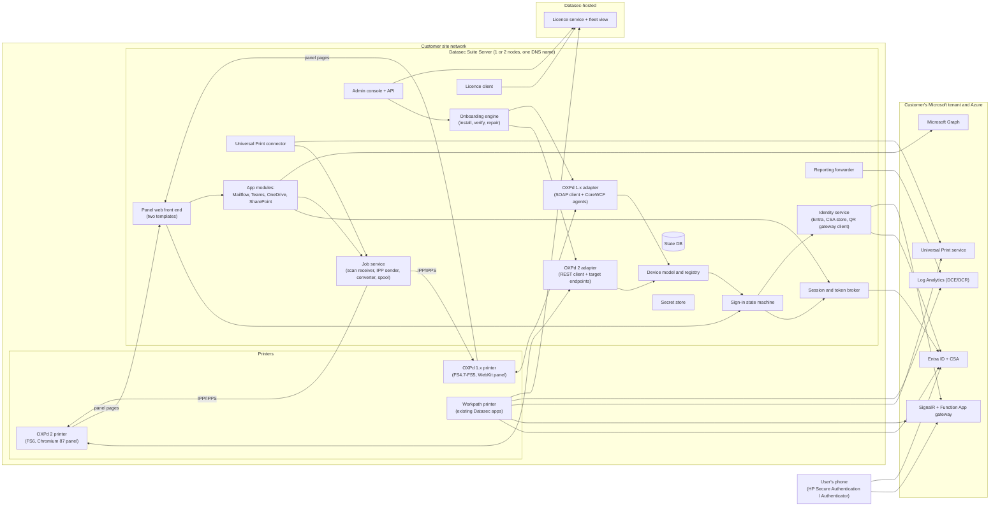

# Datasec OXPd: architecture of the HP Authentication Suite on a localised server (OXPd 2 and OXPd 1.x, beside Workpath)

Datasec / OXPd, 2026-11-18. Author: lead architect agent (Opus), for Kam. Status: DRAFT for the Fable review pass (C-5).

Sources: Kam's brief and rulings (`00_kam-brief_verbatim_2026-11-18.txt`, `CLARIFICATIONS.md` C-1 to C-5), the common analysis brief (`01_analysis-brief.md`) and the twelve analysis reports in `analysis/`, cited `[A1 §4.7]`. Library files are cited `library:relative/path:line`, relative to `/Volumes/Laptop-DEV/!CODING/Datasec/OXPd/`. "(inferred)" marks a conclusion no source states; "(assumption, Qn)" marks a design choice that waits on question Qn in document 2 (`03_plan-of-attack-and-build.md` §8). No secret value appears in this document; section 6.6 gives locations only.

Coverage note, read before trusting section 5.6.3: report A3's OneDrive/SharePoint half was never written (its sections 4.1, 5.1, 6, 7 and 8 for OneDrive are placeholders, `[A3 §4.1]`). OneDrive and SharePoint journeys here rest on the product documentation `[A6 §9 rows 61-64]`, the shared-library report `[A4]` and a short inventory of `library:HPAM - Docs and Notes/Source Code/CypherOneDrive-main/` made for this document (one code base with flavours `onedriveforpersonal` and `onedriveforbusiness`, SharePoint site and library browsing inside it: `library:HPAM - Docs and Notes/Source Code/CypherOneDrive-main/app/build.gradle.kts:121-128`, `.../app/src/com/hp/print/cypher/ui/search/sites/task/RootSiteTask.java`, `.../task/GetLibraryMetadataTask.java`). A full read of that tree is work package WP0.6 in document 2.

---

## 1. BLUF (for Kam)

1. **What we build:** one server product, the "Datasec Suite Server", that recreates HP Authentication Manager, Mailflow, Teams, OneDrive, SharePoint and Universal Print for printers that cannot run Workpath apps. The printer shows web pages from the server and passes card swipes, scans and sign-in events to it; the server does everything else.
2. **Where it runs:** on the customer's own network, one server (or a two-node pair) per site, because both OXPd generations need the printer to call the server and the server to call the printer [B1 §4.10] [C2 §5.1 item 1]. It talks outbound to Microsoft 365, to the customer's existing Azure pieces and to Datasec's licence service.
3. **Two printer "adapters" behind one core:** OXPd 2 (FutureSmart 6, REST) and OXPd 1.8.4.1 (FutureSmart 4.7 to 5, SOAP). A printer speaks one or the other, never both [B1 §4.17].
4. **What stays the same:** the Entra app registration, the card-to-user records in Entra Custom Security Attributes, the HP Secure Authentication phone app and its SignalR/Function App gateway, the Log Analytics tables, the licence service. A card enrolled at a Workpath printer works at an OXPd printer and the reverse; one licence and one admin view cover the mixed fleet.
5. **What changes for users:** Microsoft's sign-in page is not shown on the printer panel (old browsers, proven failures on OXPd 1.x [C2 §4.4]); the interactive Microsoft step moves to the user's phone (device-code or a phone redirect), card and phone-app sign-in work as today.
6. **What changes for security:** the tenant secret, user tokens and printer certificates leave the printers and live once, encrypted, on the customer's server; none of the weaknesses listed in section 6.7 is carried over.
7. **Language:** C# on .NET 10, like the existing back end; HP's OXPd 2 library is C#-first [B3 §4.7]; the OXPd 1.x agent side needs CoreWCF, proven by an early spike (Java fallback kept for that one adapter).
8. **Biggest risk 1:** OXPd 2 is a beta SDK and, as of 17 Nov 2026, no partner has an HP-signed bundle that installs on a customer printer [B3 §1 item 1]. OXPd 2 customers are blocked on HP until that is fixed.
9. **Biggest risk 2:** card sign-in on OXPd 1.x is the most failure-prone area in ten years of HP forum history (lost reader reports, wake-from-sleep races, missing sign-out events) [C2 §5.3 R2].
10. **Biggest risk 3:** HP told a partner in 2023 that OXPd does not support direct integration with public cloud services such as SharePoint Online [B3 §1 item 5]; HP must confirm in writing that a server-side Microsoft 365 integration is acceptable (and signable) before Datasec commits a release date (Q1).

---

## 2. Prior-work check (Datasec standing rule)

Everything that already exists, and what this architecture does with it.

| # | Existing asset | What it is | Verdict | Reason and evidence |
|---|---|---|---|---|
| P1 | HP Authentication Manager Workpath app v4.4.1 (`HPAuthenticationManager-main`) | Kotlin sign-in hub on the printer | **KEPT as is** for Workpath printers; **REPLACED** by the server's Session and Identity core for OXPd printers, which reimplements its behaviour as the specification | Its state already lives off the device (CSA), so a server can make the same calls [A1 §1 item 1]; the AIDL token service has no network form [A1 §1 item 2] |
| P2 | Mailflow 4.4, Teams 4.4.3 Workpath apps | Graph clients with native panel UI | KEPT for Workpath; **REPLACED** on OXPd by server modules; their Graph call lists (23 and 16 calls) are the functional contract | Both are thin Graph clients; scan and print go through CVL with local files [A2 §1] |
| P3 | OneDrive / SharePoint Workpath app 4.4.1 (`CypherOneDrive-main`) | Graph file client, two flavours | KEPT for Workpath; REPLACED on OXPd by one server module covering both | Coverage note above; [A6 §9 rows 61-64] |
| P4 | Universal Print Workpath app 4.4.1 | Registers up to three cloud printers per device, IPP INFRA to Microsoft | KEPT for Workpath; on OXPd **REPLACED** by a server connector that reuses its protocol logic almost line for line (`RegisterPrinter.kt`, `DeviceTokenManager.kt`, `IPP.kt` and others) | Registration, device token and IPP INFRA need nothing from the device [A3 §5.2] |
| P5 | Shared libraries CVL 1.09.x, `usermanagement` AAR, QuickAccessLibrary | Android scan/print wrapper, token-binding client | NOT USED on OXPd; CVL's option model and mapping tables are **KEPT as specification** for the server's neutral job ticket | Android-only; option keys and conflict rules define what admins can preset today [A4 §5.2 R3] |
| P6 | HP's 21 Workpath repositories (git bundles in `WorkPathApplicationsAndLibrariesSources-master`) | HP originals, including SecureAccess | NOT USED; reference only, pending licence clarity (Q20) | Rights over HP sources not stated anywhere [A4 §6 item 2] |
| P7 | Licence service (`License-Services-main`: portal, `License.Common`, generator) | Per-tenant licence with device cap; `POST /api/validate` | **KEPT and extended**: server calls it per device; additive batch endpoint, authenticated server caller, platform column, optional platform claim | Licence is per tenant and per serial, not per platform; devices never read the licence file, so claims can be added safely [A5 §1 items 1-3, §5.3] |
| P8 | Datasec Administration Portal | Keycloak onboarding, Marketplace SaaS | KEPT as is (commercial plumbing); **NOT USED** as the fleet view | It does not administer devices, licences or app configuration [A5 §1 item 4] |
| P9 | HPK Deployment Utility 3.0 | WinForms + worker wrapping `HPKTool-cli.exe` | Its job / task / retry / per-device result model is **KEPT and extended** into the server's onboarding engine; the HPKTool layer and its password handling are REPLACED | Platform-neutral engine; command layer is Workpath-only; hardcoded AES key and password on command line [A5 §5.1, §8.2 items 8-9] |
| P10 | HP-AuthSuite-Manager (Windows .NET 10 tool) | Pushes HPKs and configs to printers; reads OXPd 1.x DeviceInfo by SOAP | Ideas **KEPT** (IPP discovery, DeviceInfo call, device groups, DPAPI-protected passwords); code NOT USED directly; TLS-off and Basic-auth-over-TLS-1.0 patterns not carried | [A1 §5.3, §8.2 item 4] |
| P11 | Customer-hosted Azure pieces (SignalR, Function App, Storage, Log Analytics from the "Onboarding Azure Services" Marketplace offer) | QR / phone gateway and reporting | **KEPT as is** (assumption, Q4); the server joins the existing SignalR as one subscriber per tenant; the Function App gains one optional endpoint only if the phone-redirect sign-in (section 5.5) is chosen | Phone app is shipped software [A6 §5 item 4]; no source of the gateway in the library [A1 §7 Q4] [A5 §1 item 5] |
| P12 | HP Secure Authentication phone apps (iOS/Android, Intune edition) | QR and BLE badge | **KEPT as is** | [A6 §3.1], [A6 §5 item 8] |
| P13 | Legacy Keycloak back end | V3 / hosted back end | **NOT USED** (assumption, Q13) | Doubles every code path [A1 §5.2 item 8] [A5 §7 Q5] |
| P14 | Earlier OXPd 1.x attempt (`OLD BUILD/OXPd1_solution-master`, Java 21) | Spike against the simulator | **NOT USED as code**; KEPT as knowledge (registration recipe, call order, reconcile step, admin feature list) | Card never looked up, device-code only, session by source IP, no TLS, sign-out notification off [A7 §1, §5.1-5.2] |
| P15 | OXPd 2 SDK Beta 10 demos (pullPrintAuth, simpleScan, storedJob, statsDemo, kioskAndBrowser) | HP samples | KEPT as call-sequence patterns; nothing copied into the product | Demos accept any card, disable TLS, open CORS [B3 §5.3] |
| P16 | OXPd 1.x SDK 1.8.4.1 (`OXPdLib`), Demos 1.9, OXPm 1.7, Omni UI kit 1.4 | HP libraries and samples | OXPdLib **KEPT** (redistributable unchanged [C1 §5.3]); demos as patterns; OXPm records as an optional Web Jetadmin export; Omni kit as panel look and feel | [C1 §5.3] |
| P17 | Product documentation and help portal (V4.4) | Customer-facing behaviour | **KEPT**: A6's 90-row checklist is the requirements baseline; error vocabulary AI01-AI09, MF01-MF03 kept on the panel | [A6 §9], [A6 §5 item 8] |

---

## 3. Requirements

### 3.1 How to read this section

Each requirement carries its source and a binding: **D** = needs the device (panel, reader, scanner, print engine, timeout), **S** = server only. For every D requirement the three columns say how it is met on OXPd 2, on OXPd 1.x, and on Workpath (unchanged product). "Same" in the Workpath column means the existing Workpath suite already does it and is not touched. The full A6 checklist is folded in by row number (`A6#n`).

### 3.2 Functional requirements: sign-in hub (HP Authentication Manager)

| Id | Requirement | Source | Bind | OXPd 2 | OXPd 1.x | Workpath |
|---|---|---|---|---|---|---|
| F1 | A sign-in method of the device ("Proxy" / custom agent) that the device calls for pre-prompt, prompt, post-prompt and sign-out | A6#1-3, [A1 §5.1 row 1] | D | Authentication Agent record in the signed bundle, kind `akCustom`; four endpoints on the server [B1 §4.7] | `RegisterAuthenticationAgent` (admin SOAP) with pre-prompt, `UserPromptTarget`, sign-out notification ON [C1 §4.4] | Same |
| F2 | Card tap at any time (panel idle, no app open, device asleep) starts sign-in | A6#3-4, [A1 §4.3] | D | Owned HID reader → `hidRead` to server → callback response `initiateLogin` or `login(succeeded)`; `login` wakes a sleeping device [B1 §4.7, §4.9] | Owned accessory `HidReportEvent` → server → `ReserveAuthenticationContext` → device calls `GetPrePromptResult` → Succeeded [C1 §4.4]; defensive retry for wake races [C2 §5.1 item 3] | Same |
| F3 | Second tap of the same card signs out; another user's card signs the first out, then signs the second in | A6#21, [A1 §4.3] | D | USB callback response `forceLogout`, then `login` when idle; 409 handling [B2 §5] | `ReleaseAuthenticationContext`, wait for idle, then `Reserve…` [C2 §5.1 item 3] | Same |
| F4 | Card string decoded per reader model exactly as Workpath decodes it (lower-cased, UUID dashes removed, max 32 bytes) | A6#6-7, [A1 §4.11], [A7 §5.3 item 1] | D+S | Raw HID reports to server; shared decoder library | Same decoder; reports are 8-byte keyboard reports with ordinals [C1 §4.6] | Same |
| F5 | Reader recognised by USB vendor/product id; missing reader reported (AI07/AI08) | A6#7-8 | D | Ids fixed in the signed manifest; a new model needs a new HP-signed bundle [B1 §5.1] | Ids registered per device at onboarding; can change without HP [C1 §4.6] | Same |
| F6 | Known card: look up user in CSA set `HPAuthenticationSuite`, attribute `cardId`, same blob format and key | A6#9, [A1 §4.7] | S | Server | Server | Same |
| F7 | Known card, MFA mode (default): interactive Microsoft step for that user with number match | A6#12-13, [A1 §4.3] | D (display) + S | Prompt page shows a QR and code; the Microsoft step runs on the user's phone (section 5.5); on-panel Microsoft page only if the Chromium 87 spike passes (D10) | Prompt page shows QR and code; Microsoft step on the phone only [C2 §5.1 item 5] | Same (WebView) |
| F8 | Known card, No-MFA mode: redeem stored refresh token from CSA, no interaction; fall back to interactive on failure; AADSTS53009 clears the token | A6#15-16, [A1 §4.3] | S | Server, then `login(succeeded)` | Server, then pre-prompt Succeeded | Same |
| F9 | Unknown card: self-enrolment with a Microsoft sign-in, then append the card to the signed-in user's `cardId` (max 15) | A6#10-11, [A1 §4.3] | D + S | Prompt page with QR and code; enrolment identity taken from the verified token | Same | Same |
| F10 | QR / phone-app sign-in through the customer's SignalR gateway; same QR format; "secret" treated as a card id | A6#26-29, [A1 §4.4, §4.10] | D (display) + S | Prompt page renders a per-device QR; the server holds one SignalR connection per tenant and routes by printer name | Same | Same |
| F11 | BLE badge: reader performs BLE and emits keyboard input | A6#5, [A1 §4.4] | D | Same as card (reader is USB HID) | Same as card; no other BLE path exists [C2 §5.1 item 4] | Same |
| F12 | Passkey / device-code sign-in (no card) | [A1 §4.4] | D (display) + S | Prompt page | Prompt page | Same |
| F13 | One session shared by all suite apps; "exit is not sign out" | A6#19, A6#22 | S + D | Server token broker keyed by device + authentication session id; apps learn the user from header macros / Security Context [B1 §5.1] | Server token broker keyed by device + `AuthenticationContextId`; apps receive an opaque handle via `$AUTHUSER_OPAQUEAUTHNTOKEN$` [C1 §5.1 item 5] | Same (AIDL) |
| F14 | Sign-out from panel, from any app, by timeout ends access for all apps; tokens erased | A6#20, A6#23, [A1 §4.13] | D + S | `signoutNotification` + `ntWalkupSignOut` + server-side expiry; `forceLogout` from server [B1 §4.7] | `SignoutNotification` (best effort, not sent on power loss) + server-side expiry; `EndUserSession` [C1 §4.4] [C2 §6] | Same |
| F15 | Display name on the console in one of four configured forms | A6#18, [A1 §4.15] | D | `details.displayName` in `login` / post-prompt | `AuthenticationInfo.DisplayName` | Same |
| F16 | "Launch the chosen app after sign-in" | A6#1, [A1 §4.8] | D | `login` action `initiateAppLaunch`, or `initiateLaunch` [B1 §5.1] | Authentication preference "launch application access point" [C1 §4.4] | Same |
| F17 | Pull-print check at sign-in with release / stay / cancel dialog and per-user auto-release (`UPAR`) | A6#77-79, [A1 §4.9] | D + S | In-server call; dialog is the prompt page before close, or a page of the Universal Print app after auto-launch (D14) | Same; release must happen in the app page, not the sign-in page [C1 §5.2] | Same |
| F18 | Card emulation for administrators (4-6 characters) | A6#31 | S | Admin console of the server only, audited, off by default | Same | Same |
| F19 | National clouds: Commercial, GCC, GCC High, DoD, Custom | A6#34, [A1 §4.15] | S | Per-tenant endpoint set on the server | Same | Same |
| F20 | Confidential-client mode where public client flows are disabled | A6#35 | S | Server is a confidential client by design (section 7.1) | Same | Same (hidden option) |
| F21 | Error vocabulary AI01-AI09 kept on the panel; finer internal codes | A6#67, [A1 §5.4] | S | Server pages | Server pages | Same |

### 3.3 Functional requirements: Microsoft 365 apps

| Id | Requirement | Source | Bind | OXPd 2 | OXPd 1.x | Workpath |
|---|---|---|---|---|---|---|
| F30 | One home-screen tile per app; tile visibility per licence | A6#1, [A4 §5.1 item 10] | D | Application Agent records in the manifest; bindable `enabled` + `refresh` [B1 §4.8] | `RegisterTopLevelButton` per app (max about 20) [C1 §4.19] | Same |
| F31 | Scan with sides, colour, size, orientation, resolution 75-600, image adjustments, blank-page suppression, misfeed detection; formats PDF, PDF/A, TIFF, MTIFF, JPEG, XPS, OCR, PDF encryption | A6#44-45, [A2 §6.1] | D | `POST scanJobs` with UI-context token, `http(s)` destination on the server, multipart POST [B2 §1 item 3] | Scan service with the app's UI context (not the sign-in one); device POSTs to server receiver [C1 §5.1 item 8] | Same |
| F32 | Scan preview with remove, rescan, add page, cancel | A6#47, [A2 §6.1] | D + S | Server renders page thumbnails from the received file; rescan = new job (assumption, Q16) | Same, under the 3 MB page budget [C2 §5.1 item 6] | Same |
| F33 | Print stored documents with sides, colour, paper size/tray, collate, copies, page range; options limited to device capability | A6#50-51 | D | Server fetches and converts, then IPP Print-Job (push) or Print-URI (pull) to the device [B1 §5.1] [B2 §5] | IPP Print-Job / Print-URI inside priority print with the app's UI context [C1 §5.1 item 7] | Same |
| F34 | Office documents converted to PDF through Graph before printing | A6#53, [A2 §1 item 3] | S | Server; Graph `?format=pdf` for files already in OneDrive/SharePoint; mail attachments through a server-side temporary location, not the user's OneDrive (D18) | Same | Same |
| F35 | Mailflow: list mail and folders, search, refresh; compose with To/CC/BCC auto-complete, scanned attachments; reply keeping thread; drafts; print message and attachments; admin max attachment size (default 35 MB) | A6#55-59, [A2 §6.4] | S + D (scan/print) | Server pages + Graph | Same | Same |
| F36 | Mailflow not offered on panels 4.3 inches or smaller | A6#60 | D | Tile hidden by panel class from `User Interface Attributes` [B1 §4.8] | Hidden by `GetUIAttributes` [C1 §4.20] | Same |
| F37 | OneDrive: browse, scan to folder, print, rename, delete, create folder, search, sort, tile/list | A6#61 | S + D | Server pages + Graph | Same | Same |
| F38 | OneDrive/SharePoint optional "Send to e-mail" through the device's SMTP, default off | A6#62 | D | No e-mail destination on either OXPd; replaced by Graph `sendMail` from the server (assumption, Q16) [C2 §5.1 item 8] | Same | Same |
| F39 | SharePoint: sites → libraries → folders; metadata entry at scan (4 custom fields); sort; multi-select print and delete | A6#63-64 | S + D | Server pages + Graph | Same | Same |
| F40 | Teams: scan to a channel folder with optional channel message (reference attachment recipe); print; manage files and folders; channels only, no chats | A6#65, [A2 §6.2, §8 Q7] | S + D | Server pages + Graph | Same | Same |
| F41 | Per-user settings roam (quick messages, quick-access pins, remember-me) between Workpath and OXPd | [A2 §8 Q3], [A1 §4.7] | S | Same store: JSON file in the user's OneDrive app folder (`special/approot`), same file name and keys | Same | Same |
| F42 | Six UI languages at parity (strings exist for six; admin config in seven); documentation says English only | [A2 §6.4], A6#42 | S | Server-side i18n | Same | Same |
| F43 | Administrator access-code sign-in opens an app's settings pages | A6#43 | D | Move app settings to the server admin console; on the panel, an `AUTH_TYPE` admin check shows read-only status (D19) | Same | Same |

### 3.4 Functional requirements: Universal Print

| Id | Requirement | Source | Bind | OXPd 2 | OXPd 1.x | Workpath |
|---|---|---|---|---|---|---|
| F50 | Register a device as up to three printers (`_Direct`, `_Secure`, `_Pull`); enable, disable, rename without re-registration | A6#68, A6#72, [A3 §1] | S | Server connector holds key, certificate and cloud id per (printer, flavour) | Same | Same |
| F51 | Registration by a Printer Administrator: interactive sign-in in the server's admin console, used for a batch; no stored admin password, no scripted login | A6#69-70, [A3 §7 Q1] | S | Server admin console | Same | Workpath keeps today's method |
| F52 | `_Direct`: print with nobody at the panel within minutes; PIN jobs land in device job storage | A6#73-74, [A3 §5.2] | D | Server polls Universal Print, pushes by IPPS `Print-Job` to TCP 631 of the device with `job-password` forwarded | Same (plain IPPS, no OXPd API) [A3 §5.2 item 9] | Same |
| F53 | `_Pull`: sign-in releases the user's jobs, prompt with count, auto-release flag | A6#77-79 | D + S | In-server call at sign-in; release by IPP from the server | Same; release in an app page with priority print where needed [C1 §5.1 item 7] | Same |
| F54 | `_Secure`: list the user's jobs, preview, select, override options, release | A6#75-76 | D + S | Server pages + IPP | Same | Same |
| F55 | Print Anywhere: any member printer serves a virtual queue's jobs; status reported back | A6#80 | S | Same connector logic | Same | Same |
| F56 | Job status and page counts reported to Universal Print for all flavours | [A3 §7 Q8] | D + S | IPP job attributes or job statistics | Same | Secure only today |
| F57 | "Device registration required" message when unregistered | A6#83 | S | Server page | Same | Same |

### 3.5 Functional requirements: administration, licence, reporting

| Id | Requirement | Source | Bind | Met by |
|---|---|---|---|---|
| F60 | Tenant configuration: tenant id, client id, secret, attribute switch, SignalR URL, name format, MFA switch, reporting string, licence endpoint, cloud | A6#36, [A1 §4.15] | S | Server configuration store; secret in the server's secret store; importer for existing `.cfg` files (assumption, Q19) |
| F61 | Fleet-wide configuration push and per-app presets | A6#37, A6#49 | S | Server holds configuration once; device groups for presets |
| F62 | Licence check per device serial against Datasec's licence service; 20-day temporary grace | A6#38, [A1 §4.16] | S | Server validates per device (section 7.5) |
| F63 | Job statistics and supplies to the customer's Log Analytics streams `<base>_StatisticsJobData_CL` and `<base>_Supply_CL`, same record shape | A6#39-40, [A1 §4.18] | D + S | OXPd 2 `jobStatistics` (non-critical) + `supplies` agents; OXPd 1.x Statistics agent (non-critical); server forwards [B1 §5.1] [C1 §5.1 item 9] |
| F64 | Clock accuracy checked and reported (AI03) | A6#88 | S | Server NTP check; device clock read at onboarding [B1 §4.10] |
| F65 | Diagnostic log export for support | A6#89 | S | Server support bundle with redaction |
| F66 | One admin view for a mixed fleet (Workpath + OXPd 1 + OXPd 2) under one tenant and one licence | Kam's brief (C-1), [A5 §5.3] | S | Server console per site + extended licence portal as the cross-site view (section 7.6) |
| F67 | Secret rotation without touching printers | A6#86 | S | Secret held only on the server |
| F68 | Coexistence: same registration, same enrolments, same queue naming, same reporting tables | A6#90 | S | Sections 7.1 to 7.4 |

### 3.6 Non-functional requirements

| Id | Requirement | Source | How met |
|---|---|---|---|
| N1 Security: no secret in source | C-3, [A1 §8.2], [A5 §8.2] | Secrets only in the server's secret store (section 6.2); CI secret scanning with no allow-listed folders |
| N2 Security: Microsoft tokens never leave the server | [B2 §1 item 4], [C1 §4.21] | The device session carries only identity and an opaque handle |
| N3 Security: TLS everywhere, validated both ways | [C1 §5.1 item 10], [A3 §8 item 3] | Section 6.3 |
| N4 Security: card numbers, tokens, mail content and file names never logged | [A4 §8 item 2], [A2 §9 item 4] | Structured logging with a deny-list of fields; tests assert it |
| N5 Scale per site | inferred from [A6 §9] and [A1 §5.2 item 5] | Design target 500 printers and 5,000 users per server node, 50 concurrent panel sessions, 20 sign-ins per minute peak (assumption, Q10) |
| N6 Latency at the panel | inferred; [C2 §4.1] reports 10-22 s sign-ins from sleep on 1.x | Known-card sign-in, panel awake: server work under 1.5 s at p95 (CSA lookup cached); panel page first paint under 2 s on OXPd 1.x WebKit |
| N7 Availability | [C2 §5.3 R6], [B3 §5.2] | No device-side failover exists; active/passive pair behind one DNS name; restore under 15 minutes for single node; printers keep native functions when the server is down (non-critical registrations only, failure behaviour dismissible) |
| N8 Offline behaviour | [A5 §5.2 item 4] | Without internet: no Microsoft sign-in possible (stated on the panel); licence grace 20 days survives restarts; Universal Print polling resumes |
| N9 Data residency | inferred from [A6 §5 item 5], [A5 §4.4] | All user data stays on the customer's server and their Microsoft tenant; the only Datasec-bound data is the licence call (tenant id, serial, nonce) and optional health telemetry without personal data |
| N10 Coexistence with other vendors | [B1 §5.3], [C1 §5.2] | No authorization proxy, no quota proxy, non-critical statistics, merged trusted sites; owned readers only for models the customer assigns to us (Q12) |
| N11 Panel classes | [B1 §4.4] seven test groups down to 320x240; [C1 §4.13] 160x64 to 1280x800 | Two page templates (OXPd 2 Chromium 87; OXPd 1.x WebKit 534 ES5); minimum supported panel 4.3 inch touch for the suite, sign-in only below that (assumption, Q9) |
| N12 Upgradeability without HP re-signing | [B1 §5.2 item 7] | Manifest kept generic; all logic and most settings on the server and in the solution context |
| N13 Auditability | [A1 §8.2 item 6] | Every card lookup, sign-in, token redemption, print release and admin action written to an append-only audit log; rate limits on card lookups |

---

## 4. Platform facts that constrain the design

One table, concept by concept. The OXPd 2 column is HP's Beta 10 documentation and contracts; the OXPd 1.x column is SDK 1.8.4.1 plus ten years of field reports; the Workpath column is the existing product, which is not changed.

| Concept | OXPd 2 (FutureSmart 6+, Beta 10) | OXPd 1.x (1.8.4.1; full set from FutureSmart 4.7, up to FutureSmart 5) | Workpath (unchanged) | Design consequence |
|---|---|---|---|---|
| Which devices | FutureSmart 6 and later only; these devices do not run OXPd 1 (`library:OXPd2/Docs/how-it-works.md:28`); model list "to be defined prior to production release" [B1 §4.17] | Every FutureSmart up to 5; full 1.8 from FS 4.7; legacy "Oz" subset; Pro devices are a separate frozen 1.7 REST dialect [C1 §4.20] | HPAM V4.4 on Workpath-enabled FutureSmart firmware (documented ranges 5.8.x to 5.10.x, with doubts) [A6 §6 row 1]; Workpath packages also appear as a target type in OXPd 2 contracts, so FS6 devices can carry Workpath apps (inferred from [B2 §1 item 5]) | Platform chosen **per device** by capability probe at onboarding, never by model name [C2 §5.1 item 13]; Pro and Oz out of scope (assumption, Q9) |
| Where code runs | Nothing on the device; signed bundle of declarations; server hosts every target [B1 §1 item 1] | Nothing on the device; registration records written by admin SOAP [C1 §1 item 1] | APKs on the device | One server; two device adapters |
| Network direction | Two-way: device → server (pages, callbacks, scan upload, Print-URI fetch); server → device (tokens, `login`, HID open, IPP) [B1 §4.10] | Two-way, fixed port 7627 on the device, no NAT remap, no 3xx on agent endpoints [C1 §5.2] [C2 §5.1 item 1] | Device → cloud only | Server on the customer LAN; a cloud-only server is not viable without a site relay |
| Wire protocol | REST/JSON, 16 services, 201 operations [B2 §1] | SOAP 1.2 + WS-Addressing 2004, both directions [C1 §4.1] | Android SDK | Adapter per platform; core never sees SOAP or REST |
| Trust: device → server | TLS validated only against CAs in the solution's own store on the device; static Basic or bearer credential in the target; no device client certificate [B1 §4.3] | TLS validated against the device's OXPd CA store; Subject CN must match the URI host exactly, no IP addresses; empty store = no outbound HTTPS [C1 §4.2] | n/a | Server certificate on an FQDN; customer CA pushed to every device; per-device callback credential |
| Trust: server → device | Device OAuth2: admin password grant (1 h, install only), then per-device solution access + refresh token from an install code exchanged within 5 minutes [B1 §4.3] | HTTP Basic `admin` on every admin-class call, including run-time calls (`ReserveUIContext`, home-screen messages) [C1 §4.2] | n/a | OXPd 2: admin password discarded after install (assumption, Q7); OXPd 1.x: admin password stored encrypted for the server's life |
| Device identity to server | Header macros `$DEVICE(ID)$`, `$DEVICE(IPV4_ADDRESS)$`; no signature [B1 §4.3] | `serverContextId` per registration, `$DEVICE_ID$` macros, DeviceInfo GUID and serial [C1 §4.1, §4.21] | Serial from `DeviceService` | Device record keyed by serial; per-device callback credential binds callbacks to the record |
| Sign-in agent | Authentication Agent: pre-prompt, prompt page, post-prompt, sign-out; server-initiated `login(succeeded|continue|failed)`; 409 if UI not idle; one session at a time; `forceLogout` [B2 §4.2] | `RegisterAuthenticationAgent`; pre-prompt, prompt page, post-prompt; `ReserveAuthenticationContext` (server-initiated) and `ReleaseAuthenticationContext`; sign-out notification not sent on power loss [C1 §4.4] | `AbstractAuthenticationService` callbacks [A1 §4.12] | One sign-in state machine in the core |
| Identity carried by the device session | Security Context attributes; custom attributes up to 256 pairs of 512 characters; no tokens [B2 §1 item 4] | `AuthenticationInfo` → `$AUTHUSER_...$` macros posted to each button's first request, including an opaque token chosen by the agent [C1 §5.1 item 5] | Principal with display data and a placeholder password [A4 §1 item 2] | Device carries identity + an opaque session handle; Entra tokens only on the server |
| Card readers / HID | Owned HID readers declared by vendor/product id in the signed bundle; raw reports with sequence numbers; a model already owned by another solution blocks install; a new model needs a new HP-signed bundle [B1 §4.9] | Owned or shared HID readers registered per device; raw 8-byte keyboard reports with ordinals; HID only, single report id; owned-accessory events not guaranteed, `ResendOwnedAccessoryEvent` [C1 §4.6] | Owned accessories, per-reader decoders [A1 §4.11] | One decoder library shared by both adapters, tested byte-for-byte against Workpath output |
| Panel UI and browser | Chromium 87 (QtWebEngine 5.15); no pop-ups, file input, downloads; cookies, cache and hooks "under development"; trusted-sites list in context; seven test groups down to 320x240 [B1 §4.8] | AppleWebKit 534+ on FS4/5 (523 on FS3); 10-second JavaScript limit; about 2-3 MB per solution; no SVG, pop-ups, downloads; cookies unreliable on FS5; screens 160x64 to 1280x800 [C1 §1 item 4] [C2 §5.1 item 6] | Native Android screens + WebView | Server-rendered pages, two templates, ES5 for 1.x; no Microsoft sign-in page on the 1.x panel; on OXPd 2 only after a spike |
| Timeouts | Inactivity 10-300 s (default 60); `resetInactivityTimer` must not extend indefinitely [B1 §4.7] | Same range; reset from server unreliable in the field [C2 §6] | Device timeout | Long Graph operations run asynchronously with progress pages; reset sparingly |
| Scan | `POST scanJobs` only with the UI-context token; `http(s)` destination; multipart POST, `tmJob` or `tmImage`; ~60 options; no stated size limit [B2 §4.7] | Scan service only with the app's UI context, not the sign-in one; POST to server receiver; TLS 1.3 upload faults before FS 5.8 [C1 §4.4] [C1 §6] | CVL to local files [A4 §1 item 3] | Scan receiver endpoint on the server, streaming to disk, per-job secret in the destination |
| Print | No REST print; IPP Print-Job (push) or Print-URI (device fetches with Basic or cookie); priority-print submission "currently not supported"; IPP certificate check on from 6.25.0.730 [B2 §4.6] [B1 §5.1] | IPP Print-Job / Print-URI; priority print keyed by the app's UI context; queue at most 5 jobs (often 1) [C1 §4.8] [C2 §5.1 item 9] | Workpath print from file; Universal Print Direct/Pull already IPPS to the device's own port [A3 §1 item 3] | One "send job to device" interface over IPP; jobs held on the server or in Universal Print |
| Held jobs | Only `copy/storedJobs` (scan-created; driver jobs unknown) [B2 §4.8] | No device job-storage API [C1 §1 item 5] | Universal Print `_Secure` uses device print path | Secure release = server-held / cloud-held jobs on both OXPd platforms |
| Statistics | `jobStatistics` with user identity; critical mode blocks jobs when unacknowledged; `deviceUsage`, `supplies` [B2 §4.11] | Statistics agent with ordinals; critical agent locks the device (48.A1.01); no supplies service [C1 §4.10] [C2 §5.3 R9] | Polled on device [A1 §4.12] | Non-critical registration; supplies on OXPd 1.x from another source or dropped (D22) |
| Deployment and life cycle | Bundle `solution.bdl` installed via the Solution Manager Installer API only (EWS/USB routes not supported); context and CA import after install; developer mode (LDB) wipes all solutions when toggled; same-id upgrade behaviour undocumented [B1 §6 rows 4, 5] [B1 §5.3] | Records written per device; wiped by disk initialisation; re-check and repair after firmware change; Web Jetadmin + OXPm can push buttons, accessories, agents [C1 §4.19] | HPK via HP Command Center or the HPK utility [A5 §5.2 item 6] | Onboarding engine with drift detection and repair for both |
| Signing / certification | Production bundle must be HP-signed after "VAV/VNV"; self-certified tests on one device from each of seven groups for an authentication solution; no partner has a working signed bundle as of 17 Nov 2026 [B1 §1 item 3] [B3 §1 item 1] | None; no HP approval for 1.8 [C1 §4.19] | HP validation of HPKs (Q19) | OXPd 1.x can reach customers first; OXPd 2 release gated on HP |
| Firmware spread | Each beta needs matching firmware; Beta 9 bundles hang Beta 10 firmware [B3 §5.4] | "Firmware lottery": TLS 1.3 in 5.5, cookie changes in FS5, sign-out loss in 5.7, duplicated buttons in 5.9.0.2 [C2 §5.3 R5] | Documented ranges | Minimum firmware per platform + defect table in the server |
| Maturity | Beta 10 (1 Jun 2026); `userPolicy` Alpha; browser "under development"; no production date [B1 §5.3] | Mature, frozen; OXPd 1.9 "soon" since 2017, treat as absent [C2 §6] | Shipping product | Design against 1.8.4.1 and Beta 10; contract tests against both |
| Simulator | OVA 6.38.0.793, not yet downloaded (`library:START-HERE.md:6`) | Windows OXPd Simulator 1.3 with a Chromium panel, not the device WebKit [C1 §5.4] | Workpath emulator | Real devices are mandatory test targets for both |

---

## 5. The architecture

### 5.1 Shape in one paragraph

A single server product, deployed on the customer's network, contains a platform-independent **core** (sign-in state machine, token broker, Entra and Graph clients, the five app modules, the Universal Print connector, licence and reporting clients) and two **device adapters** (OXPd 2 REST, OXPd 1.x SOAP) that translate each platform's callbacks and calls into one internal device model. A **panel web front end** serves pages to both device browsers from one code base with two templates. An **onboarding engine** installs, verifies and repairs the solution on each device. The customer's existing Azure pieces (SignalR, Function App, Log Analytics) are reused unchanged; Datasec's licence service gains small additive changes and becomes the cross-site fleet view.

### 5.2 Component view



The Workpath printer (PW) talks to the same Entra tenant, the same gateway, the same Universal Print service, the same Log Analytics workspace and the same licence service. Those shared stores are the whole integration between the two products; no bridge component is needed [A1 §1 item 2] [A4 §5.2 R4].

### 5.3 Components

| # | Component | Responsibility | Technology and reason | Interfaces | Data held | Runs where |
|---|---|---|---|---|---|---|
| C1 | **Device model and registry** | One record per printer: serial (key), platform (`oxpd2`, `oxpd1`), firmware, model, capability set, address and DNS name, panel class, registration state, per-device credentials (references into C15), health | .NET 10 class library + EF Core | internal API used by every component | device rows, capability snapshots, defect-table matches | Server |
| C2 | **OXPd 2 adapter** | Calls device REST services with the per-device solution token (refresh on 401, re-issue path); hosts every target the manifest declares: authentication (`prePromptResult`, `prompt`, `postPromptResult`, `signoutNotification`), USB registration target, solution notifications (`ntAuthCode`, `ntDeviceBoot`, `ntWalkupSignIn/Out`), job statistics, scan notifications; validates the per-device callback credential on every call | ASP.NET Core minimal APIs + HP `OXPd2Lib` (netstandard2.0, C#-first [B3 §4.7]) | REST to device; HTTPS targets from device; emits internal events | solution refresh token per device (encrypted), last sequence numbers | Server |
| C3 | **OXPd 1.x adapter** | SOAP client to device services on 7627 (OXPdLib .NET 8 build, client side); SOAP 1.2 agent endpoints for Authentication Agent, Accessories callbacks, Statistics agent, Scan notifications | .NET 10 + `OXPdLibCore` + **CoreWCF** for the agent side, HP's own advice [C1 §5.1 item 1]; proven by spike S2 in document 2; fallback: the same adapter as a small Java 21 sidecar (JAX-WS RI 4.0.3 + OXPdLib 1.8.4.1 jar, known to work [A7 §5.1]) speaking the same internal gRPC/HTTP contract | SOAP to device; SOAP agents from device; emits internal events | device admin password reference, authentication and accessory context ids, `serverContextId` per device | Server |
| C4 | **Onboarding engine** | Probe device (discovery tree / capabilities), choose platform, push CA, install bundle (OXPd 2) or write records (OXPd 1.x), exchange install code, set context, verify, record what was registered; detect drift (disk init, firmware change, reboot) and repair; idempotent uninstall | .NET 10 background service; job/task/retry/result model taken from the HPK Deployment Utility [A5 §5.1] | admin API and console; C2/C3 | job history, per-device registration manifest (what we wrote) | Server |
| C5 | **Sign-in state machine** | Per-device instance of HPAM's state machine (`AuthPhase`) with the "stale session" guard [A1 §4.3]; triggers: card, QR/phone, panel button, device-code; outcomes: login with identity, enrol, fail, cancel; handles "same card = sign out", "other card = switch user", 409 / Concurrency retries, wake-from-sleep races [C2 §5.1 item 3] | .NET 10, actor-per-device (a `Channel<T>` per device, serialising events) | internal events from C2/C3/C7/C8; calls C6, C7, C9 | per-device transient state only (persisted for restart within 10 min, like HPAM [A1 §4.7]) | Server |
| C6 | **Session and token broker** | Replaces the Android `TokenManagementService` [A1 §4.8]: holds the user's access + refresh tokens per device session; `GetToken(sessionHandle)`, `GetNewToken`, refresh before expiry and on 401; sign-in / new-token / sign-out events to app modules; "launch app after sign-in"; per-user properties (CSA keys and the OneDrive approot JSON); token-subject = session-user check on every read | .NET 10 in-process service; tokens in memory, persisted only encrypted and only while the session lives (D6) | internal API; no network surface | sessions keyed by (device serial, platform session id); opaque session handle → session | Server |
| C7 | **Identity service** | Entra: auth-code + PKCE (confidential client), device-code, refresh redemption; CSA store (find by card blob, read/write attributes, enrolment, 15-card / 50-value limits, schema creation cached); QR gateway client (one SignalR connection per tenant, routes by printer name); national clouds | .NET 10 + MSAL.NET (confidential client) + `Microsoft.AspNetCore.SignalR.Client`; Graph via `HttpClient` with `Retry-After` handling | Entra, Graph, customer SignalR | app-only token cache; CSA schema check cache; no card numbers at rest | Server |
| C8 | **Card decoder library** | Decode raw HID keyboard reports per reader model into the same string Workpath produces (six decoders + generic) [A1 §4.11]; reassemble reports by sequence/ordinal with a ~1 s window [C2 §5.1 item 4] | .NET 10 library, golden-file tests from the Workpath decoders | used by C2/C3 | none | Server |
| C9 | **Panel web front end** | All panel pages: sign-in prompt (QR, code, enrolment, errors), each app's screens, pull-print dialog, Universal Print secure list; one code base, two templates: `p2` (Chromium 87, modern ES2017 subset) and `p1` (WebKit 534, ES5, Omni UI kit, ≤ 2 MB per page set) | ASP.NET Core Razor Pages, server-rendered HTML, minimal JS, no third-party CDN; state carried in URL/POST + server session, not cookies [C2 §5.1 item 6] | HTTPS from device browsers; calls C6, C10, C11 | none beyond session | Server |
| C10 | **App modules** (Mailflow, Teams, OneDrive+SharePoint) | Port of each app's Graph call list as server services: mail list/search/compose/reply/drafts/send; Teams teams→channels→files, channel message recipe; OneDrive/SharePoint browse, metadata, rename/delete/create, search; quick access; scan-to and print-from orchestration | .NET 10; one shared Graph HTTP layer (refresh on 401, `Retry-After`, paging, chunked upload sessions) [A2 §6.3] | C6 tokens; C11 jobs; Graph | per-session temp files only (C11 spool) | Server |
| C11 | **Job service** | Scan receiver (multipart, streaming to an encrypted spool, size caps); page thumbnail renderer; document converter (Graph `?format=pdf` or local); IPP sender (Print-Job default, Print-URI optional with one-time Basic credential or cookie; priority print where supported); job status tracking; spool wiped per job and per session end | .NET 10; IPP via a maintained .NET IPP library or a port of HP's JIPP logic (Q20 licence); PDF rendering with a permissively licensed library (inferred need) | HTTPS from devices (scan upload, Print-URI fetch); IPPS to devices | encrypted spool, deleted on completion | Server |
| C12 | **Universal Print connector** | Port of the Workpath Universal Print logic: registration (CSR, device certificate), device token, IPP INFRA polling, Direct / Pull / Secure flows, attribute sync, job state report; unit of state = (printer, flavour) [A3 §5.2] | .NET 10; IPP INFRA encoder (port of `IPP.kt`, `ResumableIppDocumentInputStream.kt`); keys via C15 key provider (non-exportable where available) | Universal Print service; C11 for delivery; C5 at sign-in for Pull | per (printer, flavour): key reference, certificate, cloud device id, endpoints, persisted job map | Server |
| C13 | **Licence client** | Per-device validation (and batch when available), 20-day grace persisted, seat release on device removal | .NET 10 referencing `License.Common` directly [A5 §5.1] | Datasec licence service | licence state per serial, last success timestamp (tamper-evident) | Server |
| C14 | **Reporting forwarder** | Job statistics, supplies (OXPd 2), device events → Log Analytics streams `<base>_StatisticsJobData_CL`, `<base>_Supply_CL`, same record shape, de-duplicated by device + job sequence [A1 §4.18] | .NET 10 + Azure Monitor Logs Ingestion API, app-only token for the monitor scope | customer DCE/DCR | high-water marks per device | Server |
| C15 | **Secret store** | Holds: Entra client secret or certificate, CSA card-blob key, OXPd 1.x admin passwords, OXPd 2 solution refresh tokens, per-device callback credentials, Universal Print private keys (or references to non-exportable keys), server TLS key | Pluggable: (a) default local store encrypted with ASP.NET Core Data Protection keys protected by DPAPI-NG / TPM on Windows or a sealed key file on Linux; (b) customer Azure Key Vault (keys non-exportable, sign remotely) when the customer allows (assumption, Q14) | internal only | secrets | Server or customer Key Vault |
| C16 | **Admin console and API** | Site operations: tenant config, devices and onboarding jobs, health, Universal Print registration (interactive admin sign-in), reader assignments, presets per device group, card emulation (audited, off by default), support bundle; reports device inventory and health to the licence portal | ASP.NET Core + Entra sign-in for admins (roles: Site Admin, Operator, Auditor), no anonymous first-run (bootstrap code printed at install) | HTTPS for admins; licence portal API | admin audit log | Server |
| C17 | **State database** | Device registry, sessions (encrypted), jobs, Universal Print state, audit log | EF Core; PostgreSQL 16 default (container appliance), SQL Server supported (Windows installs) (assumption, Q14) | internal | as above | Server or customer DB |
| C18 | **Licence service extensions** (Datasec-hosted) | Additive: authenticated server caller, batch validate, `platform` / `serverId` / `model` / `appVersion` columns, optional per-platform claim, fleet view pages (Workpath + OXPd devices from both sources) | existing ASP.NET Core portal [A5 §3] | REST | as today plus columns | Datasec Azure |
| C19 | **Solution bundle (OXPd 2)** | Signed manifest: one authentication agent, one USB accessories record (reader list), six application agents, security agent, print job agent, scan job agent, job statistics + supplies + device usage agents (non-critical), solution notification agent, message center agent, runtime registration agent; every host, path, credential and trusted site bound to the solution context [B1 §5.2 item 5] | HP SPU CLI; built in CI on Windows/Linux [B1 §6 row 8] | installed by C4 | none (declarations only) | Device |

### 5.4 The platform-adapter layer and the internal device model

The core sees every printer through one interface; adapters implement it. Events flow up, commands flow down.

| Internal event (adapter → core) | OXPd 2 source | OXPd 1.x source |
|---|---|---|
| `DeviceOnline(serial)` | `ntDeviceBoot` or successful token refresh | DiscoveryTree reachable; `OwnedAccessoryEvent` after boot |
| `ReaderAttached(serial, vid, pid)` | `usbAttached` on the registration target | `OwnedAccessoryEvent` with a new accessory context id |
| `ReaderReport(serial, readerId, bytes, seq)` | `hidRead` (`data`, `hidReadSequence`) | `HidReportEvent` (report, ordinal) |
| `SignInRequested(serial, platformSession)` | `prePromptResult` call | `GetPrePromptResult` call |
| `PromptClosed(serial, platformSession)` | `postPromptResult` call | `GetPostPromptResult` call |
| `SignedOut(serial, platformSession)` | `signoutNotification`, `ntWalkupSignOut` | `SignoutNotification` (best effort) |
| `WalkupSignedIn(serial, identity)` (another method) | `ntWalkupSignIn` | not available; inferred from `$AUTHUSER_...$` on first app POST |
| `AppOpened(serial, appId, uiContext, sessionHandle)` | page request with `UI_CONTEXT_TOKEN` and session header macros | first POST with `UIContextId` header and IPQFS data |
| `ScanDelivered(serial, jobId, files)` | multipart POST to the scan receiver | POST to the scan receiver |
| `JobRecord(serial, seq, record)` | job statistics callback | Statistics agent callback |

| Internal command (core → adapter) | OXPd 2 | OXPd 1.x |
|---|---|---|
| `StartSignIn(serial, verdict)` | `login(succeeded {details} | continue)` or USB response `initiateLogin` | `ReserveAuthenticationContext`, then answer pre-prompt |
| `CompleteSignIn(identity, launchApp?)` | pre/post-prompt result `succeeded` with `initiateAppLaunch` | `Succeeded` with `AuthenticationInfo` and launch preference |
| `ForceSignOut(serial)` | USB response `forceLogout` or `session/forceLogout` with session token | `ReleaseAuthenticationContext` |
| `OpenReader(serial, readerId)` | `hid/open` with `reportReadingActive: true` | `HidOpen` + `HidStartReading` |
| `StartScan(uiContext, ticket, destUrl, destSecret)` | `POST scanJobs` | Scan service with UI context |
| `SendPrint(serial, uiContext?, document, options)` | IPP Print-Job / Print-URI (priority if usable) | IPP inside priority print mode |
| `ResetInactivity(uiContext)` | `resetInactivityTimer` | `ResetUIInactivityTimer` (unreliable, best effort) |
| `PostMessage(serial, text)` | Message Center agent | `SetHomescreenMessage` (admin) |
| `ReadCapabilities(serial)` | `capabilities` of each service, `userInterfaceAttributes` | DiscoveryTree + `GetUIAttributes` + scan/print profiles |

Normalisation rules at the adapter boundary, both required for a mixed fleet [A7 §5.4]: the same card on the same reader model leaves both adapters as the same string; a device leaves both adapters keyed by its serial number as Workpath reads it (`DA_SYSTEM_SERIALNUMBER`) [A1 §4.14], so licence seats do not double-count [A5 §5.3].

### 5.5 Sign-in flows: what is possible where

**The panel browser does not host Microsoft's sign-in page in the default design.** On OXPd 1.x a partner's attempt failed on memory and CA trust (45.00.33, 45.00.CB) and the page budget is 2-3 MB for the whole solution [C2 §4.4]. On OXPd 2 the engine is Chromium 87 with undefined cookie behaviour (risk of user B inheriting user A's Microsoft session) and no pop-ups [B1 §5.3]. Today's WebView path depends on cookie wipe, script injection and a spoofed user agent that the server cannot reproduce in a device browser [A1 §5.4]. So the interactive Microsoft step is moved off the panel:

| Mechanism | How it works | Where it works | Limits |
|---|---|---|---|
| **M1 Device code (baseline)** | Server requests a device code; panel shows the verification QR and the user code; user signs in on the phone (number match, MFA, CA apply there); server polls; server verifies the token's `oid` equals the expected user for a known card | OXPd 2 and 1.x; already in HPAM ("Sign-in with Passkey") [A1 §4.4] and the old build [A7 §1] | Needs "allow public client flows" on the registration; tenants that disabled public flows (the DPF guide exists for them, A6#35) or block device-code by Conditional Access cannot use it (general knowledge; verify per tenant) |
| **M2 Phone redirect (auth code + PKCE, confidential)** | Panel shows a QR with a short-lived authorize URL built by the server (state + PKCE verifier kept on the server); the user's phone browser completes sign-in and is redirected to an https endpoint; the code reaches the server, which redeems it with its secret and verifier | OXPd 2 and 1.x | The redirect endpoint must be reachable from the phone: (a) the server's own FQDN when phones are on the corporate network, or (b) a relay endpoint added to the customer's existing Function App that hands the code to the server over the existing SignalR connection (a change to the customer's Azure back end; assumption, Q4) |
| **M3 HP Secure Authentication app (QR via SignalR)** | Unchanged: the phone app signs in itself and publishes `{printer name, email, secret}`; the server treats `secret` as a card id [A1 §4.10] | OXPd 2 and 1.x | In MFA mode Workpath still runs an interactive step after the QR (`login_hint`) [A1 §4.3]; on OXPd that step becomes M1 or M2, unless Kam rules the phone-app sign-in itself satisfies MFA (Q2) |
| **M4 On-panel Microsoft page** | Panel browser redirects to Microsoft and back to the server (https redirect, `prompt=login`, `state` verified) | OXPd 2 only, and only if spike S4 passes on real firmware (cookie isolation, CA trust for Microsoft hosts, number-match page renders) | Optional, per tenant; never on OXPd 1.x |
| **M5 No-MFA silent** | Stored refresh token in CSA redeemed by the server; no interaction | Both | Only with the same client id as Workpath (section 7.1) |

Matrix: which method serves which trigger (assumption, Q2):

| Trigger | Known card, MFA mode | Known card, No-MFA | Unknown card (enrolment) | QR / phone app | Passkey button |
|---|---|---|---|---|---|
| OXPd 2 | M1 or M2 (M4 if enabled) | M5 | M1 or M2, then write CSA | M3 (+ M1/M2 if MFA step required) | M1 |
| OXPd 1.x | M1 or M2 | M5 | M1 or M2 | M3 (+ M1/M2) | M1 |
| Workpath | unchanged WebView | unchanged | unchanged | unchanged | unchanged |

Binding rule that replaces Workpath's `login_hint` + cookie wipe: for a known card, the token obtained by M1/M2/M4 must carry the `oid` of the user the card maps to, otherwise the sign-in is refused and audited. For enrolment, the card is bound to whoever signs in, as today [A1 §4.3]; the phone-side sign-in shows the panel's printer name and a short code on the QR page so the user can check they are completing the sign-in for the printer in front of them (inferred mitigation for code-phishing).

#### 5.5.1 Sequence: card sign-in on OXPd 2

```mermaid
sequenceDiagram
  autonumber
  participant U as User
  participant R as Card reader (owned HID)
  participant D as OXPd 2 device
  participant S as Suite Server (adapter + core)
  participant E as Entra / Graph
  participant P as User's phone
  Note over D,S: At boot: device sends usbAttached; server calls hid/open (reportReadingActive=true)
  U->>R: Tap card
  R->>D: HID keyboard reports
  D->>S: POST registrationTarget: hidRead {data, hidReadSequence} (bearer = per-device secret)
  S->>S: Validate callback secret, reassemble reports, decode card string (Workpath-identical)
  S->>E: GET users?$filter=CSA cardId startswith(blob) (app-only, cached schema)
  E-->>S: user (oid, upn, mail, UPAR, refreshToken chunks)
  alt Same user already signed in on this device
    S-->>D: callback response action forceLogout
  else Known card, No-MFA mode
    S->>E: redeem stored refresh token (same client id)
    E-->>S: access + refresh token
    S->>S: Token broker opens session; pull-print check (Universal Print connector)
    S-->>D: callback response initiateLogin, or POST authenticationAgents/{id}/login succeeded {details, action initiateAppLaunch}
    D-->>S: sessionId + sessionAccessToken
  else Known card, MFA mode, or unknown card
    S->>D: POST authenticationAgents/{id}/login {result: continue}
    D->>S: GET /prompt (headers: AUTHENTICATION_CONTEXT_ID, TOKEN)
    S-->>D: Prompt page: QR + user code (device code) or QR (phone redirect)
    U->>P: Scan QR, sign in, number match
    P->>E: Microsoft sign-in
    S->>E: poll token endpoint / receive code
    E-->>S: tokens; server checks oid == card's user (or enrols card)
    D->>S: page polls server, then window.close()
    D->>S: POST /postPromptResult
    S-->>D: succeeded {userName, emailAddress, displayName, custom handle} + initiateAppLaunch
  end
  U->>D: Opens OneDrive tile
  D->>S: GET app page (headers: UI_CONTEXT_TOKEN, DEVICE ID, session macros)
  S->>S: Resolve session handle → tokens; render page
```

#### 5.5.2 Sequence: card sign-in on OXPd 1.x

```mermaid
sequenceDiagram
  autonumber
  participant U as User
  participant R as Card reader (owned HID)
  participant D as OXPd 1.x device
  participant S as Suite Server (adapter + core)
  participant E as Entra / Graph
  participant P as User's phone
  Note over D,S: At registration/boot: OwnedAccessoryEvent(accessoryContextId); server HidOpen + HidStartReading (admin Basic auth)
  U->>R: Tap card
  R->>D: HID keyboard reports
  D->>S: HidReportEvent(report, ordinal, serverContextId) [SOAP 1.2]
  S->>S: Detect lost ordinals, assemble within ~1 s, decode card string
  S->>E: CSA lookup (as on OXPd 2)
  E-->>S: user record
  alt Same user signed in
    S->>D: ReleaseAuthenticationContext(contextId)
  else Panel idle
    S->>D: ReserveAuthenticationContext(agentId) (retry on Concurrency / wake timeout)
    D-->>S: AuthenticationContextId
    D->>S: GetPrePromptResult(contextId, serverContextId, lang)
    alt No-MFA mode
      S->>E: redeem stored refresh token
      S-->>D: Succeeded(AuthenticationInfo: user, UPN, email, display name, opaque handle) + launch preference
    else MFA mode / enrolment
      S-->>D: Continued
      D->>S: GET UserPromptTarget (headers: OXPd.AuthenticationContextId, OXPd.UIContextId)
      S-->>D: Lightweight ES5 page: QR + code, polls server by XHR
      U->>P: Scan QR, sign in on phone
      S->>E: device-code poll / code redemption; oid check
      D->>S: page calls window.close()
      D->>S: GetPostPromptResult(contextId)
      S-->>D: Succeeded(AuthenticationInfo...)
    end
  end
  U->>D: Presses OneDrive button
  D->>S: POST app URL with IPQFS: $AUTHUSER_OPAQUEAUTHNTOKEN$, $AUTHUSER_USERPRINCIPALNAME$, $DEVICE_ID$ (+ UIContextId header)
  S->>S: Opaque handle → session → tokens
  Note over D,S: Sign-out: SignoutNotification (best effort) + server-side expiry at device timeout + 30 s
```

### 5.6 Per-app journeys

#### 5.6.1 Common pattern (scan to cloud, print from cloud)

Scan: the app page (holding the UI context) asks the server to start a scan; the server calls `StartScan` with a ticket built from admin presets and the user's choices and a destination URL `https://<server>/scan/<jobId>` carrying a one-time bearer (OXPd 2) or per-job path secret (OXPd 1.x, inferred: no bearer field on 1.x destinations in the reports read); the device POSTs files; the server streams them to the encrypted spool, renders page thumbnails for the preview page, then uploads through Graph (upload session for large files, chunked) and deletes the spool [B2 §4.7] [C1 §5.1 item 8] [A2 §6.1]. While upload runs, the page shows progress and calls `ResetInactivity` at most every 45 s (inferred cadence under the 60 s default).

Print: the server downloads from Graph, converts when needed (Graph `?format=pdf` for Office files already in OneDrive/SharePoint/Teams; for mail attachments, local conversion or a server-held location instead of the user's OneDrive, D18), checks the device's `document-format-supported`, and sends by IPP Print-Job from the server; Print-URI with a one-time Basic credential is the alternative for very large files [B2 §4.6] [B3 §5.1 item 8]. Options are limited to the device's reported capabilities [A6#51].

#### 5.6.2 Mailflow
Scan to mail: compose page (To/CC/BCC with People search, subject, message), scan, preview, then draft → attachments (upload session, real chunking) → send; on failure after draft creation, delete the draft (fixes [A2 §6.3 item 8]). Reply keeps the thread. Print: message body rendered to PDF on the server (sanitised HTML, no script) and attachments converted. Graph delegated: `Mail.ReadWrite`, `Mail.Send`, `People.Read` [A2 §6.4]. Not offered on panels ≤ 4.3 inches [A6#60].

#### 5.6.3 OneDrive and SharePoint
One module, two entry tiles. OneDrive: `/me/drive` browse, search, sort, tile/list, rename, delete, create folder, scan to folder, print. SharePoint: sites → libraries → folders, library metadata entry at scan (four custom fields) via library column definitions and list item update (`GetLibraryMetadataTask`, `UpdateLibraryFieldsTask` in the Workpath source show the pattern; full read pending WP0.6). Delegated: `Files.ReadWrite.All`, `Sites.ReadWrite.All` (`library:START-HERE.md`, key facts). OneDrive personal (consumer) flavour: out of scope (assumption, Q15).

#### 5.6.4 Teams
Teams → channels → channel files folder (`filesFolder`), browse/manage, scan to folder with optional channel message using the reference-attachment recipe (GUID from eTag, cleaned `webUrl`) ported exactly [A2 §6.2]; quick-access pins ≤ 20 to stay inside one Graph batch [A2 §6.3 item 11]; channels only. Delegated: `Team.ReadBasic.All`, `Channel.ReadBasic.All`, `Files.ReadWrite.All`, `ChannelMessage.Send` [A2 §6.4].

#### 5.6.5 Universal Print
The connector stands in for many printers; the unit of state is (physical printer, flavour) [A3 §5.2].

- **Registration**: from the admin console, one interactive sign-in of a Printer Administrator (device code or auth code) yields a token for the print registration resource, used for a batch of registrations; nothing stored [A3 §7 Q1]. Per (printer, flavour): RSA-2048 key generated in C15's key provider (non-exportable where the provider supports it), CSR, Microsoft-issued certificate, cloud device id, endpoints; same `_Direct` / `_Secure` / `_Pull` naming (assumption, Q17).
- **Direct**: poll `Get-Jobs` per Direct printer (staggered, `Retry-After` honoured, investigate the registration's `notification_url` for events [A3 §5.2 item 4]); fetch with HTTP Range resume; push to the device by IPPS `Print-Job` on 631, forwarding `job-password` for PIN jobs; report state and counts.
- **Pull**: at sign-in (C5 → C12, in process) count the user's jobs (exact match on one identity rule: UPN, fixing the substring match [A3 §8 item 6]); show the release dialog or auto-release by `UPAR`; release by IPP. The release decision is bound to a verified panel sign-in event inside the server, because the device token can fetch any user's jobs [A3 §5.2 item 6].
- **Secure**: app page lists the user's jobs, server-rendered preview, option overrides, release by IPP.
- **Delivery path**: the IPPS leg needs TCP 631 from server to printer and the printer's certificate pinned at onboarding (not trust-on-every-use [A3 §8 item 3]). Priority print is not used on OXPd 2 until HP supports it [B2 §4.6]; on OXPd 1.x it is used for Secure/Pull release from an app page [C1 §5.1 item 7].
- **Mixed fleet**: a device is registered by one product only; moving a device from Workpath to OXPd means new registrations and re-sharing [A3 §5.2 item 2]. Pull jobs released at any registered `_Pull` printer if the cloud-side sharing pools them (Q18).
- **Identity the server must hold**: per tenant the print client id (`CLIENT_ID_UP`, a separate registration from HPAM's [A3 §6 row 8]) and cloud endpoints; per (printer, flavour) the table in [A3 §5.2]. Up to 3N private keys: the single most valuable store in the product.

### 5.7 Single-tenant or multi-tenant server

**Decision: one customer tenant per installation; the data model is tenant-keyed so a Datasec- or partner-hosted multi-tenant edition stays possible later.** Reasons: Kam's "localised server" (C-1); both platforms need LAN reachability [B1 §5.2 item 2] [C2 §5.1 item 1]; HPAM is one tenant per printer today [A1 §4.14]; a multi-tenant server would hold many customers' admin passwords and Universal Print keys in one place. A customer with several Entra tenants installs one server per tenant (assumption, Q5).

### 5.8 High availability and scale

- **No device-side failover** on either platform (OXPd 2 `hostSets` not supported; OXPd 1.x one agent per device) [B1 §4.10] [C2 §5.1 item 2]. HA therefore means one DNS name in front of an active/passive pair with shared state DB and a shared secret-store key; switchover by DNS or a virtual IP (keepalived on Linux, Windows NLB not supported by HP for agents [C2 §5.1 item 2]).
- Per-device actors (C5) are owned by the active node only; the passive node takes over by lease in the DB (inferred design).
- Sizing (assumption, Q10): one node, 4 vCPU / 8 GB, for 500 printers. Graph calls per sign-in are 2 to 7 [A1 §5.2 item 5]; caching the CSA schema checks and the app-only token cuts that to 1-2.
- **Failure behaviour**: all registrations non-critical; OXPd 1.x "Enable HP home screen if OXPd app fails to load" left ON; application failure dialog dismissible; no kiosk/default application by default [C1 §5.4] [C2 §5.1 item 12]. When the server is down, users cannot use the suite but the printer's native functions keep working.

### 5.9 Observability

Structured logs (Serilog to file + optional OpenTelemetry exporter) with a field deny-list (tokens, card strings, mail content, file names, passwords); correlation id per device session; metrics: sign-ins by method and outcome, sign-in latency, Graph throttling, scan and print job outcomes, device health, licence state; health endpoint for the admin console and the licence-portal heartbeat (device count, version, no personal data). Support bundle export with redaction (A6#89). OXPd 2 `solutionDiagnostics` used to pull device-side logs for support [B1 §5.1].

### 5.10 Configuration and administration

- Tenant settings exactly as HPAM's `.moc` frames (tenant id, client id, secret, CSA switch, SignalR endpoint, cloud, console name format, MFA mode, reporting string, licence endpoint) [A1 §4.15], plus the app settings from the other apps' `.moc` files [A2 §6.2]; importer for existing `.cfg` files (assumption, Q19).
- Device groups carry presets (scan and print defaults, enabled tiles, reader model list).
- OXPd 2 per-device solution context carries only: server host, callback credential, trusted sites, tile `enabled` flags; no tenant secret goes to devices [B1 §5.1].
- Admin console roles; device-panel administrators cannot change tenant configuration (fixes [A4 §8 item 7]).

---

## 6. Security architecture

### 6.1 Trust boundaries

```
 [Phone] --(internet)--> [Microsoft Entra] <--(TLS, outbound)-- +----------------------------------+
 [Phone] --(internet)--> [Customer SignalR/Function] <--------- |  B3: Suite Server (customer LAN)  |
                                                                |  - adapters, core, secret store  |
 [Printer OXPd 2] ==(TLS, per-device bearer)==> targets ------> |  - admin console (Entra sign-in) |
 [Printer OXPd 1] ==(TLS, CN match, per-reg Basic)==> agents -> |                                  |
 [Printer panel browser] ==(TLS)==> panel pages -------------->  +----------------------------------+
 [Server] ==(TLS, device token / admin Basic)==> printers           |  outbound TLS only
 [Server] ==(IPPS 631, pinned device cert)==> printers              v
                                                     [Graph, Universal Print, Log Analytics, Datasec licence]
 B1: printer and panel (untrusted input: HID bytes, callbacks, page requests)
 B2: customer LAN (other hosts may imitate a printer; no device client certificate exists [B1 §5.3])
 B3: the server (holds every high-value secret of the site)
 B4: Microsoft cloud and the customer's Azure (trusted, verified TLS)
 B5: Datasec licence service (trusted for licence answers only; receives no user data)
```

Rules at each boundary:
- **B1 → B3**: every device callback must present the per-device secret set in that device's context (OXPd 2 target `authorization`, OXPd 1.x registration network credentials) [B2 §4.3] [C1 §4.2]; the secret is unique per device and rotatable; source address is never an identity (fixes [A7 §8.2 item 3]).
- **Panel pages**: a page request is accepted only with a valid platform context (UI-context token or `UIContextId` + session handle that the server issued for that device); no CORS; no third-party scripts; no external links (kiosk escape, [A6 §8 item 8]); mail HTML is sanitised and rendered without script [A2 §9 item 9].
- **B3 → B1**: TLS to devices with the device certificate pinned at onboarding (trust on first use, recorded, admin-confirmed) or a customer-issued device certificate where available (inferred design response to [C1 §5.4]); never accept-all.
- **Admin console**: Entra sign-in with roles; no anonymous first-run (fixes [A7 §8.2 item 9]); lockout and rate limits.

### 6.2 Secrets and where they live

| Secret | Why the server needs it | Where | Protection |
|---|---|---|---|
| Entra app credential (prefer a certificate; secret supported) | Confidential client; app-only Graph for CSA; SignalR scope; Monitor scope [A1 §4.6] | C15 | Never on a printer; rotation in the admin console without touching printers (A6#86) |
| CSA card-blob key (current production key of the Workpath product; the copies in the library are old and rotated per C-3) | Byte-compatible card lookup across the mixed fleet [A1 §5.2 item 1] | C15, delivered by Datasec at install, never in source | Loaded only into the card-lookup routine; versioned (`keyId`) for a later per-tenant key migration (D5) |
| OXPd 1.x device admin password, per device | Run-time admin-class calls [C1 §4.2] | C15 | Encrypted at rest; never logged (OXPdLib's `ToString()` prints it: wrap proxies [C1 §8]); never shown again after entry; lockout-aware retry (FS4 lockout [C1 §4.20]); rotation workflow per device |
| OXPd 2 admin password | Install only (password grant, 1 h token) [B1 §4.3] | Entered at onboarding, held in memory for the job, discarded (assumption, Q7); optional stored copy only if Kam accepts unattended re-issue after reboot (B1 §5.3 trap) | |
| OXPd 2 solution refresh token, per device | All run-time device calls [B2 §4.1] | C15 | Encrypted; refreshed; re-issue path audited |
| Per-device callback credential | Authenticate device callbacks | C15 + device context (sensitive key) | Unique per device; rotated by context PATCH (OXPd 2) or re-registration (OXPd 1.x) |
| Universal Print private keys (up to 3 per printer) and device tokens | Device-token requests and IPP INFRA [A3 §5.2] | C15 key provider: non-exportable keys where possible (TPM / customer Key Vault), else Data-Protection-encrypted | The most valuable store; separate encryption key; backup policy |
| Users' Microsoft access and refresh tokens | Act for the signed-in user | C6 memory; persisted encrypted only for crash recovery during the session | Erased at sign-out and at server-side expiry; never sent to a device or browser |
| Server TLS private key | HTTPS for devices, panel and admin | OS store / C15 | Customer CA issued; renewal alert at 30 days |
| Licence installation credential | Authenticated licence calls (new) | C15 | Issued per installation by Datasec |

Never in source, configuration files in clear, logs, URLs or e-mail. CI runs secret scanning with no allow-listed folders (the existing repositories allow-list whole test folders [A1 §8.1]).

### 6.3 TLS and certificates

- **Server certificate**: issued for the server's FQDN (CN and SAN), never an IP address, because OXPd 1.x devices require an exact CN match with no IPs [C1 §4.2]; SAN may also carry the IP for tools, per field advice [C2 §5.1 item 11]. RSA 2048+ (the 1024-bit text in HP's spec is stale [C1 §6]). Full chain served.
- **Customer CA pushed to every device** by the onboarding engine: OXPd 1.x `CertificateManagement.ImportCertificate` into the OXPd CA store (an empty store means no outbound HTTPS at all) [C1 §4.19]; OXPd 2 `solutions/{id}/certificateAuthorities/import` into the solution's own store after install, because the CAs inside an HP-signed bundle are fixed [B1 §4.10 item 4]. Separately, for IPP Print-URI fetches the device validates against its OXPd CA store [B2 §4.1], and for IPP certificate checks (on by default from 6.25.0.730) the device's own EWS certificate store may be the one consulted (inferred separation, [B1 §5.3]): onboarding verifies both by a test fetch.
- **Protocol**: TLS 1.2 minimum, TLS 1.3 allowed; cipher suites the oldest in-scope devices accept; `Expect: 100-continue` disabled on all .NET clients (FS 5.5+ defect) [C1 §5.1 item 10].
- **Device certificates**: devices present self-signed identity certificates by default; older models cannot carry a SAN [C1 §4.2]. The server pins each device's certificate at onboarding and alerts on change (devices regenerate certificates after some firmware events [C2 §5.1 item 11]).
- **SDK development CA**: never trusted outside the lab; its private key and passphrase ship in every SDK copy [B3 §8]; CI fails a production bundle that contains it [B1 §8].
- **Microsoft and licence endpoints**: normal public-CA validation; no trust-all anywhere (fixes [A1 §8.2 item 4], [A5 §8.2 item 1]).

### 6.4 Token custody

- Microsoft tokens are obtained, held, refreshed and used only by the server. The device session carries identity attributes and an opaque random session handle (≥ 128 bits), nothing else [B2 §8] [C1 §4.21].
- The handle is bound to (device serial, platform session id); a request with a handle from another device is refused.
- Every token read checks "token subject = session user" (Workpath's anti-mix-up rule) [A1 §4.8].
- Sessions end on: sign-out notification, `ntWalkupSignOut`, a new sign-in on that device, server-side inactivity expiry (device timeout + 30 s, because notifications are not guaranteed [C2 §6] [A7 §5.3 item 3]), server restart beyond 10 minutes.
- The refresh token rotated by Entra is kept (fixes [A1 §6 item 3]); in No-MFA mode the rotated token is written back to CSA so the stored one does not die (Q24).
- The Universal Print device token is not user-bound; the server releases a user's jobs only after a verified sign-in event on that device [A3 §5.2 item 6].

### 6.5 Abuse controls

Rate limits and audit on card lookups per device and per card (a card alone is a full credential in No-MFA mode [A1 §8.2 item 6]); lockout of a card after repeated "association invalid" results; card emulation off by default and audited [A6 §8 item 4]; QR/phone messages accepted only for printer names the server issued, over a validated TLS connection.

### 6.6 Secret material seen in the library (locations only; C-3: keys are old and rotated, the rule still applies)

| Location (library-relative) | What | Report |
|---|---|---|
| `HPAM - Docs and Notes/Source Code/*/datasec_printer_keystore` (5 copies) and the `build.gradle.kts` lines naming its passwords | Release signing keystore and passwords | [A1 §8.1], [A2 §9], [A3 §8], [A4 §8] |
| `.../HPAuthenticationManager-main/config.properties`, `app/notes`, `app/moc_file/*.cfg`, `app/src/test/resources/*.cfg` | Client ids, an app secret, API keys, test accounts with passwords | [A1 §8.1] |
| `.../HPAuthenticationManager-main/app/src/main/java/.../util/CardValidator.kt:10`, `.../util/Encryptor.kt:12` | Hardcoded card-blob / QR key | [A1 §8.1] |
| `.../MailFlow-main/.../GotenbergCloudRenderingRequestJob.kt:36-39`, `AuthenticateGotenberg.kt:11` | Conversion API client secret and tenant id | [A2 §9] |
| `.../UniversalPrint-main/app/moc/config_for_printer.cfg`, `config_from_moc_tool.cfg` | What look like an admin UPN and password | [A3 §8] |
| `.../License-Services-main/certificates/hpam_root_key.pem`, `hpam_api_key.pem`, `image_cache.bin` (and copies under `src/`) | Licence root and API private keys | [A5 §8.1] |
| `.../HPK-Deployment-Utility-main/src/HpkDeployment.Common/Utilities/EncryptionUtils.cs:54-55` | Hardcoded AES key and IV | [A5 §8.1] |
| `OLD BUILD/OXPd1_solution-master/server/src/.../MicrosoftAuthService.java:33-34` | Hardcoded HMAC and AES keys | [A7 §8.1] |
| `OXPd2/SDK/OXPd2-SDK-Beta-10/tools/certificates/ExtSDKRootCA.key` + passphrase in `generateHPExtSDKExample.sh:5-6` | SDK development CA | [B3 §8] |
| `HPAM/.../NFR Free Azure Tenant Deployment Instructions.txt:116-127` and two deployment instruction files | Demo back-end keys; PDF-form password | [A6 §8] |
| HP forum exports under `OXPd1-NET-Java/Support-Forum/` | FTP passwords, Basic headers, personal data | [C2 §8] |

### 6.7 Weaknesses in the existing code that the new build must NOT carry over

Each is a test case in the hardening phase (document 2, phase 6).

| # | Weakness | Where found | New build rule |
|---|---|---|---|
| W1 | Tenant-wide client secret on every printer, with roles over every user's security attributes | [A1 §8.2 item 1], [A6 §8 item 1] | Secret only on the server (C15); certificate credential preferred |
| W2 | User refresh tokens in plain text in CSA, readable by attribute readers; docs claim encryption | [A1 §8.2 item 2], [A6 §8 item 2] | No-MFA stored tokens encrypted with a tenant key held in C15, with dual-read migration so Workpath still works (needs a Workpath release: Q24); until then documented as an accepted risk |
| W3 | One global hardcoded key for card blob and QR payload; deterministic | [A1 §8.2 item 3], [A7 §8.2 item 11] | Key from C15, versioned; plan per-tenant key v2 with dual-read |
| W4 | TLS verification disabled (SignalR, licence, device calls, IPP printer fetch, demos, OXPd samples) | [A1 §8.2 item 4], [A3 §8 item 3], [A5 §8.2 item 1], [A7 §8.2 item 2], [B3 §5.3], [C1 §8] | Verified TLS everywhere; device certs pinned |
| W5 | Unlock messages broadcast to every printer of a tenant, carrying e-mail and virtual card id | [A1 §8.2 item 5] | One subscriber per tenant on the server; messages never forwarded to devices (Workpath side unchanged: Q4) |
| W6 | OAuth `state` generated but never verified | [A1 §8.2 item 7] | `state`, `nonce`, PKCE verified on every redirect |
| W7 | Debug entry points in release builds (unprotected broadcasts, fixed diagnostics password, crash receiver, card emulation) | [A1 §8.2 item 8], [A2 §9 item 3], [A3 §8 item 11], [A4 §8 item 3], [A7 §8.2 item 10] | Test hooks compiled out of release; emulation is an audited admin feature |
| W8 | Signature check skipped on one method; trust by shared APK signing key committed with passwords | [A1 §8.2 items 9, 12], [A4 §8 item 1], [A3 §8 item 5] | Module trust is in-process; no shared static secret; signing keys in a vault-backed signing service |
| W9 | Tokens, card numbers, config, job packets, user e-mails in logs and analytics events | [A1 §8.2 item 10], [A2 §9 item 4], [A3 §8 item 8], [A4 §8 item 2], [A7 §8.2 item 12] | Deny-listed fields; tests assert absence |
| W10 | Silent failures that look like success or "new user" (failed search = unknown card; swallowed write errors) | [A1 §8.2 item 11] | Lookup failure is an error state, never "unknown card"; write failures fail the sign-in |
| W11 | Secrets compiled into client apps (Gotenberg secret) | [A2 §9 item 1] | No secret in any shipped artefact |
| W12 | Claims trusted from unvalidated JWT decoding | [A2 §9 item 5], [A3 §8 item 7], [A7 §8.2 item 7] | Identity from the server's own token responses (validated id token) only |
| W13 | Mail HTML rendered with JavaScript enabled | [A2 §9 item 9] | Sanitise; no script; served from the server's origin with CSP |
| W14 | User files left in the user's OneDrive as a side effect of printing | [A2 §9 item 8] | No OneDrive round trip for mail conversion (D18) |
| W15 | Privileged Entra account password pushed through device management and stored on printers; scripted sign-in into Microsoft's page | [A3 §8 items 1-2], [A6 §8 item 5] | Interactive admin sign-in in the console; nothing stored |
| W16 | Exportable device private keys | [A3 §8 item 4] | Non-exportable keys where possible |
| W17 | Substring user matching for Pull release | [A3 §8 item 6] | Exact match on one identity rule |
| W18 | No cloud clean-up of orphaned printer objects | [A3 §8 item 12] | Deregistration on removal; orphan report |
| W19 | Placeholder password written into the device session; `$AUTHUSER_PASSWORD$` / `password` fields | [A4 §8 item 4], [B2 §8], [C1 §5.4] | Never set or read user passwords on devices |
| W20 | Configuration write-back by any device admin | [A4 §8 item 7] | Tenant config only via the server console |
| W21 | Anonymous licence device registration and licence upload replay; open DB migration page; operator status by name pattern; root key in a desktop executable; tokens without expiry | [A5 §8.2 items 2-7] | Authenticated server caller; issue-date ordering; role checks; key in a vault-backed issuing service (Q11) |
| W22 | Device admin password on a process command line, under a static key with fixed IV | [A5 §8.2 items 8-9] | C15; never on command lines; AEAD with random nonces |
| W23 | Webhook auth by query-string code; client secrets sent by e-mail | [A5 §8.2 items 10-11], [A6 §8 item 6] | Not part of the server; flagged to the portal owner |
| W24 | Session keyed by source IP; Graph proxy without auth; SSRF; plain HTTP listeners; plain-text secrets in SQLite; open first-run admin; CORS `*`; CDN scripts on admin page | [A7 §8.2 items 1-13], [B3 §5.3], [C1 §8] | Device-keyed sessions with per-device secret; no generic proxy; no URL fetch from user input; TLS only; C15; bootstrap code; no CORS; no CDNs |
| W25 | Demo patterns: any card accepted; access token shown on a page; `TRUSTED_SITES=*`; device password in a web form | [B1 §8], [B3 §5.3] | Trusted sites listed exactly; tokens never rendered |
| W26 | Critical statistics agents, non-dismissible failure behaviour, kiosk default application | [C1 §5.4], [C2 §5.1 items 10, 12] | Non-critical, dismissible, no default application unless a customer asks |
| W27 | Function App secret in a plain environment variable | [A6 §8 item 9] | Customer guidance: Key Vault reference (Workpath side unchanged unless Q4 allows) |

---

## 7. Integration

### 7.1 Entra app registration: same as Workpath or a new confidential client

| | Option A: reuse the customer's existing "HP Authentication Manager" registration | Option B: a new registration for the server |
|---|---|---|
| What changes in the tenant | Add a **Web** platform redirect URI on the server's FQDN (and the relay URL if M2b is chosen); add a client certificate or secret for the server (the registration already holds one for printers [A1 §4.6]); keep "allow public client flows" if M1 is used | New registration with web redirect, delegated Graph scopes, app-only permissions and the two attribute-administrator roles; admin consent; customers manage two |
| No-MFA stored refresh tokens | Redeemable by the server: a refresh token is bound to the client it was issued to [A1 §5.2 item 2] (whether a token issued to the public-client flow redeems with the confidential credential must be proven: spike S5) | Not redeemable: users enrolled on Workpath fall back to interactive sign-in on OXPd, and the two products overwrite each other's single stored token [A1 §5.2 items 2-3] |
| Per-user settings in OneDrive app folder | Same `special/approot` folder, so settings roam (the app folder is per application, inferred from Graph's approot semantics) (`library:HPAM - Docs and Notes/Source Code/HPAuthenticationManager-main/app/src/main/java/com/hp/print/hpauthenticationmanager/storage/OneDriveUserPropertiesStore.kt:136`) | Different app folder: settings do not roam (inferred) |
| Conditional Access | Same enterprise app; existing CA exclusions and policies apply; sign-ins now come from the server's IP (printer-subnet location rules no longer match) [A6 §5 item 5] | Customers must replicate CA policy work |
| Blast radius | One credential now used by printers (Workpath) and the server | Separate credentials; a compromise of one does not expose the other |
| Card enrolments in CSA | Shared regardless (app-only access to the same attribute set works from either registration) | Shared, but the second registration needs the same two directory roles |
| **Recommendation** | **Option A** (assumption, Q6): it is the only option that keeps No-MFA users and per-user settings working across a mixed fleet, which Kam's mixed-fleet requirement implies | Offered for customers who refuse to share a credential with printers; documented consequences |

Universal Print registration uses a separate client id (`CLIENT_ID_UP`) and the print service resource [A3 §6 row 8]; the server reuses it for registration (assumption, Q17).

### 7.2 Graph and resource permissions per module

| Module | Delegated (user) | App-only / other | Source |
|---|---|---|---|
| Sign-in hub | `openid`, `profile`, `offline_access`, `email`, `User.Read` | Graph app-only for users and custom security attributes (read users, read/write attribute assignments, create attribute set and definitions; exact permission names not in the code, inferred: `User.Read.All`, `CustomSecAttributeAssignment.ReadWrite.All`, `CustomSecAttributeDefinition.ReadWrite.All`), plus directory roles Attribute Assignment Administrator and Attribute Definition Administrator on the service principal [A1 §4.6] [A6 §8 item 1]; `api://{clientId}/.default` for SignalR; Monitor `.default` for ingestion | [A1 §4.6] |
| Mailflow | `Mail.ReadWrite`, `Mail.Send`, `People.Read` | — | [A2 §6.4] |
| Teams | `Team.ReadBasic.All`, `Channel.ReadBasic.All`, `Files.ReadWrite.All`, `ChannelMessage.Send` | — | [A2 §6.4] |
| OneDrive / SharePoint | `Files.ReadWrite.All`, `Sites.ReadWrite.All` | — | `library:START-HERE.md` key facts; OneDrive source grep (coverage note) |
| Universal Print | Printer Administrator's delegated token for `<print resource>/.default` at registration only | device certificates and device tokens per (printer, flavour) | [A3 §1 item 4] |

The server requests the delegated union at sign-in, so one token serves all modules, matching what Workpath effectively receives through tenant-wide consent [A1 §6 item 4] [A2 §7 item 1] (inferred).

### 7.3 Universal Print

Covered in 5.6.5. Integration points: the customer's Universal Print portal (shares, Print Anywhere membership) is configured by the customer exactly as for Workpath devices; the server offers a "registration report" listing each cloud printer created, for the customer to share. Orphans are deregistered when a device is removed (W18).

### 7.4 The existing Workpath fleet: what is shared

| Shared item | How | Rule |
|---|---|---|
| Card / BLE / QR enrolments | CSA attribute set `HPAuthenticationSuite`, `cardId` blob with the same key and algorithm | byte-for-byte compatibility tests (D5, D9) |
| No-MFA stored refresh token | CSA `refreshToken` chunks (`NNN_` + 60 chars) | same client id (Option A) |
| Per-user properties | CSA keys (`UPAR` and others) and the OneDrive approot JSON `hpam-user-properties.v1.json` | same keys and file name |
| Universal Print queues | Customer's Universal Print tenant; separate cloud printers per device | one product per device; same naming |
| Reporting | Log Analytics streams `<base>_StatisticsJobData_CL`, `<base>_Supply_CL`, same `deviceInfo` record shape, plus a `platform` field | customers' KQL keeps working [A6 §5 item 6] |
| Licence | Same tenant licence, one seat per serial whatever the platform | (assumption, Q11) |
| QR gateway | Same SignalR hub and Function App; server subscribes once per tenant; printer names unique across both products | the server issues names in its own namespace (inferred: avoid collision with Workpath UUIDs) |
| Device | **Not shared**: one stack per device (Workpath or OXPd), chosen at onboarding | avoids two sign-in agents and duplicate tiles on one device [C2 §5.3 R7] (assumption, Q12) |

### 7.5 Licence service: claims and endpoints to add

All additive; fielded Workpath devices never read the licence file [A5 §1 item 2].

- `POST /api/validate` unchanged for Workpath. New **`POST /api/v2/validate-batch`** for servers: `{tenantId, serverId, devices:[{serial, platform, model, appVersion}], nonce}`, authenticated with the installation credential; response: per-serial signed verdicts plus an expiry claim.
- `TenantDevice` gains `platform` (`workpath` default, `oxpd1`, `oxpd2`), `reportingServerId`, `model`, `appVersion`, and "last seen" meaning the device, not the batch [A5 §5.3].
- Optional licence claims: `platforms` (allowed set), per-platform caps (only if commercially needed, Q11), `servers` (allowed installation count). Old licences without the claims mean "all platforms".
- Seat release endpoint for a server that removes a device.
- Validation token gains `exp`, `iss`, `aud` as the readme already describes [A5 §6 row 1]; the server verifies them, Workpath ignores them.
- Grace: 20 days without contact, persisted tamper-evidently on the server; a confirmed expiry stops new sign-ins at once (assumption, Q11) [A5 §5.4].

### 7.6 Admin view for a mixed fleet

Two levels (assumption, Q23):
- **Site level, the server's console**: OXPd devices of that site, onboarding state, health, sessions, Universal Print registrations, configuration.
- **Fleet level, the extended licence portal** (it already knows every tenant and device and signs customers in [A5 §5.3]): one list of all devices of a tenant with platform, site/server, model, version, licence state, last seen; Workpath devices appear from their validate calls, OXPd devices from server batches and heartbeats. Role checks are added before it grows into a fleet view [A5 §8.2 item 12]. Deep links to each site console. The Datasec Administration Portal is not used for this [A5 §1 item 4].

---

## 8. Deployment methodologies

### 8.1 Installing the server at a customer

| Item | Choice |
|---|---|
| Packaging | **Primary: Linux container set** (server + PostgreSQL) delivered as a signed OCI image with a compose file, and as a pre-built **virtual appliance** (OVA / VHDX) for customers without container skills. **Secondary: Windows Server installer** (Windows service, SQL Server Express or existing SQL Server) for Windows-only sites (assumption, Q14) |
| Prerequisites | 4 vCPU, 8 GB RAM, 100 GB disk for spool and DB per 500 printers (assumption, Q10); static IP on a network that reaches every printer (TCP 7627 for OXPd 1.x, 443 for OXPd 2 REST, 631 for IPPS) and is reachable from printers on the server's HTTPS port; outbound 443 to Microsoft endpoints of the tenant's cloud, the customer's SignalR/Function App, Log Analytics DCE and the Datasec licence service [A6#87]; NTP |
| DNS | An FQDN in the customer's DNS (for example `printsuite.<customer domain>`) resolving to the server or the HA virtual IP; must be resolvable by printers |
| Certificates | Server certificate for that FQDN from the customer's internal CA (or a public CA if the customer prefers) (assumption, Q22); CA chain uploaded to the installer for push to devices; renewal alerts |
| First run | Bootstrap code printed on the console (no open first-run); Entra admin consent link for the registration (Option A: add redirect and credential; Option B: create); paste the Datasec-issued licence installation credential and CSA key package; import existing `.cfg` (Q19); test page checks Graph, CSA schema, SignalR, Log Analytics, licence |
| Backup | DB + secret-store key escrow; documented restore under 15 minutes |

### 8.2 Onboarding OXPd 2 devices

1. Discover (IP list, CSV, subnet scan by IPP) and probe capabilities; refuse devices whose firmware is below the minimum (Beta 10 needs 6.38.0.793 [B3 §1]).
2. Admin password grant (1 h token) [B1 §4.3].
3. Install the HP-signed `solution.bdl` through the Solution Manager Installer API (the only supported route [B1 §6 row 4]); the server's notification target must be up, because the install code must be exchanged within 5 minutes [B1 §5.2 item 4].
4. Exchange the install code; store the solution refresh token (C15).
5. Set the solution context: server host, callback credential (sensitive key), trusted sites, tile `enabled` flags.
6. Import the customer CA into the solution's store; verify a callback round trip and a Print-URI test fetch.
7. Open owned readers on `usbAttached`; verify a simulated tap where `sdkSupport` exists (development firmware only).
8. Record everything written (the per-device registration manifest) and discard the admin password (Q7).
9. Pilot devices in developer mode (LDB) are separate units: toggling LDB wipes all solutions [B1 §5.2 item 8].

Signing: Datasec builds the bundle with HP's SPU in CI, submits it for HP VAV/VNV and self-certifies on one device from each of the seven groups [B1 §1 item 3]; the manifest is kept generic so it changes rarely [B1 §5.2 item 7]. A new reader model needs a new signed bundle [B1 §5.1].

### 8.3 Onboarding OXPd 1.x devices

1. Discover and probe the DiscoveryTree; record service revisions; refuse Pro and below FS 4.7 (assumption, Q9) [C1 §4.20].
2. Store the admin password in C15 (Q7).
3. `ImportCertificate(CA)`; merge (never overwrite) trusted sites with `SetBrowserConfiguration` [C1 §5.2].
4. `RegisterAuthenticationAgent` with pre-prompt ON, sign-out notification ON with retries, `serverContextId` = device record id + callback credential [A7 §5.3 item 3].
5. `RegisterOwnedAccessory` for each assigned reader model (VID/PID); then `HidOpen` + `HidStartReading` on each `OwnedAccessoryEvent`.
6. `RegisterTopLevelButton` per enabled app with an `InitialPostQueryFormatString` posting `$AUTHUSER_OPAQUEAUTHNTOKEN$`, `$AUTHUSER_USERPRINCIPALNAME$`, `$DEVICE_ID$` [C1 §5.1 item 5]; no default application.
7. Non-critical Statistics agent; home-screen hint message.
8. Keep "Enable HP home screen if OXPd app fails to load" ON (EWS) [C2 §5.1 item 12].
9. Verify; record the registration manifest.

**Repair after a disk wipe, firmware change or reboot**: a drift check every 15 minutes and on any failed callback compares the device's records (`GetAuthenticationAgentRecords`, `GetOwnedAccessoryRecords`, buttons, CA store) with the manifest and re-applies missing items; `ResendOwnedAccessoryEvent` refreshes context ids [C1 §5.1 item 3]. Optional export of OXPm XML records for customers who use Web Jetadmin policies (buttons, accessories, authentication agent only; no per-device context id) [C1 §4.19].

### 8.4 Updates and rollback

- **Server**: blue/green on the appliance (two container versions, DB migrations forward-compatible for one version back); Windows: side-by-side install directories with a switch. Rollback = switch back, DB untouched. Because no device-side failover exists, updates are scheduled outside office hours; panels show the failure message during the minute of switch-over (inferred).
- **OXPd 2 bundle**: a new bundle version only when the manifest must change (new reader, new tile, new agent). Same-id upgrade behaviour is undocumented [B1 §5.3]: plan "install new version, verify, remove old" until HP confirms in-place upgrade (spike S8).
- **OXPd 1.x records**: re-applied by the onboarding engine; record changes are idempotent.

### 8.5 Uninstall that leaves nothing on the device

- OXPd 2: Solution Manager uninstall (admin token) removes the bundle, its context, its certificate store and its agents [B1 §4.5]; server deletes the device's tokens and credentials, deregisters its Universal Print printers, releases the licence seat.
- OXPd 1.x: unregister every record listed in the manifest (agent, accessories, buttons, statistics agent, home-screen message), remove the CA only if the server imported it and nothing else uses it (the onboarding engine records the pre-existing CA list), restore the previous trusted-sites list [A7 §5.3 item 8]; then the same server-side clean-up.
- Verification step reads the device back and proves the records are gone.

### 8.6 A customer with several sites

One server (or pair) per site whose printers it can reach on the LAN; all servers of a tenant share the tenant's Entra registration, CSA, gateway, Log Analytics and licence; each server has its own installation credential and appears in the fleet view. Sites without a local server but routed to another site's server are supported only where the WAN allows the two-way traffic without NAT (OXPd 1.x forbids NAT remapping [C1 §5.2]). A single central server for many sites is possible where the network is flat (assumption, Q5).

---

## 9. Decisions

"ASSUMPTION" marks a decision that stands until Kam answers the named question in document 2 §8.

| # | Decision | Options considered | Choice | Reason and evidence | Status |
|---|---|---|---|---|---|
| D1 | Where the solution runs | (a) customer-site server; (b) Datasec cloud multi-tenant; (c) customer Azure VM with VPN to sites | (a), one server or pair per site/LAN | Both platforms need two-way traffic, OXPd 1.x forbids NAT and fixes port 7627; HP calls OXPd on-premises [B1 §4.10] [C2 §5.1 item 1]; Kam: "localised server" (C-1) | ASSUMPTION, Q5 |
| D2 | Structure | (a) one core + two adapters; (b) two products | (a) | HP says one server can serve both [B1 §5.2 item 1]; the old build fused protocol and logic [A7 §5.4] | Firm |
| D3 | Language and stack | (a) C#/.NET 10; (b) Java 21; (c) mixed | (a), with CoreWCF for OXPd 1.x agents; Java sidecar as fallback for that adapter only | Existing back end and licence library are .NET 10 [A5 §3, §5.1]; OXPd 2 APIs land in C# first, demos are ASP.NET Core, netstandard2.0 library (`library:OXPd2/SDK/README_Beta_10.txt:112-197`) [B3 §1 item 4]; OXPdLib .NET 8 build is client-only, agent side via CoreWCF on HP's advice [C1 §5.1 item 1]; Java covers both 1.x sides but would split the code base | Firm after spike S2 (Q-minor: language) |
| D4 | Entra registration | (A) reuse HPAM registration as confidential client; (B) new registration | (A) | No-MFA tokens and approot settings roam only with the same client id [A1 §5.2 item 2] (7.1) | ASSUMPTION, Q6 |
| D5 | CSA contract | (a) byte-for-byte reuse incl. current key; (b) new per-tenant format | (a) now, with versioned key id and a planned v2 dual-read migration | Mixed-fleet enrolment sharing [A1 §5.2 item 1] [A7 §5.3 item 1]; key weakness noted [A1 §8.2 item 3] | ASSUMPTION, Q3 |
| D6 | User token custody | (a) memory only; (b) memory + encrypted persistence during the session; (c) DB in clear | (b) | Survive a service restart mid-session; HPAM restores within 10 minutes [A1 §4.7]; server must hold tokens [A7 §5.3 item 4] | Firm |
| D7 | Identity on the device session | (a) identity + opaque handle; (b) tokens in attributes | (a) | Attributes capped at 512 chars and visible to other solutions [B2 §1 item 4, §8]; 1.x opaque token macro [C1 §5.1 item 5] | Firm |
| D8 | Session end | (a) trust sign-out notifications; (b) notifications + server expiry | (b) | Notifications not sent on power loss, unreliable in the field [C1 §4.4] [C2 §6] | Firm |
| D9 | Card decoding | (a) generic parser; (b) per-reader decoders identical to Workpath | (b) | The stored value is keyed on the exact string [A7 §5.3 item 1] [A1 §4.11] | Firm |
| D10 | Interactive Microsoft sign-in | (a) on-panel page; (b) off-panel on the phone (device code, phone redirect); (c) both per tenant | (b) as baseline on both platforms; on-panel only on OXPd 2 after spike S4, per tenant | OXPd 1.x panel failures [C2 §4.4]; Chromium 87 cookie behaviour undefined [B1 §5.3]; WebView tricks not reproducible [A1 §5.4] | ASSUMPTION, Q2 |
| D11 | QR gateway | (a) server subscribes once per tenant; (b) per device | (a) | Removes broadcast exposure for OXPd devices [A1 §5.1, §8.2 item 5] | ASSUMPTION, Q4 |
| D12 | Panel UI | (a) one SPA; (b) server-rendered, two templates | (b) | 1.x: 10 s JS cap, ES5, 2-3 MB budget, unreliable cookies [C2 §5.1 item 6]; OXPd 2: Chromium 87 [B1 §4.8] | Firm |
| D13 | Print delivery | (a) IPP Print-Job push; (b) Print-URI pull; (c) priority print | (a) default, (b) for large files, (c) on OXPd 1.x only for release from an app page; not on OXPd 2 until HP supports it | No REST print; priority submission unsupported on OXPd 2 [B2 §4.6]; 1.x priority keyed by app UI context [C1 §5.1 item 7] | Firm (revisit with HP) |
| D14 | Pull-print dialog | (a) in the sign-in prompt page; (b) auto-launch the Universal Print app page after sign-in | (a) when a prompt page is open, else (b); release on OXPd 1.x always from an app page | Sign-in UI context cannot print on 1.x [C1 §5.2]; Workpath shows the dialog during sign-in [A1 §4.9] | Firm |
| D15 | Universal Print | (a) server connector porting Workpath logic; (b) Graph print API | (a) | Workpath never uses Graph print; IPP INFRA proven [A3 §1 item 1] | Firm |
| D16 | Secure release | (a) device-held jobs; (b) cloud/server-held | (b) | No device job-storage API on 1.x; OXPd 2 only scan-created stored jobs [C1 §1 item 5] [B2 §4.8] | ASSUMPTION, Q17 |
| D17 | Scan path | (a) device → server receiver → Graph; (b) device SMB/e-mail destinations | (a) | E-mail destination absent on 1.x, unsupported on 2 [C2 §5.1 item 8] [B2 §4.14] | Firm |
| D18 | Office-to-PDF for mail attachments | (a) OneDrive round trip as today; (b) server-held location / local converter | (b); Graph `?format=pdf` kept for files already in OneDrive/SharePoint/Teams | Removes Files dependency and leftover files [A2 §6.3 item 4] [A2 §9 item 8] | ASSUMPTION, Q16 |
| D19 | App settings normally reached by panel admin sign-in | (a) on panel; (b) in the server console | (b) | Tenant config separated from device admins [A4 §8 item 7] | Firm |
| D20 | Device roles registered | (a) sign-in agent, readers, tiles, non-critical stats only; (b) also authorization/quota proxies, critical stats | (a) | Singletons and device-lock risks [C1 §5.2] [B2 §5] | ASSUMPTION, Q12, Q21 |
| D21 | Tenancy | (a) single tenant per installation; (b) multi-tenant | (a), tenant-keyed schema | 5.7 | ASSUMPTION, Q5 |
| D22 | Supplies on OXPd 1.x | (a) drop for 1.x; (b) another channel (SNMP/EWS) | (a) in release 1; (b) later if customers need it | No supplies service on 1.x per HP's SDK chooser [C2 §5.3 R9] | ASSUMPTION, Q21 |
| D23 | Packaging | (a) Linux container/appliance; (b) Windows service; (c) both | (c), container primary | CoreWCF and ASP.NET Core run on Linux; HP's 1.x demos assume IIS but that is a demo choice (inferred); customers vary | ASSUMPTION, Q14 |
| D24 | Fleet admin view | (a) extended licence portal; (b) server console only; (c) admin portal | (a) + site consoles | Only store that knows every tenant and device [A5 §5.3] | ASSUMPTION, Q23 |
| D25 | Licence | (a) server validates per serial, batch endpoint, authenticated caller; (b) per server seat | (a) | One seat per serial already fits mixed fleets [A5 §1 item 1] | ASSUMPTION, Q11 |
| D26 | Fleet deployment tool | (a) server's onboarding engine; (b) Web Jetadmin + OXPm | (a), with optional OXPm export | WJA covers only part of 1.x and nothing of OXPd 2 [C1 §4.19] | ASSUMPTION, Q19 |
| D27 | HA | (a) active/passive pair, one DNS name; (b) active/active | (a) | No device failover; one agent per device [C2 §5.1 item 2] | Firm |
| D28 | Secret store | (a) local encrypted store; (b) customer Key Vault; (c) pluggable | (c), local default | Customer variety; UP keys benefit from non-exportable storage [A3 §8 item 4] | ASSUMPTION, Q14 |
| D29 | OXPd 2 manifest | (a) generic, context-bound; (b) per-customer bundles | (a) | HP signing per bundle version is slow [B1 §5.2 items 5, 7] | Firm |
| D30 | Legacy Keycloak back end | (a) out; (b) in | (a) | Doubles code paths [A1 §5.2 item 8] | ASSUMPTION, Q13 |
| D31 | One stack per device | (a) Workpath or OXPd per device; (b) both on a device | (a) | One default sign-in method and one authorization agent per device; duplicate tiles seen in the field [C2 §5.3 R7] | ASSUMPTION, Q12 |
| D32 | Device scope | FS 4.7+ for OXPd 1.x, FS6 for OXPd 2; Pro and Oz excluded | as stated | [C1 §4.20] | ASSUMPTION, Q9 |

---

## 10. Risks

Likelihood (L) and impact (I) on a 1-5 scale.

| # | Risk | L | I | Evidence | Mitigation |
|---|---|---|---|---|---|
| R1 | **OXPd 2 beta SDK and HP signing**: no partner has an HP-signed bundle that installs; LDB not supported for production; APIs may change between betas; no production date | 4 | 5 | [B3 §1 item 1], [B1 §5.3], [B1 §6 row 7] | Ship OXPd 1.x first; keep the OXPd 2 adapter thin and contract-tested; open the HP App Center/VNV track in phase 0; get HP's written position (Q1) |
| R2 | **HP rejects public-cloud integration via OXPd** (2023 statement) | 2 | 5 | `library:OXPd2/Support-Forum/2023-06-15-17607595895827-...md:98-100` [B3 §1 item 5] | Ask HP in phase 0 with the architecture (server, not device, calls Microsoft); hold OXPd 2 commitments until answered |
| R3 | **Firmware spread** on OXPd 1.x (TLS 1.3, cookies, sign-out loss, duplicated buttons) and per-beta firmware on OXPd 2 | 4 | 4 | [C2 §5.3 R5], [B3 §5.4] | Minimum firmware per platform; defect table in the server; device lab per firmware family; capability probes |
| R4 | **No simulator yet / simulators unlike devices**: OXPd 2 OVA not downloaded; OXPd 1.x simulator renders in Chromium, not WebKit | 5 | 3 | `library:START-HERE.md:6`, [C1 §5.4] | Phase 0 downloads the OVA (x86-64 host needed [B3 §7 Q3]); real devices from phase 1 |
| R5 | **Panel browser limits**: Microsoft page cannot run on 1.x; Chromium 87 cookies undefined; 3 MB budget; 10 s JS cap | 5 | 3 | [C2 §4.4], [B1 §4.8] | D10 off-panel sign-in; D12 server-rendered pages; budget tests per page |
| R6 | **Card-reader reliability on OXPd 1.x**: lost/partial HID reports, wake races 10-22 s, context-id regeneration, Concurrency faults | 4 | 5 | [C2 §5.3 R2] | Defensive state machine; ordinal gap detection; reader re-binding; soak tests per reader and firmware; reader configuration guidance |
| R7 | **Device code blocked by tenant policy** (public flows disabled or CA blocking device code) | 3 | 4 | A6#35 (DPF guide exists); general knowledge for CA | M2 phone-redirect as a second mechanism; per-tenant setting; documented |
| R8 | **Universal Print via the server on HP models**: Graph-registered jobs not printing on some models (M406/M507 report); IPPS 631 closed by policy; certificate checks on IPP | 3 | 4 | [C2 §5.1 item 9], [A3 §7 Q5], [B1 §5.1] | IPP INFRA (not Graph) as Workpath does; onboarding test print; pinned device certs; per-model matrix |
| R9 | **TLS in the field**: CN mismatch, empty CA store, devices regenerating certificates, SAN-less older models, TLS 1.3 Expect-100 | 4 | 4 | [C1 §4.2], [C2 §5.1 item 11] | FQDN certificates; CA push and verification; Expect-100 off; certificate monitor |
| R10 | **Certification effort**: seven device groups for self-certification of an authentication solution | 4 | 3 | [B1 §1 item 3] | Borrow devices early (Q25); automate tests with `sdkSupport` on dev firmware |
| R11 | **Server is a single point of failure** for sign-in on every device of a site | 3 | 4 | [C2 §5.3 R6] | Active/passive pair; non-critical registrations; dismissible failure; native functions stay usable |
| R12 | **Refresh token cross-redemption** (Workpath-issued public-client token redeemed by the confidential server) may fail | 3 | 3 | inferred from [A1 §5.2 item 2] | Spike S5 in phase 0; fallback: interactive on first OXPd use, then shared |
| R13 | **Reader ownership collision** with another vendor's solution on OXPd 2 blocks install | 2 | 4 | [B1 §5.3] | Ask per customer (Q12); configurable reader list |
| R14 | **High-value secret concentration** on the server (admin passwords, UP keys for 3N printers, tokens) | 3 | 5 | [A3 §5.2 item 1], [C1 §5.1 item 2] | C15 with non-exportable keys where possible; least-privilege service account; security tests; customer guidance on hardening |
| R15 | **Graph throttling** from one IP and one app for a whole site | 3 | 3 | [A2 §6.3 item 2], [A1 §5.2 item 5] | Shared HTTP layer with `Retry-After`, caching, queueing |
| R16 | **Licence rights over HP sources and redistribution of OXPd2Lib (beta)** | 3 | 3 | [A4 §7 Q3], [B3 §7 Q4] | Reimplement logic; ask HP (Q20); OXPdLib 1.x redistributable unchanged [C1 §5.3] |
| R17 | **OneDrive/SharePoint behaviour under-analysed** (A3 half missing) | 4 | 2 | coverage note at top | WP0.6 reads the source before phase 3 |
| R18 | **HP support quality** ("could not reproduce", closed for inactivity) | 4 | 3 | [C2 §5.3 R10] | Own lab; partner manager contact (Q1) |
